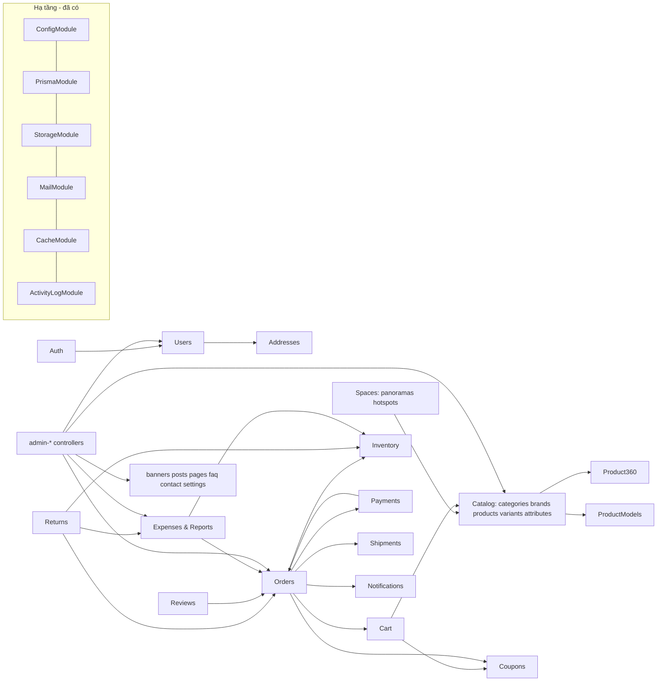
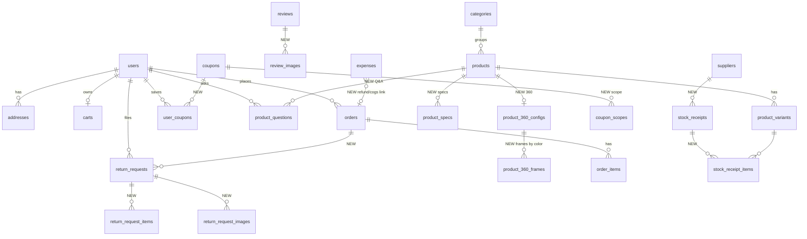

> Cập nhật lần cuối: 2026-11-11 – theo commit `c579fa8`.

# THIẾT KẾ BACKEND – Aurelia Living

> Giai đoạn 5 của `docs/PROMPT_AGENT_BE.md`. Trạng thái: **bản thiết kế, chờ người dùng "Đồng ý" ở Giai đoạn 6** trước khi chạy migration.
> Căn cứ: quét DB/BE/FE ngày 2026-11-06 (xem `docs/BE_PROGRESS.md`), hợp đồng API ở `docs/API_CONTRACT.md`.

## 0. Hiện trạng tóm tắt

| Lớp | Hiện trạng |
|---|---|
| DB | PostgreSQL 16 (`xdudtmdt-postgres-1`, host `localhost:55432`, DB `aurelia_dev`). Prisma 5.14; 2 migration (`0_init`, `20261006134647_media_file_size_int`), `migrate status` = **up to date**. Bảng thống kê `pg_stat_user_tables` báo 0 dòng nhưng **thực tế DB `aurelia_dev` có sẵn bộ dữ liệu mẫu cũ (ngày 2026-10-06)**; migration chỉ thêm cột/bảng nên không làm mất dữ liệu đó. *(Đính chính ở Mốc 1.)* 41 bảng, 19 enum. |
| Nền tảng BE (`apps/api`) | NestJS 10, prefix `/api`, `helmet`, CORS, `ValidationPipe`, `TransformResponseInterceptor` (envelope), `AllExceptionsFilter` (mã lỗi + tiếng Việt), `JwtAuthGuard` + `RolesGuard` toàn cục, Swagger `/docs`, `/health`, cấu hình env có validate, `StorageService` (local/MinIO/S3), mail (SMTP/Mailpit + BullMQ), Redis cache + throttler, `serialize()` (Decimal→number), `ActivityLogService`. **Đã dùng được, giữ nguyên.** |
| Module nghiệp vụ | 35 thư mục `modules/*` nhưng controller/service là **khung rỗng** ("khung rỗng, chưa cài đặt logic"). Chỉ `media` (presign/confirm) và `health` có route thật. ⇒ **gần như toàn bộ 139 endpoint của contract phải xây mới.** |
| FE | 54 màn hình + Xem 360° chạy trên mock; hợp đồng = `mockApi`. FE chỉ gửi Bearer access token, không dùng refresh. |

## 1. Kiến trúc

### 1.1 Luồng request

```
HTTP → helmet/CORS/json(1mb) → ThrottlerGuard (Redis) → JwtAuthGuard (global; @Public() bỏ qua)
     → RolesGuard (@Roles('admin')) → ValidationPipe (whitelist, transform, class-validator)
     → Controller (DTO in) → Service (nghiệp vụ, Prisma $transaction) → Serializer (entity → *View)
     → TransformResponseInterceptor ({success,data,meta}) ; lỗi → AllExceptionsFilter ({success:false,error})
```

### 1.2 Sơ đồ module



### 1.3 Cấu trúc thư mục (giữ phong cách sẵn có)

```
apps/api/src/
  common/            (có) guards, filters, interceptors, pipes, decorators, dto/pagination
                     (thêm) query/list-query.ts (phân trang+sort+tìm không dấu), utils/{vi-fold,code-generator,money}.ts,
                            serializers/ (entity → View, dùng chung cho FE contract)
  modules/<module>/  <module>.module.ts, <module>.controller.ts, admin-<module>.controller.ts,
                     <module>.service.ts, dto/*.dto.ts, serializers/*.ts, *.spec.ts
  payments/gateways/ vnpay.gateway.ts, momo.gateway.ts (stub), zalopay.gateway.ts (stub), payment-gateway.interface.ts
prisma/schema.prisma, migrations/, seed.ts (+ seed/*.ts đọc mock-data)
```

- **DTO & validation**: `class-validator` (đã dùng); thông báo tiếng Việt qua `createValidationPipe` có sẵn; `details` theo định dạng contract.
- **Serializer**: hàm thuần `toProductListItem(p)`, `toOrderView(o)`… nằm cạnh service, trả **đúng tên trường contract**. Kiểu trả về lấy từ `@aurelia-living/shared-types` (đề xuất chuyển các `*View` từ `apps/web/src/types/api.ts` sang gói này – FE chỉ đổi import kiểu).
- **Lỗi**: ném `AppException(ErrorCode.X, message, details?)` (đã có) ⇒ filter map sang HTTP status.
- **Logging**: Nest `Logger` + request-id (thêm middleware gán `x-request-id`, đưa vào log & response header).
- **Giờ**: lưu UTC; báo cáo theo ngày/tháng quy đổi `Asia/Ho_Chi_Minh` (`AT TIME ZONE`).
- **Soft delete**: `products.deletedAt`, `users.deletedAt` (đã có); mọi truy vấn lọc `deletedAt IS NULL`.

## 2. Gap analysis Contract ↔ BE ↔ DB

Ký hiệu BE: ❌ khung rỗng/chưa có · 🟡 có một phần. DB: ✅ đủ · 🟡 thiếu cột · ❌ thiếu bảng.

| Nhóm endpoint (contract) | BE | Bảng DB cần | Thiếu gì |
|---|---|---|---|
| `auth/*` (login, register, logout, forgot/reset, google, +refresh) | ❌ | users, user_roles, roles, user_sessions, password_resets | 🟡 OTP: thêm `otp_hash`, `attempts`, `last_sent_at` vào `password_resets` (hoặc dùng `token_hash` = hash OTP + 2 cột). Google OAuth chưa có key ⇒ trả `BAD_GATEWAY`/`SERVICE_UNAVAILABLE` rõ ràng |
| `users/me`, change-password | ❌ | users, media | 🟡 `gender`, `birthday`, `loyalty_points`, `admin_note` (hồ sơ); `avatarUrl` qua `media` |
| `addresses/*` | ❌ | addresses | 🟡 thêm `label` |
| `categories`, `brands`, `admin/categories` | ❌ | categories, brands, media | 🟡 `categories.description`, `is_featured` |
| `products`, `search`, `facets`, `:slug`, `related`, `model` | ❌ | products, product_variants, variant_attribute_values, attributes(+values), product_images, product_3d_models, model_files | 🟡 `products.style`, `products.features jsonb`; bảng ❌ `product_specs`; 🟡 `product_variants.cost_price, min_stock, length_cm, width_cm, height_cm`; 🟡 `attribute_values.color_hex`; tìm không dấu ⇒ extension `unaccent`/`pg_trgm` **đã có từ `0_init`**; thêm index GIN biểu thức (xem 3.3) |
| `products/:slug/360`, `admin/products/:id/360` | ❌ | — | ❌ `product_360_configs`, `product_360_frames` |
| `wishlist` | ❌ | wishlists | ✅ |
| `reviews`, `products/:slug/reviews`, `admin/reviews` | ❌ | reviews | 🟡 `tags text[]`, `is_anonymous`; ❌ `review_images` |
| `products/:slug/questions`, `admin/questions` | ❌ | — | ❌ `product_questions` |
| `spaces*`, `admin/spaces` | ❌ | spaces, space_panoramas, space_hotspots, space_product_placements, space_bookmarks, space_views | 🟡 `spaces.combo_discount_percent` (mock có `comboDiscountPercent`) |
| `cart*` | ❌ | carts, cart_items | 🟡 `carts.coupon_id` (mock lưu mã trong giỏ) |
| `orders*`, `admin/orders*` | ❌ | orders, order_items, order_status_history, payments, shipments, coupons, coupon_usages, inventory_movements | 🟡 `orders.internal_note`; 🟡 `order_items.variant_label`+`image_media_id` (snapshot hiển thị); bộ đếm mã đơn ❌ `code_counters` |
| `payments/*` (COD, VNPAY return/IPN, retry) | ❌ | payments | ✅ (`gateway_response jsonb` đã có) |
| `returns`, `admin/returns` | ❌ | — | ❌ `return_requests`, `return_request_items`, `return_request_images` |
| `coupons/*`, `admin/coupons` | ❌ | coupons, coupon_usages | 🟡 enum `coupon_type` + `freeship`; 🟡 `name, description, applies_to`; ❌ `coupon_scopes`, `user_coupons` |
| `notifications`, `admin/notifications` | ❌ | notifications (title + `data jsonb`) | ✅ (data = `{type,content,link}`) |
| `banners`, `posts`, `pages`, `faq`, `contact` | ❌ | pages | 🟡 `pages.type` (policy/static); ❌ `banners`, `posts`, `faq_topics`, `faq_items`, `contact_messages` |
| `settings/public`, `admin/settings*` | ❌ | settings (key/value jsonb) | ✅ dùng khóa `store`, `payments`, `shippingZones` |
| `admin/stats/overview` | ❌ | orders, order_items, users, products, activity_logs | ✅ (tính từ dữ liệu) |
| `admin/stats/finance`, `admin/expenses` | ❌ | orders, payments, order_items | ❌ `expenses`; giá vốn ⇒ `product_variants.cost_price` (+ snapshot `order_items.cost_price`) |
| `admin/inventory*` | ❌ | product_variants, inventory_movements | ❌ `suppliers`, `stock_receipts`, `stock_receipt_items`; 🟡 `reserved_quantity` |
| `admin/users*` | ❌ | users, orders, reviews, wishlists | 🟡 trường hồ sơ như trên; `customerGroup`, `totalOrders`, `totalSpent` tính từ đơn |
| `admin/models*` + upload | 🟡 (media presign) | product_3d_models, model_files, media | ✅ |
| `admin/media*` | 🟡 có route | media | ✅ |
| `admin/search` | ❌ | products, orders, users | ✅ |

## 3. Thiết kế schema bổ sung

### 3.1 Nguyên tắc
- **Chỉ thêm (additive)**: bảng mới, cột mới có `DEFAULT`/`NULL`, giá trị enum mới (`ALTER TYPE … ADD VALUE`). **Không sửa/xóa cột, không sửa migration cũ.** DB hiện rỗng nên mọi migration an toàn; vẫn sao lưu theo quy trình.
- Tên cột DB `snake_case`, map sang `camelCase` bằng `@map` (đúng quy ước `QUY_UOC_CODE_DB.md`). Tên trường API khớp contract, map ở serializer.

### 3.2 ERD các bảng mới (đậm = mới)



### 3.3 Danh sách migration (mỗi migration một việc, đặt tên rõ)

| # | Tên migration | Nội dung | Rủi ro mất dữ liệu |
|---|---|---|---|
| M1 | `add_user_profile_and_address_label` | `users`: `gender varchar(10)`, `birthday date`, `loyalty_points int default 0`, `admin_note text`; `addresses.label varchar(50) default 'Nhà riêng'`; `password_resets`: `otp_hash`, `attempts int default 0`, `last_sent_at timestamptz` | Không (cột nullable/default) |
| M2 | `add_catalog_extras` | `categories`: `description`, `is_featured`; `products`: `style varchar(50)`, `features jsonb default '[]'`; `product_variants`: `cost_price numeric(12,0) default 0`, `min_stock int default 5`, `reserved_quantity int default 0`, `length_cm/width_cm/height_cm numeric(6,1)`; `attribute_values.color_hex varchar(7)`; bảng `product_specs(id, product_id, label, value, sort_order)`; index `GIN` biểu thức `immutable_unaccent(lower(name))` (extension `unaccent`, `pg_trgm` đã có từ `0_init`) để tìm không dấu (D-N18) | Không |
| M3 | `add_product_360` | `product_360_configs(id, product_id UNIQUE, enabled, auto_rotate, rotation_speed, frame_count)`; `product_360_frames(id, config_id, attribute_value_id (màu), frame_index, media_id, UNIQUE(config_id, attribute_value_id, frame_index))` | Không |
| M4 | `add_reviews_and_questions` | `reviews`: `tags text[] default '{}'`, `is_anonymous bool`; `review_images(id, review_id, media_id, sort_order)`; `product_questions(id, product_id, user_id, content, answer, answered_by, answered_at, is_public, status enum unanswered/answered/hidden, created_at)` | Không |
| M5 | `add_coupon_extras` | enum `coupon_type` thêm `freeship`; `coupons`: `name`, `description`, `applies_to varchar(20) default 'all'`; `coupon_scopes(coupon_id, target_type, target_id)`; `user_coupons(id, user_id, coupon_id, saved_at, UNIQUE(user_id, coupon_id))`; `carts.coupon_id` | Không (`ADD VALUE` không đảo ngược nhưng vô hại) |
| M6 | `add_order_extras_and_counters` | `orders.internal_note`, `order_items`: `variant_label`, `image_media_id`, `cost_price`; `code_counters(key varchar PK, value bigint)` cho `ALV-YYYYMMDD-NNNN`, `RT`, `PN/PX`, `CH` (cấp mã bằng `UPDATE … RETURNING` trong transaction ⇒ không trùng khi đồng thời); partial index đơn theo trạng thái | Không |
| M7 | `add_returns` | `return_requests(id, code UNIQUE, order_id, user_id, type enum refund/exchange, reason enum, description, status enum, refund_amount, admin_note, created_at, updated_at)`; `return_request_items(request_id, order_item_id, quantity)`; `return_request_images(request_id, media_id)` | Không |
| M8 | `add_inventory_and_expenses` | `suppliers`, `stock_receipts(code, type in/out, supplier_id, status draft/completed/cancelled, order_id?)`, `stock_receipt_items(receipt_id, variant_id, quantity, cost_price)`; `expenses(id, code UNIQUE, category enum cogs/shipping/marketing/payment_fee/refund/other, amount, note, date, order_id?, receipt_id?)` | Không |
| M9 | `add_content_tables` | `banners(…position enum, start/end, sort_order, is_active, media_id)`, `posts(…status, views, cover_media_id, author_id)`, `faq_topics`, `faq_items`, `contact_messages`; `pages.type varchar(20) default 'static'`; `spaces.combo_discount_percent numeric(4,1) default 0` | Không |

Mọi migration có `CHECK` (giá ≥ 0, tồn ≥ 0, quantity > 0, rating 1–5) do Prisma không biểu diễn được ⇒ viết tay trong `migration.sql` (`--create-only`).

**Không thay đổi/xóa**: `permissions`, `role_permissions` (giữ, không dùng – hệ thống chỉ 2 vai trò), `ar_*`, `model_material_variants`.

## 4. Quy tắc nghiệp vụ (sẽ được test)

### 4.1 Tính tiền (server)
1. `unitPrice = variant.salePrice ?? variant.price` tại thời điểm tính; **không nhận giá từ client**.
2. `subtotal = Σ unitPrice × qty`. Phí ship = vùng khớp `address.province` trong `settings.shippingZones` (`fee`), `subtotal ≥ freeFrom` ⇒ 0; không khớp ⇒ phí mặc định.
3. Coupon (`percent|fixed|freeship`): hợp lệ khi `isActive`, trong `[startsAt, endsAt]`, `subtotal(phạm vi) ≥ minOrderValue`, thuộc phạm vi (tất cả/danh mục/sản phẩm/không gian), `usedCount < usageLimit`, số lần dùng của khách `< perUserLimit`. `percent`: `min(round(base × value/100), maxDiscount)`; `fixed`: `min(value, base)`; `freeship`: giảm đúng `shippingFee` (≤ `maxDiscount` nếu có).
4. `total = subtotal − discount + shippingFee` (≥ 0, số nguyên VNĐ).

### 4.2 Tồn kho
- `available = stockQuantity − reservedQuantity`.
- **Tạo đơn**: trong một `$transaction`, `SELECT … FOR UPDATE` các variant theo thứ tự `id` (tránh deadlock) ⇒ kiểm tra `available ≥ qty` (thiếu ⇒ `409 OUT_OF_STOCK {variantId, available}`) ⇒ `reservedQuantity += qty`.
- **Chuyển `shipping`**: trừ hẳn `stockQuantity -= qty`, `reservedQuantity -= qty`, ghi `inventory_movements(type=sale)`.
- **Hủy đơn** (khi chưa giao): `reservedQuantity -= qty`. **Hủy sau khi đã trừ** không xảy ra (chỉ hủy được ở pending/confirmed/processing).
- **Đổi trả được duyệt nhận hàng** (`refunded`/`exchanged` sau `inspecting`): cộng lại `stockQuantity`, ghi movement `return`.
- **Phiếu nhập hoàn tất**: cộng `stockQuantity`, movement `import`, tạo phiếu chi `cogs`.

### 4.3 Máy trạng thái đơn
`pending → confirmed → processing → shipping → completed`; `cancelled` từ `pending|confirmed|processing`; `refunded` do hoàn tiền (đổi trả/admin refund). Khách tự hủy ở `pending|confirmed` (theo FE và D-N01); admin hủy thêm ở `processing`. Mỗi lần đổi: ghi `order_status_history` + `notifications` cho khách (+ activity log). *(Prompt gốc không liệt kê bước `confirmed`; FE/DB có bước này ⇒ giữ theo contract.)*

### 4.4 Mã
`ALV-YYYYMMDD-NNNN` (đơn; contract + test FE đang dùng), `RT0001` (đổi trả), `PN0001/PX0001` (phiếu kho), `CH-0001` (chi). Cấp bằng `code_counters` trong transaction.

> ⚠️ Mâu thuẫn với prompt: prompt ghi mã đơn `ORD`+số, FE/test dùng `ALV-…`. Đề xuất **giữ `ALV-`** (sửa FE/test sẽ vi phạm quy tắc "không sửa FE"). Cần người dùng xác nhận.

### 4.5 Thanh toán
- **COD**: `payment.status = pending`; khi đơn `completed` ⇒ `success`, `order.paymentStatus = paid`.
- **VNPAY (sandbox)**: `POST /payments/:orderId/checkout` tạo URL ký `HMAC-SHA512` (TMN code/secret từ env) ⇒ `redirectUrl`; **return** và **IPN** đều kiểm tra chữ ký + số tiền + trạng thái đơn, **idempotent** (xử lý lặp không đổi kết quả); thành công ⇒ `paid`, thất bại ⇒ `failed` + giữ hàng để `retry`. Chưa có key ⇒ chế độ giả lập (giống mock: `outcome=success|failed`) để FE chạy.
- **MoMo/ZaloPay**: interface `PaymentGateway` + stub sandbox trả URL giả.
- `payments.gateway_response` lưu raw callback.

### 4.6 Đánh giá
Chỉ sản phẩm thuộc đơn `completed` của chính khách; một đánh giá/(khách, sản phẩm, đơn); đánh giá mới và đánh giá vừa sửa ở `pending`; admin duyệt `approved`, ẩn `rejected`, hiện lại `approved` (duyệt ⇒ thông báo cho khách); `ratingAvg`/`ratingCount` do trigger DB `refresh_product_rating` tính từ `approved`. Khách xem đánh giá của mình ở `/reviews/me` với mọi trạng thái.

### 4.7 Đổi trả
Trong **7 ngày** kể từ `shipments.deliveredAt`; số lượng ≤ số đã mua trừ đã yêu cầu. Luồng `pending → picking → inspecting → refunded|exchanged`, `rejected` từ `pending|picking|inspecting`. `refunded` ⇒ hoàn tồn + phiếu chi `refund` + đơn `refunded` (khi hoàn toàn bộ).

### 4.8 Kho & thu chi
Báo cáo `/admin/stats/finance`: tổng thu = Σ đơn đã thanh toán (trừ hoàn), tổng chi = Σ `expenses`, lợi nhuận, biên = lợi nhuận/thu; theo tháng/ngày/danh mục/kênh thanh toán; bảng kết quả kinh doanh (màn 7.28): `gross`, `discountAndRefund`, `net`, `cogs`, `grossProfit`, `opex`, `profitBeforeTax`; `ledger` gộp thu+chi.

### 4.9 Quên mật khẩu
OTP 6 số ngẫu nhiên (hash bcrypt/sha256), hết hạn 5 phút, tối đa 5 lần thử sai, gửi lại cách nhau ≥ 60 giây (`429 RATE_LIMITED`); dev: log + Mailpit; `OTP_FIXED_CODE=123456` chỉ khi `NODE_ENV≠production` (để e2e FE chạy). Đặt lại thành công ⇒ thu hồi mọi `user_sessions`.

## 5. Bảo mật
- Mật khẩu **bcryptjs** (đã có dependency) cost 10; JWT access (`JWT_ACCESS_EXPIRES_IN`) + refresh xoay vòng lưu **hash** trong `user_sessions`; FE chỉ dùng Bearer.
- `@Roles('admin')` cho mọi `/admin/*` (controller riêng `admin-*`); khách chỉ truy cập tài nguyên của mình (kiểm tra `userId`, trả `404` thay vì `403` khi không phải của mình – giống mock).
- Validate DTO toàn bộ; `helmet`; CORS `http://localhost:3000`; rate limit (`@AuthThrottle()` có sẵn) cho login/register/OTP/đặt hàng.
- Upload: ảnh ≤ 5MB (jpeg/png/webp), GLB ≤ 100MB (USDZ không nhận), frame 360 ≤ 2MB; kiểm tra MIME bằng magic bytes; tên file sinh mới (uuid) ⇒ chống path traversal.

## 6. Upload & lưu trữ
`StorageService` (đã có, driver `local|minio|s3` bằng env). Dev mặc định: `STORAGE_DRIVER=local` (`apps/api/uploads`, phục vụ `/uploads`) nếu MinIO chưa chạy; production đổi env sang S3. Contract FE gửi ảnh dạng URL/data-URL trong body ⇒ BE có `MediaIngestService`: nếu chuỗi là data-URL ⇒ giải mã, kiểm tra, lưu vào storage, tạo `media`; nếu là URL nội bộ ⇒ dùng lại.

## 7. Seed từ mock-data
Script `prisma/seed/from-mock.ts` đọc `apps/web/src/mock-data/tables/*` (chúng là module TypeScript thuần, import được bằng `ts-node`): map bảng ↔ bảng (tên bảng mock = tên bảng DB; mật khẩu mock `credentials` ⇒ bcrypt), copy ảnh SVG sinh ở `public/mock/**` (gồm 1.080 frame 360) và GLB vào storage, giữ **id gốc** để quan hệ không lệch, đặt lại sequence sau khi chèn. Idempotent bằng `upsert` theo khóa tự nhiên (email, slug, sku, orderCode, code). Tài khoản: `admin@aurelia.vn/admin123`, `khachhang@aurelia.vn/123456`.

## 8. Kế hoạch triển khai (nhánh `feature/backend`, commit nhỏ theo module)

| Thứ tự | Việc | Ước lượng |
|---|---|---|
| 1 | Nền tảng (request-id, list-query, serializer base, code generator, vi-fold) | 0,5 ngày |
| 2 | Migration M1–M9 + `prisma generate` + sinh lại shared-types | 0,5 |
| 3 | Seed từ mock | 1 |
| 4 | Auth + Users + Addresses | 1 |
| 5 | Catalog (+360, 3D) | 2 |
| 6 | Spaces | 1 |
| 7 | Cart + Coupons + Wishlist | 1,5 |
| 8 | Checkout/Orders/Payments (COD+VNPAY) | 2 |
| 9 | Reviews, Q&A, Returns, Notifications | 1,5 |
| 10 | Content công khai | 0,5 |
| 11 | Admin (dashboard, CRUD, đơn, kho, thu chi, nội dung, cài đặt) | 4 |
| 12 | Unit/e2e/contract test, nối FE, chạy Playwright với API thật | 2 |
| | **Tổng** | **≈ 17 ngày công** |

### Rủi ro
1. **Khối lượng**: 139 endpoint, mỗi cái phải khớp từng trường với mock ⇒ rủi ro lệch nhỏ; giảm bằng **contract test so cấu trúc** response BE ↔ mock (cùng bộ seed).
2. **Hai hệ thống dữ liệu** (mock dạng "phẳng" vs DB chuẩn hoá): serializer phải dựng lại các `*View`; các trường `TODO` cần đủ cột (migration M1–M9).
3. **Hiệu năng danh sách** (đếm sold/rating/colors/sizes): dùng cột tổng hợp sẵn có (`ratingAvg`, `soldCount`) + truy vấn gom, tránh N+1.
4. **Tìm không dấu**: `unaccent` không `IMMUTABLE` nên index biểu thức cần hàm bọc `immutable_unaccent` (migration viết tay).
5. **VNPAY/Google** cần khóa thật của người dùng; làm chế độ giả lập để không chặn luồng khác.
6. FE đặt ảnh dạng data-URL trong body (JSON giới hạn 1MB): cần tăng giới hạn cho vài route admin hoặc nhận `multipart`; chi tiết quyết định ở Giai đoạn 9.

## 9. Mâu thuẫn giữa các nguồn & cách xử lý (cần xác nhận ở Giai đoạn 6)

| # | Mâu thuẫn | Cách xử lý đề xuất |
|---|---|---|
| 1 | **Mã đơn**: prompt `ORD`+số ⇔ contract/FE/test + D-N19 `ALV-YYYYMMDD-NNNN` | Giữ `ALV-…` (không sửa FE). Mã đổi trả `RT0001` theo prompt. |
| 2 | **Tồn kho**: D-N05 "trừ khi tạo đơn" ⇔ prompt "giữ hàng khi tạo đơn, trừ hẳn khi Đang giao" ⇔ FE có `reservedQty` | Theo prompt (reserve → trừ khi `shipping`), thêm `reserved_quantity`. D-N05 cần cập nhật. |
| 3 | **Khách hủy đơn**: prompt "chỉ Chờ xác nhận" ⇔ FE + D-N01 cho `pending|confirmed` | Theo FE/D-N01 (FE đang hiện nút Hủy ở `confirmed`). |
| 4 | **Luồng đơn**: prompt không có `confirmed` ⇔ DB enum + FE có `confirmed` ("Đã xác nhận") | Giữ `confirmed`. |
| 5 | **Cổng thanh toán**: D-N20 chỉ COD + VNPAY (+ chuyển khoản D-N23) ⇔ prompt thêm MoMo/ZaloPay stub | Làm interface + stub như prompt; FE/Settings chỉ bật COD, chuyển khoản, VNPAY. |
| 6 | **Xác thực email để đánh giá** (D-N04) ⇔ FE/mock không bắt buộc | Không bắt buộc (khớp FE); ghi vào tài liệu. |
| 7 | **Gộp giỏ khách vãng lai**: D-N19 "không làm" ⇔ prompt "nếu FE có" | FE không có giỏ khách ⇒ không làm. |
| 8 | **Đánh giá mới**: D-N06 `pending` ⇔ FE hiển thị | **Có kiểm duyệt** (quyết định 2026-11-06, khớp FE/mock): mới và sửa ⇒ `pending`; công khai/điểm trung bình chỉ tính `approved`; khách thấy đánh giá của mình kèm trạng thái; admin duyệt/ẩn (`rejected` = "Ẩn")/hiện lại, duyệt ⇒ thông báo cho khách. |
| 9 | **Quên mật khẩu**: mock OTP cố định `123456` ⇔ prompt OTP ngẫu nhiên | OTP ngẫu nhiên; `OTP_FIXED_CODE` chỉ ở dev/test cho Playwright. |
| 10 | **Access token**: FE không refresh ⇔ prompt "refresh xoay vòng" | Cung cấp `/auth/refresh`; access token 12 giờ ở dev để FE không bị 401 giữa phiên. |
| 11 | **Role trong DB**: bảng `roles` (admin/user) + `permissions` ⇔ "chỉ 2 vai trò, không ma trận quyền" | Dùng `roles`/`user_roles`; bỏ qua `permissions`. |

## 10. Cập nhật sau Mốc 2 (2026-11-06)
- **Cổng/DB**: API dev cổng **4000** trên `aurelia_demo`; e2e trên `aurelia_test` (cổng 4002 khi chạy Playwright); `aurelia_dev` giữ nguyên dữ liệu gốc, chỉ áp migration (không seed). Tạo lại DB demo/test: `node scripts/db-reset.mjs aurelia_demo|aurelia_test` (từ chối mọi tên khác).
- **Migration thực tế (6, chỉ thêm)**: `add_backend_extras` (gộp M1–M9 của mục 3.3), `coupon_freeship_value`, `add_360_default_color`, `add_coupon_applies_label`. Có sẵn từ `0_init`: `unaccent`, `pg_trgm`, `immutable_unaccent()`, trigger lịch sử trạng thái đơn (`app.current_user_id`, `app.status_note`) và trigger tính rating.
- **Đăng nhập bị khóa**: `JwtAuthGuard` kiểm tra `users.status` ở mỗi request ⇒ khóa có hiệu lực ngay với token còn hạn.
- **Kiểm thử**: unit (logic thuần + `CouponsService` với DB giả), e2e supertest `test/mock-m2.db-spec.ts` (`npm run test:e2e:db`, DB `aurelia_test`, tự dừng nếu sai DB).

## 11. Cập nhật sau Mốc 3 (2026-11-06)
- **NotificationsService dùng chung** (module Global): `notify(db|tx, userId, title, type, content, link)`; mọi module (đơn hàng, thanh toán, admin đơn, đổi trả, đánh giá, hỏi đáp) gọi cùng một chỗ, ghi trong cùng transaction với thao tác chính. `data = { type: order|promo|system, content, link }`.
- **Đánh giá**: quy tắc ở `reviewEligibility()` và `averageRating()` (hàm thuần, có unit test); điểm trung bình thực tế do trigger DB `refresh_product_rating` (chỉ `approved`). Duyệt lần đầu ⇒ thông báo; ẩn (`rejected`) và hiện lại (`approved`) đều tính lại điểm.
- **Đổi trả**: `canReturnTransition()` (pending→picking→inspecting→refunded|exchanged, rejected từ ba bước đầu), `isWithinReturnWindow()` (7 ngày kể từ `shipments.delivered_at`), `returnableQuantity()`. Nhận hàng về (`refunded|exchanged`) ⇒ `stock_quantity += qty` đúng biến thể + `inventory_movements(type=return)`; `refunded` ⇒ `expenses(category=refund)`, và nếu tổng đã hoàn ≥ (tạm tính − giảm giá) của đơn ⇒ `orders.status/payment_status = refunded`, `payments.status = refunded`. Khóa `FOR UPDATE` dòng yêu cầu để hai admin không xử lý trùng.
- **Upload mô hình 3D**: `validateModelFile()` (`apps/api/src/modules/product-models/model-file-validator.ts`): **chỉ nhận GLB** (đuôi `.glb`, MIME `model/gltf-binary` hoặc `application/octet-stream`, chữ ký `glTF`, dung lượng ≤ `UPLOAD_MAX_MODEL_MB` = 100 MB, định dạng khai báo phải khớp đuôi, tên tệp làm sạch chống path traversal). **USDZ, GLTF và mọi định dạng khác ⇒ `415`** (AR đã loại bỏ, D-P16); quá dung lượng ⇒ `413`. Khóa lưu trữ do server sinh `models/<productId>/<uuid>.<ext>`.
- **Nội dung**: HTML rich text (bài viết, trang tĩnh, câu trả lời FAQ) lọc bằng `sanitize-html` (danh sách thẻ/thuộc tính cho phép, chỉ `http(s)/mailto`, ảnh chỉ `http(s)`); banner kéo thả lưu `sort_order`; `POST /contact` chống spam bằng throttler (Redis).
- **Không gian mẫu**: `calcComboTotal(originalTotal, percent)` = tổng giá hiện tại × (100 − %)/100 làm tròn nghìn; `POST /spaces/:slug/add-to-cart` đi qua `CartService.addItem` nên dùng đúng quy tắc tồn khả dụng (tồn − giữ chỗ).
- **Migration**: thêm `add_contact_handled` (tổng cộng 7 migration, chỉ thêm).
