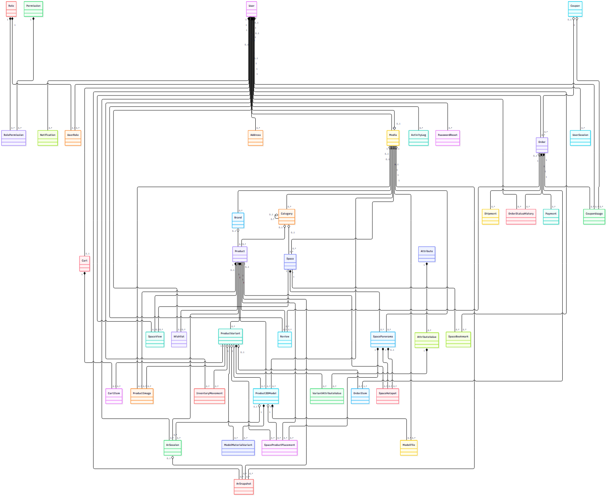
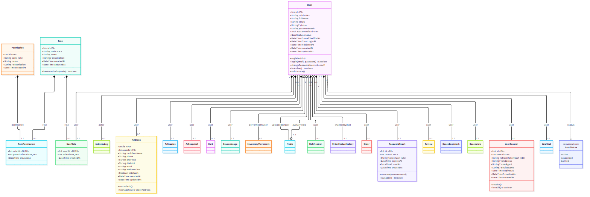
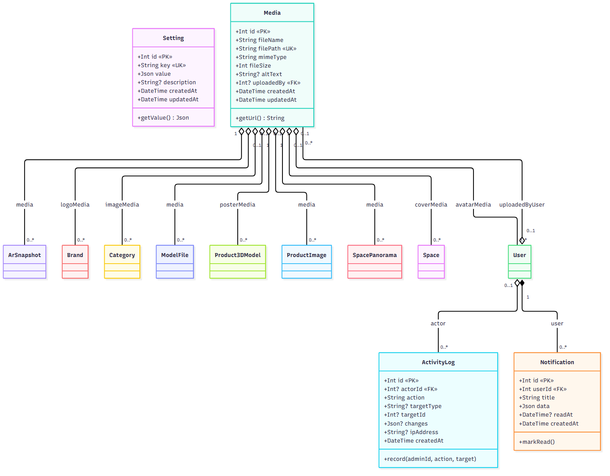
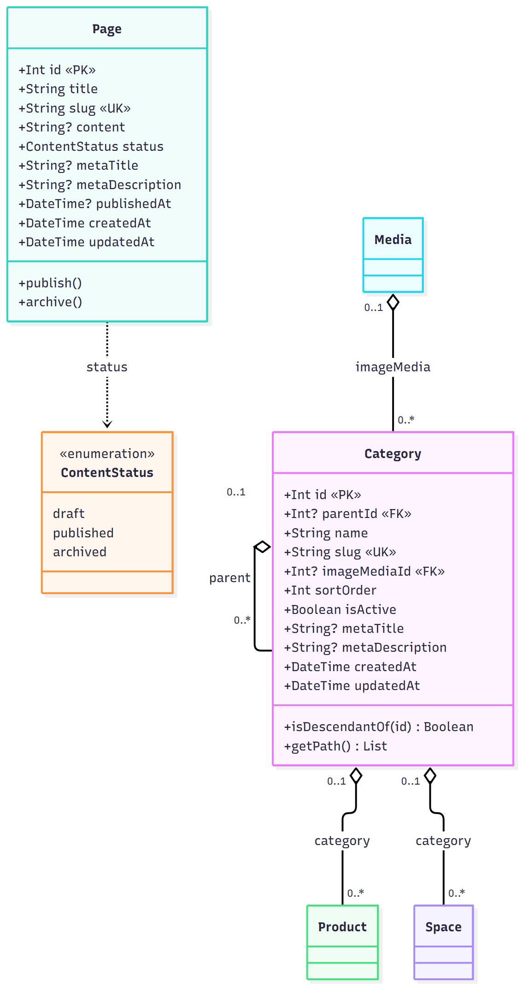
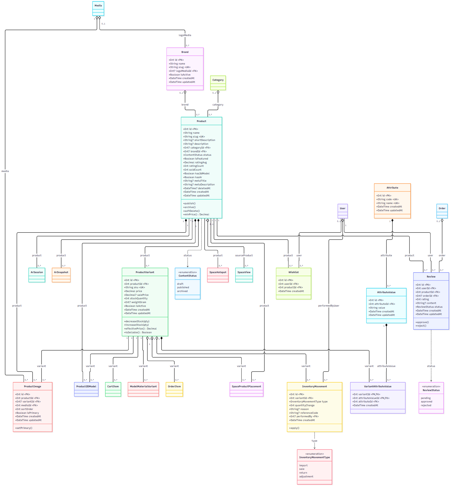
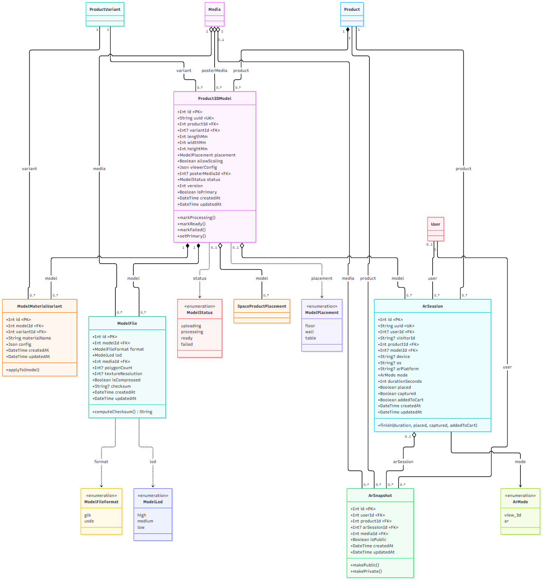
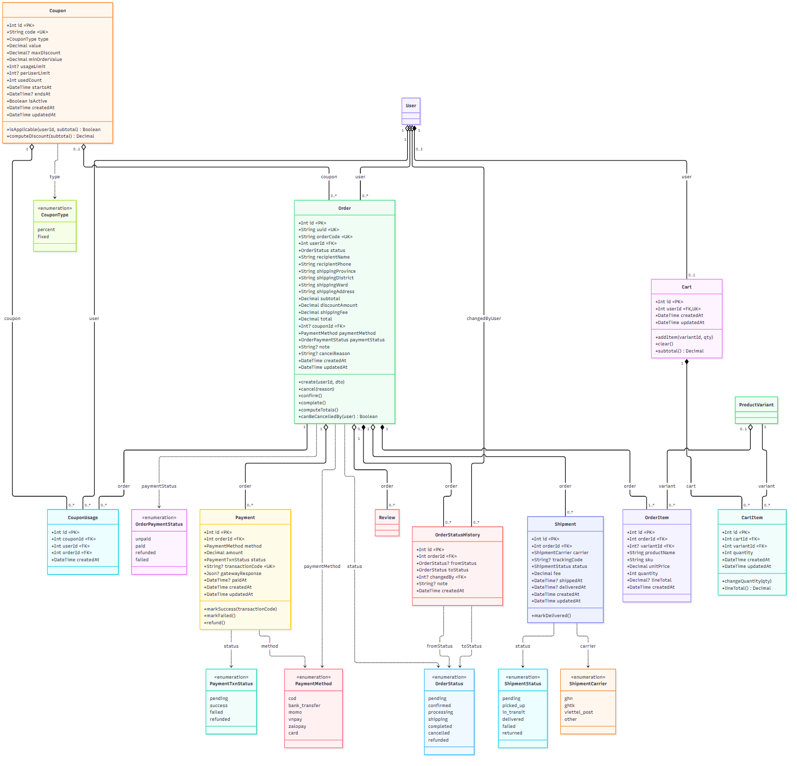
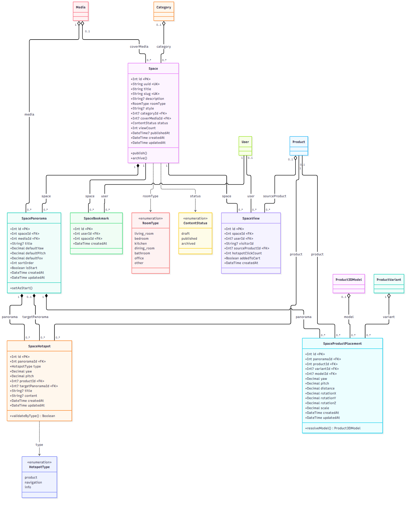

# Bài tập tự học 2: Thiết kế cơ sở dữ liệu cho hệ thống Aurelia Living

**Đề tài:** Aurelia Living, website thương mại điện tử nội thất có xem sản phẩm 3D, thực tế tăng cường (AR), không gian mẫu 360° và ứng dụng Android.
**Yêu cầu của giảng viên:** dựa trên đề tài đã đăng ký và bài tập tự học 1 (phân tích hệ thống), thiết kế cơ sở dữ liệu gồm: (1) biểu đồ quan hệ dữ liệu theo hướng đối tượng, (2) thiết kế các collection, (3) cho biết mỗi collection phục vụ chức năng nào, (4) tạo cấu trúc collection, (5) thêm dữ liệu vào các collection.
**Công nghệ thực tế của nhóm:** PostgreSQL 16 (chạy bằng Docker) và Prisma 5.22 làm lớp truy cập dữ liệu, không dùng MongoDB. Đề bài cho phép sinh viên chọn công nghệ.

## 0. Lưu ý về thuật ngữ

Đề bài dùng từ "collection" (thuật ngữ của MongoDB). Với CSDL quan hệ như PostgreSQL, khái niệm tương đương là **bảng (table)**:

| MongoDB | PostgreSQL (nhóm sử dụng) |
| --- | --- |
| Database | Database `aurelia_dev` (môi trường phát triển) |
| Collection | **Bảng (table)** |
| Document | Dòng (row) |
| Field | Cột (column) |
| Tham chiếu bằng `_id` | Khóa ngoại (foreign key) |

Vì vậy trong tài liệu này, "collection" được trình bày là **bảng**. Hệ thống có **44 bảng**, chia thành **7 nhóm** chức năng.

**Vì sao chọn CSDL quan hệ.** Hệ thống có các nghiệp vụ cần nhất quán chặt chẽ: đặt hàng đồng thời trừ tồn kho, ghi lượt dùng mã giảm giá, tạo thanh toán và thông báo. Các thao tác này ghi từ hai bảng trở lên nên phải thành công hoặc thất bại cùng nhau; PostgreSQL hỗ trợ giao dịch (transaction), khóa ngoại, ràng buộc CHECK và trigger để CSDL tự bảo vệ dữ liệu (nguyên tắc ghi ở DECISIONS D-T52). Tiền được lưu bằng kiểu `numeric` để không sai số.

| Hạng mục | Số lượng (đếm trực tiếp từ CSDL đang chạy) |
| --- | --- |
| Bảng | 44 |
| Kiểu liệt kê (ENUM) | 18 |
| Trigger | 36 (29 trigger cập nhật `updated_at`, 7 trigger nghiệp vụ) |
| Khóa ngoại | 74 |
| Ràng buộc CHECK | 45 |
| Chỉ mục (index) | 168 trên các bảng nghiệp vụ |

## 1. Biểu đồ quan hệ dữ liệu theo hướng đối tượng (ERD / sơ đồ lớp)

Mô hình dữ liệu được vẽ dưới dạng **sơ đồ lớp UML** (mỗi bảng là một lớp, quan hệ thể hiện bằng association, aggregation, composition và multiplicity). Nội dung đầy đủ nằm ở mục 5 của [BAO_CAO_PHAN_TICH_THIET_KE.md](BAO_CAO_PHAN_TICH_THIET_KE.md). Ảnh chèn vào bài nộp (thư mục `docs/diagrams/png/`, bản SVG phóng to không vỡ ở `docs/diagrams/svg/`):

| Hình | Nội dung | Tệp ảnh |
| --- | --- | --- |
| 1 | Tổng quan 44 lớp và quan hệ (chỉ tên lớp) | `class_tong-quan.png` |
| 2 | Nhóm 1: Người dùng và phân quyền | `class_nhom-1-nguoi-dung-va-phan-quyen.png` |
| 3 | Nhóm 2: Hệ thống chung | `class_nhom-2-he-thong-chung.png` |
| 4 | Nhóm 3: Nội dung | `class_nhom-3-noi-dung.png` |
| 5 | Nhóm 4: Sản phẩm | `class_nhom-4-san-pham.png` |
| 6 | Nhóm 5: Mô hình 3D và AR | `class_nhom-5-mo-hinh-3d-va-ar.png` |
| 7 | Nhóm 6: Giỏ hàng và đơn hàng | `class_nhom-6-gio-hang-va-don-hang.png` |
| 8 | Nhóm 7: Không gian mẫu 360° | `class_nhom-7-khong-gian-mau.png` |

















### Các quan hệ chính (một-nhiều, nhiều-nhiều)

| Quan hệ | Loại | Giải thích |
| --- | --- | --- |
| `users` — `roles` qua `user_roles` | nhiều-nhiều | Một người dùng có nhiều vai trò, một vai trò có nhiều người dùng |
| `roles` — `permissions` qua `role_permissions` | nhiều-nhiều | Gán quyền cho vai trò |
| `users` — `addresses`, `user_sessions`, `password_resets`, `notifications` | một-nhiều | Dữ liệu con của người dùng |
| `categories` — `categories` (`parent_id`) | một-nhiều (tự tham chiếu) | Danh mục nhiều cấp |
| `categories`, `brands` — `products` | một-nhiều | Mỗi sản phẩm thuộc một danh mục và một thương hiệu |
| `products` — `product_variants` — `product_images` | một-nhiều | Sản phẩm có nhiều biến thể và nhiều ảnh |
| `product_variants` — `attribute_values` qua `variant_attribute_values` | nhiều-nhiều | Biến thể là tổ hợp giá trị thuộc tính (màu, chất liệu...) |
| `products` — `product_3d_models` — `model_files`, `model_material_variants` | một-nhiều | Sản phẩm có mô hình 3D, mỗi mô hình có nhiều tệp (GLB/USDZ, 3 mức chi tiết) |
| `ar_sessions` — `ar_snapshots` | một-nhiều | Một phiên xem AR có thể chụp nhiều ảnh |
| `users` — `carts` — `cart_items` — `product_variants` | một-một, một-nhiều | Mỗi người dùng một giỏ hàng; dòng giỏ trỏ tới biến thể |
| `orders` — `order_items`, `order_status_history`, `payments`, `shipments` | một-nhiều | Một đơn có nhiều dòng hàng, lịch sử trạng thái, giao dịch, vận đơn |
| `coupons` — `coupon_usages` — `orders` | một-nhiều | Ghi nhận từng lần dùng mã giảm giá |
| `spaces` — `space_panoramas` — `space_hotspots`, `space_product_placements` | một-nhiều | Không gian mẫu gồm nhiều ảnh 360°, mỗi ảnh có điểm bấm và sản phẩm 3D đặt vào |
| `users` — `spaces` qua `space_bookmarks` | nhiều-nhiều | Lưu không gian mẫu yêu thích |
| `users` — `products` qua `wishlists` | nhiều-nhiều | Danh sách sản phẩm yêu thích |
| `media` — nhiều bảng | một-nhiều | Kho tệp dùng chung: ảnh sản phẩm, danh mục, thương hiệu, tệp 3D, ảnh 360°, ảnh AR |

Tổng cộng có 74 khóa ngoại. Quy tắc xóa: `CASCADE` cho dữ liệu con thuần túy, `RESTRICT` cho dữ liệu cần giữ lịch sử (ví dụ đơn hàng), `SET NULL` cho tham chiếu tùy chọn.

## 2. Thiết kế tổng thể các bảng (7 nhóm)

| Nhóm | Số bảng | Bảng |
| --- | --- | --- |
| 1. Người dùng và phân quyền | 8 | `users`, `roles`, `permissions`, `role_permissions`, `user_roles`, `password_resets`, `user_sessions`, `addresses` |
| 2. Hệ thống chung | 4 | `settings`, `media`, `notifications`, `activity_logs` |
| 3. Nội dung | 2 | `categories`, `pages` |
| 4. Sản phẩm | 10 | `brands`, `products`, `attributes`, `attribute_values`, `product_variants`, `variant_attribute_values`, `product_images`, `inventory_movements`, `reviews`, `wishlists` |
| 5. Mô hình 3D và AR | 5 | `product_3d_models`, `model_files`, `model_material_variants`, `ar_sessions`, `ar_snapshots` |
| 6. Giỏ hàng và đơn hàng | 9 | `carts`, `cart_items`, `coupons`, `coupon_usages`, `orders`, `order_items`, `order_status_history`, `payments`, `shipments` |
| 7. Không gian mẫu 360° | 6 | `spaces`, `space_panoramas`, `space_hotspots`, `space_product_placements`, `space_bookmarks`, `space_views` |

Các quy ước thiết kế chung:

- Khóa chính `id` kiểu số nguyên tự tăng; các bảng chính có thêm cột `uuid` để dùng ra ngoài.
- Tiền dùng `numeric(15,2)` kèm CHECK không âm; kích thước 3D lưu bằng milimét (`int`); email và mã giảm giá dùng kiểu `citext` (không phân biệt hoa thường); IP dùng `inet`; dữ liệu linh hoạt dùng `jsonb`.
- Bảng nhật ký (`activity_logs`, `inventory_movements`, `order_status_history`, `space_views`, `coupon_usages`) chỉ ghi thêm, có `created_at`.
- Ràng buộc "tối đa một" (ảnh đại diện sản phẩm, mô hình chính, địa chỉ mặc định) dùng partial unique index.
- Một số việc do **trigger** của CSDL làm: cập nhật `updated_at`, tính điểm đánh giá trung bình, cập nhật cờ có mô hình 3D/AR của sản phẩm, đếm lượt xem không gian, ghi lịch sử trạng thái đơn hàng, gán vai trò `user` cho tài khoản mới.

## 3. Cấu trúc từng bảng

Chú thích: `PK` khóa chính, `FK→bảng` khóa ngoại, `UQ` duy nhất, `null` cho phép rỗng. Bảng liệt kê đúng cột có trong CSDL đang chạy. Chi tiết ràng buộc, chỉ mục và ghi chú từng bảng xem [DATABASE_SCHEMA.md](DATABASE_SCHEMA.md) (mục 4, từ điển dữ liệu).

### 3.1. Nhóm 1: Người dùng và phân quyền (8 bảng)

| STT | Bảng | Cột (kiểu, khóa) |
| --- | --- | --- |
| 1 | `users` | `id` int (PK)<br>`uuid` uuid (UQ)<br>`full_name` varchar(150)<br>`email` citext<br>`phone` varchar(20) (null)<br>`password_hash` varchar(255)<br>`avatar_media_id` int (FK→media, null)<br>`status` user_status<br>`email_verified_at` timestamptz (null)<br>`last_login_at` timestamptz (null)<br>`deleted_at` timestamptz (null)<br>`created_at` timestamptz<br>`updated_at` timestamptz |
| 2 | `roles` | `id` int (PK)<br>`code` varchar(50) (UQ)<br>`name` varchar(100)<br>`description` text (null)<br>`created_at` timestamptz<br>`updated_at` timestamptz |
| 3 | `permissions` | `id` int (PK)<br>`code` varchar(100) (UQ)<br>`name` varchar(150)<br>`description` text (null)<br>`created_at` timestamptz |
| 4 | `role_permissions` | `role_id` int (PK, FK→roles)<br>`permission_id` int (PK, FK→permissions)<br>`created_at` timestamptz |
| 5 | `user_roles` | `user_id` int (PK, FK→users)<br>`role_id` int (PK, FK→roles)<br>`created_at` timestamptz |
| 6 | `password_resets` | `id` int (PK)<br>`user_id` int (FK→users)<br>`token_hash` varchar(255) (UQ)<br>`expires_at` timestamptz<br>`used_at` timestamptz (null)<br>`created_at` timestamptz |
| 7 | `user_sessions` | `id` int (PK)<br>`user_id` int (FK→users)<br>`refresh_token_hash` varchar(255) (UQ)<br>`ip_address` inet (null)<br>`user_agent` text (null)<br>`device_name` varchar(150) (null)<br>`expires_at` timestamptz<br>`revoked_at` timestamptz (null)<br>`created_at` timestamptz |
| 8 | `addresses` | `id` int (PK)<br>`user_id` int (FK→users)<br>`recipient_name` varchar(150)<br>`phone` varchar(20)<br>`province` varchar(100)<br>`district` varchar(100)<br>`ward` varchar(100)<br>`address_line` varchar(255)<br>`is_default` bool<br>`created_at` timestamptz<br>`updated_at` timestamptz |

### 3.2. Nhóm 2: Hệ thống chung (4 bảng)

| STT | Bảng | Cột (kiểu, khóa) |
| --- | --- | --- |
| 9 | `settings` | `id` int (PK)<br>`key` varchar(100) (UQ)<br>`value` jsonb<br>`description` text (null)<br>`created_at` timestamptz<br>`updated_at` timestamptz |
| 10 | `media` | `id` int (PK)<br>`file_name` varchar(255)<br>`file_path` varchar(500) (UQ)<br>`mime_type` varchar(100)<br>`file_size` int<br>`alt_text` varchar(255) (null)<br>`uploaded_by` int (FK→users, null)<br>`created_at` timestamptz<br>`updated_at` timestamptz |
| 11 | `notifications` | `id` int (PK)<br>`user_id` int (FK→users)<br>`title` varchar(255)<br>`data` jsonb<br>`read_at` timestamptz (null)<br>`created_at` timestamptz |
| 12 | `activity_logs` | `id` int (PK)<br>`actor_id` int (FK→users, null)<br>`action` varchar(100)<br>`target_type` varchar(100) (null)<br>`target_id` int (null)<br>`changes` jsonb (null)<br>`ip_address` inet (null)<br>`created_at` timestamptz |

### 3.3. Nhóm 3: Nội dung (2 bảng)

| STT | Bảng | Cột (kiểu, khóa) |
| --- | --- | --- |
| 13 | `categories` | `id` int (PK)<br>`parent_id` int (FK→categories, null)<br>`name` varchar(150)<br>`slug` varchar(180) (UQ)<br>`image_media_id` int (FK→media, null)<br>`sort_order` int<br>`is_active` bool<br>`meta_title` varchar(255) (null)<br>`meta_description` varchar(500) (null)<br>`created_at` timestamptz<br>`updated_at` timestamptz |
| 14 | `pages` | `id` int (PK)<br>`title` varchar(255)<br>`slug` varchar(180) (UQ)<br>`content` text (null)<br>`status` content_status<br>`meta_title` varchar(255) (null)<br>`meta_description` varchar(500) (null)<br>`published_at` timestamptz (null)<br>`created_at` timestamptz<br>`updated_at` timestamptz |

### 3.4. Nhóm 4: Sản phẩm (10 bảng)

| STT | Bảng | Cột (kiểu, khóa) |
| --- | --- | --- |
| 15 | `brands` | `id` int (PK)<br>`name` varchar(150)<br>`slug` varchar(180) (UQ)<br>`logo_media_id` int (FK→media, null)<br>`is_active` bool<br>`created_at` timestamptz<br>`updated_at` timestamptz |
| 16 | `products` | `id` int (PK)<br>`name` varchar(255)<br>`slug` varchar(280) (UQ)<br>`short_description` varchar(500) (null)<br>`description` text (null)<br>`category_id` int (FK→categories, null)<br>`brand_id` int (FK→brands, null)<br>`status` content_status<br>`is_featured` bool<br>`rating_avg` numeric(3,2)<br>`rating_count` int<br>`sold_count` int<br>`has_3d_model` bool<br>`has_ar` bool<br>`meta_title` varchar(255) (null)<br>`meta_description` varchar(500) (null)<br>`deleted_at` timestamptz (null)<br>`created_at` timestamptz<br>`updated_at` timestamptz |
| 17 | `attributes` | `id` int (PK)<br>`code` varchar(50) (UQ)<br>`name` varchar(100) (UQ)<br>`created_at` timestamptz<br>`updated_at` timestamptz |
| 18 | `attribute_values` | `id` int (PK, UQ)<br>`attribute_id` int (FK→attributes, UQ)<br>`value` varchar(150) (UQ)<br>`created_at` timestamptz<br>`updated_at` timestamptz |
| 19 | `product_variants` | `id` int (PK, UQ)<br>`product_id` int (FK→products, UQ)<br>`sku` varchar(100) (UQ)<br>`price` numeric(15,2)<br>`sale_price` numeric(15,2) (null)<br>`stock_quantity` int<br>`weight_gram` int (null)<br>`is_active` bool<br>`created_at` timestamptz<br>`updated_at` timestamptz |
| 20 | `variant_attribute_values` | `variant_id` int (PK, FK→product_variants, UQ)<br>`attribute_value_id` int (PK, FK→attribute_values)<br>`attribute_id` int (FK→attribute_values, UQ)<br>`created_at` timestamptz |
| 21 | `product_images` | `id` int (PK)<br>`product_id` int (FK→products)<br>`variant_id` int (FK→product_variants, null)<br>`media_id` int (FK→media)<br>`sort_order` int<br>`is_primary` bool<br>`created_at` timestamptz<br>`updated_at` timestamptz |
| 22 | `inventory_movements` | `id` int (PK)<br>`variant_id` int (FK→product_variants)<br>`type` inventory_movement_type<br>`quantity_change` int<br>`reason` varchar(255) (null)<br>`reference_code` varchar(100) (null)<br>`performed_by` int (FK→users, null)<br>`created_at` timestamptz |
| 23 | `reviews` | `id` int (PK)<br>`user_id` int (FK→users, UQ)<br>`product_id` int (FK→products, UQ)<br>`order_id` int (FK→orders, UQ, null)<br>`rating` int2<br>`content` text (null)<br>`status` review_status<br>`created_at` timestamptz<br>`updated_at` timestamptz |
| 24 | `wishlists` | `id` int (PK)<br>`user_id` int (FK→users, UQ)<br>`product_id` int (FK→products, UQ)<br>`created_at` timestamptz |

### 3.5. Nhóm 5: Mô hình 3D và thực tế tăng cường AR (5 bảng)

| STT | Bảng | Cột (kiểu, khóa) |
| --- | --- | --- |
| 25 | `product_3d_models` | `id` int (PK)<br>`uuid` uuid (UQ)<br>`product_id` int (FK→products)<br>`variant_id` int (FK→product_variants, null)<br>`length_mm` int<br>`width_mm` int<br>`height_mm` int<br>`placement` model_placement<br>`allow_scaling` bool<br>`viewer_config` jsonb<br>`poster_media_id` int (FK→media, null)<br>`status` model_status<br>`version` int<br>`is_primary` bool<br>`created_at` timestamptz<br>`updated_at` timestamptz |
| 26 | `model_files` | `id` int (PK)<br>`model_id` int (FK→product_3d_models, UQ)<br>`format` model_file_format (UQ)<br>`lod` model_lod (UQ)<br>`media_id` int (FK→media)<br>`polygon_count` int (null)<br>`texture_resolution` int (null)<br>`is_compressed` bool<br>`checksum` varchar(128) (null)<br>`created_at` timestamptz<br>`updated_at` timestamptz |
| 27 | `model_material_variants` | `id` int (PK)<br>`model_id` int (FK→product_3d_models, UQ)<br>`variant_id` int (FK→product_variants, UQ)<br>`material_name` varchar(150)<br>`config` jsonb<br>`created_at` timestamptz<br>`updated_at` timestamptz |
| 28 | `ar_sessions` | `id` int (PK)<br>`uuid` uuid (UQ)<br>`user_id` int (FK→users, null)<br>`visitor_id` uuid (null)<br>`product_id` int (FK→products)<br>`model_id` int (FK→product_3d_models, null)<br>`device` varchar(150) (null)<br>`os` varchar(50) (null)<br>`ar_platform` varchar(50) (null)<br>`mode` ar_mode<br>`duration_seconds` int<br>`placed` bool<br>`captured` bool<br>`added_to_cart` bool<br>`created_at` timestamptz<br>`updated_at` timestamptz |
| 29 | `ar_snapshots` | `id` int (PK)<br>`user_id` int (FK→users)<br>`product_id` int (FK→products)<br>`ar_session_id` int (FK→ar_sessions, null)<br>`media_id` int (FK→media)<br>`is_public` bool<br>`created_at` timestamptz<br>`updated_at` timestamptz |

### 3.6. Nhóm 6: Giỏ hàng và đơn hàng (9 bảng)

| STT | Bảng | Cột (kiểu, khóa) |
| --- | --- | --- |
| 30 | `carts` | `id` int (PK)<br>`user_id` int (FK→users, UQ)<br>`created_at` timestamptz<br>`updated_at` timestamptz |
| 31 | `cart_items` | `id` int (PK)<br>`cart_id` int (FK→carts, UQ)<br>`variant_id` int (FK→product_variants, UQ)<br>`quantity` int<br>`created_at` timestamptz<br>`updated_at` timestamptz |
| 32 | `coupons` | `id` int (PK)<br>`code` citext (UQ)<br>`type` coupon_type<br>`value` numeric(15,2)<br>`max_discount` numeric(15,2) (null)<br>`min_order_value` numeric(15,2)<br>`usage_limit` int (null)<br>`per_user_limit` int (null)<br>`used_count` int<br>`starts_at` timestamptz<br>`ends_at` timestamptz (null)<br>`is_active` bool<br>`created_at` timestamptz<br>`updated_at` timestamptz |
| 33 | `coupon_usages` | `id` int (PK)<br>`coupon_id` int (FK→coupons, UQ)<br>`user_id` int (FK→users)<br>`order_id` int (FK→orders, UQ)<br>`created_at` timestamptz |
| 34 | `orders` | `id` int (PK)<br>`uuid` uuid (UQ)<br>`order_code` varchar(30) (UQ)<br>`user_id` int (FK→users)<br>`status` order_status<br>`recipient_name` varchar(150)<br>`recipient_phone` varchar(20)<br>`shipping_province` varchar(100)<br>`shipping_district` varchar(100)<br>`shipping_ward` varchar(100)<br>`shipping_address` varchar(255)<br>`subtotal` numeric(15,2)<br>`discount_amount` numeric(15,2)<br>`shipping_fee` numeric(15,2)<br>`total` numeric(15,2)<br>`coupon_id` int (FK→coupons, null)<br>`payment_method` payment_method<br>`payment_status` order_payment_status<br>`note` text (null)<br>`cancel_reason` text (null)<br>`created_at` timestamptz<br>`updated_at` timestamptz |
| 35 | `order_items` | `id` int (PK)<br>`order_id` int (FK→orders)<br>`variant_id` int (FK→product_variants, null)<br>`product_name` varchar(255)<br>`sku` varchar(100)<br>`unit_price` numeric(15,2)<br>`quantity` int<br>`line_total` numeric(15,2) (null)<br>`created_at` timestamptz |
| 36 | `order_status_history` | `id` int (PK)<br>`order_id` int (FK→orders)<br>`from_status` order_status (null)<br>`to_status` order_status<br>`changed_by` int (FK→users, null)<br>`note` text (null)<br>`created_at` timestamptz |
| 37 | `payments` | `id` int (PK)<br>`order_id` int (FK→orders)<br>`method` payment_method<br>`amount` numeric(15,2)<br>`status` payment_txn_status<br>`transaction_code` varchar(100) (UQ, null)<br>`gateway_response` jsonb (null)<br>`paid_at` timestamptz (null)<br>`created_at` timestamptz<br>`updated_at` timestamptz |
| 38 | `shipments` | `id` int (PK)<br>`order_id` int (FK→orders)<br>`carrier` shipment_carrier<br>`tracking_code` varchar(100) (null)<br>`status` shipment_status<br>`fee` numeric(15,2)<br>`shipped_at` timestamptz (null)<br>`delivered_at` timestamptz (null)<br>`created_at` timestamptz<br>`updated_at` timestamptz |

### 3.7. Nhóm 7: Không gian mẫu – Space / Panorama (6 bảng)

| STT | Bảng | Cột (kiểu, khóa) |
| --- | --- | --- |
| 39 | `spaces` | `id` int (PK)<br>`uuid` uuid (UQ)<br>`title` varchar(255)<br>`slug` varchar(280) (UQ)<br>`description` text (null)<br>`room_type` room_type<br>`style` varchar(100) (null)<br>`category_id` int (FK→categories, null)<br>`cover_media_id` int (FK→media, null)<br>`status` content_status<br>`view_count` int<br>`published_at` timestamptz (null)<br>`created_at` timestamptz<br>`updated_at` timestamptz |
| 40 | `space_panoramas` | `id` int (PK)<br>`space_id` int (FK→spaces)<br>`media_id` int (FK→media)<br>`title` varchar(255) (null)<br>`default_yaw` numeric(9,4)<br>`default_pitch` numeric(9,4)<br>`default_fov` numeric(9,4)<br>`sort_order` int<br>`is_start` bool<br>`created_at` timestamptz<br>`updated_at` timestamptz |
| 41 | `space_hotspots` | `id` int (PK)<br>`panorama_id` int (FK→space_panoramas)<br>`type` hotspot_type<br>`yaw` numeric(9,4)<br>`pitch` numeric(9,4)<br>`product_id` int (FK→products, null)<br>`target_panorama_id` int (FK→space_panoramas, null)<br>`title` varchar(255) (null)<br>`content` text (null)<br>`created_at` timestamptz<br>`updated_at` timestamptz |
| 42 | `space_product_placements` | `id` int (PK)<br>`panorama_id` int (FK→space_panoramas)<br>`product_id` int (FK→products)<br>`variant_id` int (FK→product_variants, null)<br>`model_id` int (FK→product_3d_models, null)<br>`yaw` numeric(9,4)<br>`pitch` numeric(9,4)<br>`distance` numeric(9,4)<br>`rotation_x` numeric(9,4)<br>`rotation_y` numeric(9,4)<br>`rotation_z` numeric(9,4)<br>`scale` numeric(9,4)<br>`created_at` timestamptz<br>`updated_at` timestamptz |
| 43 | `space_bookmarks` | `id` int (PK)<br>`user_id` int (FK→users, UQ)<br>`space_id` int (FK→spaces, UQ)<br>`created_at` timestamptz |
| 44 | `space_views` | `id` int (PK)<br>`space_id` int (FK→spaces)<br>`user_id` int (FK→users, null)<br>`visitor_id` uuid (null)<br>`source_product_id` int (FK→products, null)<br>`hotspot_click_count` int<br>`added_to_cart` bool<br>`created_at` timestamptz |


## 4. Mỗi bảng phục vụ chức năng nào của hệ thống

Cột "Use case" lấy từ phần "Model + C/R/U/D" của từng use case trong [DAC_TA_CHUC_NANG_THEO_VAI_TRO.md](DAC_TA_CHUC_NANG_THEO_VAI_TRO.md) (mã UC-AUTH: xác thực, UC-ACC: tài khoản, UC-CAT: danh mục sản phẩm, UC-CART: giỏ hàng, UC-ORD: đơn hàng, UC-PAY: thanh toán, UC-REV: đánh giá, UC-3D: 3D và AR, UC-SPACE: không gian mẫu, UC-ADM: quản trị, UC-MOB: ứng dụng Android). Khi một bảng có nhiều use case, chỉ liệt kê 8 mã đầu.

| STT | Bảng | Phục vụ chức năng | Use case dùng bảng |
| --- | --- | --- | --- |
| 1 | `users` | Lưu tài khoản người dùng: họ tên, email (không phân biệt hoa thường), số điện thoại, mật khẩu đã mã hóa, ảnh đại diện. | UC-AUTH-02, UC-AUTH-03, UC-AUTH-05, UC-AUTH-06, UC-REV-01, UC-3D-06, UC-AUTH-01, UC-AUTH-07 (+10) |
| 2 | `roles` | Danh sách vai trò trong hệ thống. | UC-AUTH-02, UC-ADM-02 |
| 3 | `permissions` | Danh sách các quyền cụ thể: quản lý người dùng, quản lý sản phẩm, xem đơn hàng, xử lý đơn hàng, quản lý nội dung, cấu hình hệ thống. | UC-ADM-02 |
| 4 | `role_permissions` | Gán quyền cho từng vai trò. | UC-ADM-02 |
| 5 | `user_roles` | Gán vai trò cho người dùng. | UC-AUTH-02, UC-AUTH-01, UC-ADM-02 |
| 6 | `password_resets` | Lưu mã đặt lại mật khẩu (đã mã hóa), thời hạn hiệu lực và thời điểm sử dụng, đảm bảo mỗi mã chỉ dùng được một lần. | UC-AUTH-05, UC-AUTH-06 |
| 7 | `user_sessions` | Quản lý phiên đăng nhập: mã làm mới phiên (refresh token), địa chỉ IP, thiết bị, thời hạn. | UC-AUTH-02, UC-AUTH-03, UC-AUTH-04, UC-AUTH-06, UC-AUTH-01, UC-ACC-02, UC-ACC-03, UC-ACC-07 (+1) |
| 8 | `addresses` | Sổ địa chỉ giao hàng của người dùng (user): tên người nhận, số điện thoại, tỉnh/thành, quận/huyện, phường/xã, số nhà. | UC-ACC-04, UC-ORD-01 |
| 9 | `settings` | Lưu cấu hình website: tên website, email liên hệ, đơn vị tiền tệ, phí vận chuyển mặc định… | UC-CAT-01, UC-ORD-01, UC-ADM-03 |
| 10 | `media` | Kho tệp tin dùng chung cho toàn hệ thống: ảnh sản phẩm, ảnh danh mục, tệp mô hình 3D, ảnh chụp AR. | UC-CAT-04, UC-3D-01, UC-3D-06, UC-SPACE-01, UC-SPACE-02, UC-MOB-01, UC-MOB-02, UC-MOB-03 (+9) |
| 11 | `notifications` | Thông báo gửi đến người dùng (ví dụ: đơn hàng đã được giao). | UC-ACC-05, UC-ORD-01, UC-ORD-03, UC-ADM-13, UC-ADM-18, UC-ADM-21, UC-ADM-22, UC-ADM-23 (+4) |
| 12 | `activity_logs` | Nhật ký thao tác của quản trị viên: ai thực hiện, thao tác gì, trên đối tượng nào, nội dung thay đổi, địa chỉ IP. | UC-ADM-04, UC-ADM-07, UC-ADM-08, UC-ADM-09, UC-ADM-13, UC-ADM-27 |
| 13 | `categories` | Danh mục sản phẩm, hỗ trợ nhiều cấp (ví dụ: Nội thất → Phòng khách → Sofa). | UC-CAT-01, UC-CAT-02, UC-CAT-04, UC-SPACE-01, UC-MOB-01, UC-ADM-05, UC-ADM-09, UC-ADM-15 |
| 14 | `pages` | Các trang tĩnh như Giới thiệu, Chính sách đổi trả, Hướng dẫn mua hàng. | UC-CAT-05, UC-ADM-07 |
| 15 | `brands` | Thương hiệu sản phẩm: tên, đường dẫn, logo, trạng thái bật/tắt. | UC-CAT-02, UC-CAT-04, UC-ADM-06, UC-ADM-09 |
| 16 | `products` | Thông tin chung của sản phẩm: tên, đường dẫn, mô tả ngắn, mô tả chi tiết, danh mục, thương hiệu, trạng thái, sản phẩm nổi bật. | UC-CAT-01, UC-CAT-02, UC-CAT-03, UC-CAT-04, UC-CAT-06, UC-SPACE-02, UC-SPACE-03, UC-SPACE-05 (+14) |
| 17 | `attributes` | Các loại thuộc tính sản phẩm như Màu sắc, Kích thước, Chất liệu. | UC-CAT-04, UC-ADM-08, UC-ADM-10 |
| 18 | `attribute_values` | Giá trị cụ thể của từng thuộc tính, ví dụ: Đỏ, Xanh, XL, Gỗ sồi. | UC-CAT-04, UC-ADM-08, UC-ADM-10 |
| 19 | `product_variants` | Biến thể cụ thể của sản phẩm dùng để bán. | UC-CAT-02, UC-CAT-04, UC-SPACE-03, UC-MOB-01, UC-MOB-02, UC-CART-01, UC-CART-02, UC-ORD-01 (+9) |
| 20 | `variant_attribute_values` | Liên kết biến thể với các giá trị thuộc tính (ví dụ: biến thể SKU-001 là màu Đỏ, kích thước L). | UC-CAT-04, UC-ADM-08, UC-ADM-10 |
| 21 | `product_images` | Ảnh sản phẩm, có thể gắn riêng cho từng biến thể. | UC-CAT-02, UC-CAT-03, UC-CAT-04, UC-CAT-06, UC-MOB-01, UC-MOB-02, UC-MOB-03, UC-CART-02 (+2) |
| 22 | `inventory_movements` | Lịch sử biến động tồn kho: nhập hàng, xuất bán, trả hàng, điều chỉnh. | UC-ORD-01, UC-ORD-03, UC-ADM-12, UC-ADM-22, UC-ADM-23 |
| 23 | `reviews` | Đánh giá sản phẩm từ 1 đến 5 sao kèm nội dung. | UC-CAT-04, UC-REV-01, UC-REV-02, UC-REV-03, UC-ADM-18 |
| 24 | `wishlists` | Danh sách sản phẩm yêu thích của từng người dùng. | UC-ACC-06 |
| 25 | `product_3d_models` | Mô hình 3D của sản phẩm hoặc của một biến thể cụ thể. | UC-CAT-04, UC-3D-01, UC-3D-02, UC-SPACE-02, UC-SPACE-05, UC-ADM-13, UC-ADM-17 |
| 26 | `model_files` | Các tệp thực tế của mô hình 3D: định dạng GLB dùng cho web và Android, định dạng USDZ dùng cho iPhone. | UC-3D-01, UC-3D-02, UC-SPACE-02, UC-ADM-13 |
| 27 | `model_material_variants` | Cho phép đổi màu hoặc chất liệu ngay trên cùng một mô hình 3D khi người xem chọn biến thể khác, không cần tải lại mô hình mới. | UC-3D-01, UC-3D-03, UC-ADM-14 |
| 28 | `ar_sessions` | Thống kê mỗi lượt xem 3D hoặc AR (của cả người dùng và khách vãng lai): thiết bị, hệ điều hành, nền tảng AR, thời gian xem, có đặt được sản phẩm vào không gian hay không, có chụp ảnh hay ... | UC-3D-02, UC-3D-07, UC-3D-04, UC-ADM-29 |
| 29 | `ar_snapshots` | Ảnh người dùng (đã đăng nhập) chụp khi đặt sản phẩm vào không gian thật bằng AR. | UC-3D-06, UC-3D-04, UC-3D-05, UC-ADM-30 |
| 30 | `carts` | Giỏ hàng của người dùng đã đăng nhập (user). | UC-CART-01, UC-CART-02, UC-CART-03, UC-CART-04, UC-ORD-01 |
| 31 | `cart_items` | Danh sách sản phẩm (theo biến thể) và số lượng trong giỏ hàng. | UC-CART-01, UC-CART-02, UC-CART-03, UC-ORD-01 |
| 32 | `coupons` | Mã giảm giá theo phần trăm hoặc số tiền cố định. | UC-CART-04, UC-ORD-01, UC-ORD-03, UC-ADM-19, UC-ADM-22 |
| 33 | `coupon_usages` | Ghi nhận mỗi lần sử dụng mã giảm giá (người dùng nào, đơn hàng nào) để kiểm soát giới hạn lượt dùng. | UC-CART-04, UC-ORD-01, UC-ORD-03, UC-ADM-19, UC-ADM-22 |
| 34 | `orders` | Đơn hàng: mã đơn, trạng thái (chờ xác nhận, đã xác nhận, đang xử lý, đang giao, hoàn tất, đã hủy, hoàn tiền). | UC-ORD-01, UC-ORD-02, UC-ORD-03, UC-PAY-01, UC-PAY-03, UC-REV-02, UC-ADM-01, UC-ADM-20 (+7) |
| 35 | `order_items` | Chi tiết từng sản phẩm trong đơn hàng. | UC-ORD-01, UC-ORD-02, UC-ORD-03, UC-REV-02, UC-ADM-20, UC-ADM-21, UC-ADM-22, UC-ADM-23 (+2) |
| 36 | `order_status_history` | Lịch sử thay đổi trạng thái đơn hàng: trạng thái cũ, trạng thái mới, người thay đổi, ghi chú và thời điểm. | UC-ORD-01, UC-ORD-02, UC-ORD-03, UC-ADM-20, UC-ADM-21, UC-ADM-22, UC-ADM-23, UC-ADM-25 (+1) |
| 37 | `payments` | Giao dịch thanh toán: phương thức (COD, chuyển khoản, MoMo, VNPay, ZaloPay, thẻ), số tiền, trạng thái, mã giao dịch từ cổng thanh toán, dữ liệu phản hồi và thời điểm thanh toán. | UC-ORD-01, UC-ORD-02, UC-ORD-03, UC-PAY-01, UC-PAY-03, UC-ADM-20, UC-ADM-22, UC-ADM-23 (+3) |
| 38 | `shipments` | Thông tin vận chuyển: đơn vị vận chuyển (GHN, GHTK, Viettel Post…), mã vận đơn, trạng thái giao hàng, phí vận chuyển, thời điểm gửi và thời điểm nhận. | UC-ORD-02, UC-ADM-20, UC-ADM-21, UC-ADM-25 |
| 39 | `spaces` | Lưu thông tin một không gian mẫu hoàn chỉnh, ví dụ "Phòng khách tối giản 20m²". | UC-CAT-01, UC-SPACE-01, UC-SPACE-02, UC-SPACE-04, UC-ADM-15, UC-ADM-29 |
| 40 | `space_panoramas` | Lưu các ảnh 360° của một không gian mẫu. | UC-SPACE-02, UC-ADM-15, UC-ADM-16 |
| 41 | `space_hotspots` | Lưu các điểm bấm tương tác đặt tại một vị trí trên ảnh 360°. | UC-SPACE-02, UC-SPACE-03, UC-ADM-16 |
| 42 | `space_product_placements` | Đặt mô hình 3D thật của sản phẩm vào ảnh 360° với đúng phối cảnh. | UC-SPACE-02, UC-SPACE-05, UC-ADM-17 |
| 43 | `space_bookmarks` | Lưu danh sách không gian mẫu yêu thích của từng người dùng để xem lại sau, tương tự danh sách sản phẩm yêu thích. | UC-SPACE-04 |
| 44 | `space_views` | Ghi nhận mỗi lượt xem không gian mẫu để đo hiệu quả. | UC-SPACE-02, UC-SPACE-06, UC-ADM-29 |

## 5. Tạo cấu trúc các bảng trong PostgreSQL

Cấu trúc được tạo bằng **Prisma Migrate** (nguồn chuẩn: `apps/api/prisma/schema.prisma` và thư mục `apps/api/prisma/migrations/`). Bản SQL thuần để đọc và đối chiếu nằm ở thư mục `database/`.

| Nội dung | Vị trí |
| --- | --- |
| Mô hình dữ liệu (44 model Prisma) | `apps/api/prisma/schema.prisma` |
| Migration `0_init` (tiện ích mở rộng, 18 ENUM, 44 bảng, ràng buộc, chỉ mục, hàm, trigger) | `apps/api/prisma/migrations/0_init/migration.sql` |
| Migration bổ sung (`media.file_size` thành số nguyên) | `apps/api/prisma/migrations/20261006134647_media_file_size_int/` |
| Bản SQL thuần, chia theo bước | `database/01_extensions.sql`, `02_types.sql`, `03_tables.sql`, `04_constraints_indexes.sql`, `05_functions_triggers.sql` |

**Cách chạy (môi trường phát triển):**

```bash
# 1. Bật PostgreSQL bằng Docker (cùng Redis, MinIO, Mailpit)
npm run infra:up

# 2. Tạo cấu trúc bảng (áp dụng các migration)
npm run db:deploy

# 3. Xem trạng thái migration
npm run db:status

# 4. Xem dữ liệu bằng giao diện (Prisma Studio)
npm run db:studio
```

Cũng có thể dựng nhanh bằng SQL thuần (chỉ để thử/đối chiếu): chạy các tệp `database/01_extensions.sql` đến `database/07_sample_data.sql` bằng `psql`, hoặc `database/run_all.sql`.

**Kiểm chứng:** CSDL đang chạy có đúng 44 bảng, 18 ENUM, 36 trigger, 74 khóa ngoại, 45 ràng buộc CHECK; kết quả `migrate deploy` trên CSDL trống giống hệt `run_all.sql` (đã đối chiếu bằng `prisma migrate diff` và `pg_dump --schema-only`).

## 6. Thêm dữ liệu vào các bảng

Có hai nguồn dữ liệu:

| Nguồn | Nội dung | Cách chạy |
| --- | --- | --- |
| Dữ liệu bắt buộc (`database/06_seed.sql`, hoặc `apps/api/prisma/seed.ts`) | 2 vai trò (`admin`, `user`), 6 quyền, gán quyền cho vai trò, cấu hình website mặc định, tài khoản quản trị | `npm run db:seed` (chạy lặp lại không trùng) |
| Dữ liệu mẫu (`database/07_sample_data.sql`, hoặc `seed.ts` khi `SEED_SAMPLE=true`) | 2 người dùng mẫu, địa chỉ, danh mục nhiều cấp, thương hiệu, thuộc tính và giá trị, 2 sản phẩm với 4 biến thể, mô hình 3D, giỏ hàng, mã giảm giá, 1 đơn hàng hoàn tất kèm thanh toán và vận đơn, đánh giá, yêu thích, không gian mẫu 360° kèm điểm bấm và sản phẩm 3D đặt vào | `npm run db:seed` |

Ví dụ một đoạn dữ liệu mẫu (từ `database/07_sample_data.sql`, đã rút gọn):

```sql
INSERT INTO categories (name, slug, sort_order) VALUES ('Nội thất', 'noi-that', 1);
INSERT INTO categories (parent_id, name, slug, sort_order)
  VALUES (<id Nội thất>, 'Phòng khách', 'phong-khach', 1);
INSERT INTO categories (parent_id, name, slug, sort_order)
  VALUES (<id Phòng khách>, 'Sofa', 'sofa', 1);
INSERT INTO attributes (code, name) VALUES ('color', 'Màu sắc');
INSERT INTO attributes (code, name) VALUES ('material', 'Chất liệu');
```

### Số dòng dữ liệu hiện có trong từng bảng

Đếm trực tiếp trên CSDL phát triển `aurelia_dev` (ngày 2026-10-11): **106 dòng trong 42/44 bảng**. Hai bảng `password_resets` và `user_sessions` rỗng vì chỉ phát sinh khi người dùng thật đăng nhập hoặc yêu cầu đặt lại mật khẩu.

| STT | Bảng | Số dòng | STT | Bảng | Số dòng |
| --- | --- | --- | --- | --- | --- |
| 1 | `users` | 3 | 23 | `reviews` | 1 |
| 2 | `roles` | 2 | 24 | `wishlists` | 1 |
| 3 | `permissions` | 6 | 25 | `product_3d_models` | 1 |
| 4 | `role_permissions` | 6 | 26 | `model_files` | 2 |
| 5 | `user_roles` | 3 | 27 | `model_material_variants` | 2 |
| 6 | `password_resets` | 0 | 28 | `ar_sessions` | 2 |
| 7 | `user_sessions` | 0 | 29 | `ar_snapshots` | 1 |
| 8 | `addresses` | 2 | 30 | `carts` | 1 |
| 9 | `settings` | 8 | 31 | `cart_items` | 1 |
| 10 | `media` | 10 | 32 | `coupons` | 1 |
| 11 | `notifications` | 1 | 33 | `coupon_usages` | 1 |
| 12 | `activity_logs` | 1 | 34 | `orders` | 1 |
| 13 | `categories` | 4 | 35 | `order_items` | 2 |
| 14 | `pages` | 1 | 36 | `order_status_history` | 5 |
| 15 | `brands` | 1 | 37 | `payments` | 1 |
| 16 | `products` | 2 | 38 | `shipments` | 1 |
| 17 | `attributes` | 2 | 39 | `spaces` | 1 |
| 18 | `attribute_values` | 4 | 40 | `space_panoramas` | 2 |
| 19 | `product_variants` | 4 | 41 | `space_hotspots` | 3 |
| 20 | `variant_attribute_values` | 4 | 42 | `space_product_placements` | 1 |
| 21 | `product_images` | 2 | 43 | `space_bookmarks` | 1 |
| 22 | `inventory_movements` | 6 | 44 | `space_views` | 2 |

### Kiểm tra dữ liệu bằng truy vấn

Danh mục nhiều cấp (tự tham chiếu `parent_id`):

```sql
SELECT c.name AS danh_muc, p.name AS danh_muc_cha
FROM categories c LEFT JOIN categories p ON p.id = c.parent_id ORDER BY c.id;
```

| danh_muc | danh_muc_cha |
| --- | --- |
| Nội thất | (rỗng) |
| Phòng khách | Nội thất |
| Sofa | Phòng khách |
| Bàn trà | Phòng khách |

Sản phẩm và biến thể (giá, tồn kho):

```sql
SELECT p.name AS san_pham, v.sku, v.price, v.stock_quantity
FROM products p JOIN product_variants v ON v.product_id = p.id ORDER BY v.id;
```

| san_pham | sku | price | stock_quantity |
| --- | --- | --- | --- |
| Sofa Oslo 3 chỗ | SOFA-OSLO-XAM | 12000000.00 | 19 |
| Sofa Oslo 3 chỗ | SOFA-OSLO-BE | 12000000.00 | 20 |
| Bàn trà Nordic | BAN-NORDIC-SOI | 3200000.00 | 15 |
| Bàn trà Nordic | BAN-NORDIC-OC | 3500000.00 | 14 |

Đơn hàng và số dòng hàng:

```sql
SELECT o.order_code, o.status, o.total, count(i.id) AS so_dong
FROM orders o JOIN order_items i ON i.order_id = o.id GROUP BY o.id;
```

| order_code | status | total | so_dong |
| --- | --- | --- | --- |
| ALV-20261006-0001 | completed | 14050000.00 | 2 |

Trigger tự tính điểm đánh giá (không do mã ứng dụng ghi):

```sql
SELECT name, rating_avg, rating_count, has_3d_model, has_ar FROM products ORDER BY id;
```

| name | rating_avg | rating_count | has_3d_model | has_ar |
| --- | --- | --- | --- | --- |
| Sofa Oslo 3 chỗ | 5.00 | 1 | true | true |
| Bàn trà Nordic | 0.00 | 0 | false | false |

Kết quả trên cho thấy các trigger đã làm đúng việc: sau khi thêm đánh giá và mô hình 3D, sản phẩm tự có điểm trung bình và các cờ `has_3d_model`, `has_ar`.

## 7. Đối chiếu với yêu cầu của giảng viên

| Yêu cầu | Đã đáp ứng bằng | Mục |
| --- | --- | --- |
| Biểu đồ quan hệ dữ liệu (ERD theo hướng đối tượng) | Sơ đồ lớp UML: tổng quan và 7 nhóm | 1 |
| Thiết kế các collection | 44 bảng, 7 nhóm, từng bảng có cột, kiểu, khóa, ràng buộc | 2, 3 |
| Cho biết mỗi collection phục vụ chức năng nào | Bảng ánh xạ bảng với chức năng và use case | 4 |
| Tạo cấu trúc collection | Prisma Migrate trên PostgreSQL, kèm bản SQL thuần | 5 |
| Thêm dữ liệu vào các collection | Dữ liệu bắt buộc và dữ liệu mẫu, đếm số dòng từng bảng | 6 |

**Hạn chế cần nói rõ khi nộp:**

- Nhóm dùng PostgreSQL thay vì MongoDB; thuật ngữ collection được thay bằng bảng như ở mục 0.
- Dữ liệu mẫu chỉ ở mức đủ minh họa mọi bảng (106 dòng), không phải dữ liệu thật của cửa hàng.
- Hai bảng `password_resets` và `user_sessions` chưa có dòng nào vì chỉ phát sinh khi hệ thống chạy thật.
- Số liệu trong tài liệu được đếm ngày 2026-10-11 từ CSDL phát triển; nếu dữ liệu thay đổi thì số dòng sẽ khác.

## 8. Tài liệu liên quan

- [CAU_TRUC_DB.md](CAU_TRUC_DB.md): danh sách và mô tả nghiệp vụ 44 bảng.
- [DATABASE_SCHEMA.md](DATABASE_SCHEMA.md): từ điển dữ liệu chi tiết, ma trận C/R/U/D, ràng buộc, chỉ mục.
- [QUY_UOC_CODE_DB.md](QUY_UOC_CODE_DB.md): quy ước khi code với CSDL (transaction, trigger, Prisma).
- [BAO_CAO_PHAN_TICH_THIET_KE.md](BAO_CAO_PHAN_TICH_THIET_KE.md): sơ đồ lớp, activity, sequence.
- [DAC_TA_CHUC_NANG_THEO_VAI_TRO.md](DAC_TA_CHUC_NANG_THEO_VAI_TRO.md): đặc tả 80 use case.
