# Phân tích dự án Aurelia Living (phục vụ dựng Frontend theo wireframe)

> Lập bởi agent FE, nhánh `feature/fe-wireframe-mock`. Mọi khẳng định kèm file nguồn. Tài liệu `docs/` rất lớn (BAO_CAO ~467 KB, DAC_TA ~241 KB, sơ đồ UML): đã đọc **toàn bộ** `WIREFRAME.md`, `API_CONVENTIONS.md`, `DECISIONS.md`, `CAU_TRUC_DB.md`, `PROMPT_AGENT_FE.md`; đọc mục lục + phần liên quan (API, vòng đời trạng thái) của `DAC_TA_…`, `DATABASE_SCHEMA.md`, `BAO_CAO_…`, `CONG_NGHE.md`, `TIEN_DO.md`; các file còn lại (ENVIRONMENT, READINESS, SHARED_TYPES_SYNC, QUY_UOC_CODE_DB, KHAO_SAT…, báo cáo giữa kì, bài tập tự học, sơ đồ `docs/diagrams/**`) chỉ liệt kê và đọc tiêu đề – không ảnh hưởng đến giao diện.

## 1. Tóm tắt stack

| Lớp | Công nghệ | Nguồn |
|---|---|---|
| Monorepo | npm workspaces + Turborepo, Node ≥ 22 | `package.json`, `turbo.json` |
| Database | PostgreSQL, **44 bảng**, 18 enum; Prisma Migrate là nguồn thật | `apps/api/prisma/schema.prisma`, `database/*.sql` (tham chiếu) |
| Backend | NestJS (TypeScript), prefix `/api`, port 4000, Swagger `/docs`, JWT (access 15', refresh 7d), BullMQ+Redis, MinIO | `apps/api/src`, `docs/API_CONVENTIONS.md` |
| Frontend | **Next.js 14.2.35 (App Router)**, React 18.3.1, **TypeScript**, Tailwind 3.4, Zustand 4.5, TanStack Query 5, react-hook-form + zod, Recharts 2.15, `@google/model-viewer` 3.5, R3F 8 + drei 9 + three 0.163 | `apps/web/package.json` |
| Test | Vitest, Playwright (port 3100) | `apps/web/tests` |
| Lệnh FE | `npm run dev/build/lint/typecheck/test -w @aurelia-living/web` (port 3000) | `apps/web/package.json` |
| Kiểu dùng chung | `@aurelia-living/shared-types` (sinh từ Prisma): entity camelCase, enum, `ApiResponse` | `packages/shared-types/src` |

**Vai trò:** DB/BE chỉ có `admin` và `user` (`RoleCode`, `roles`). Ánh xạ: `admin` = **Doanh nghiệp**, `user` = **Khách hàng**. Khách vãng lai không có tài khoản. Không có nhân viên, không có role thứ ba (đã kiểm tra `schema.prisma`, `DECISIONS D-P02`). Bảng `permissions`/`role_permissions` có trong DB nhưng **không dựng UI** (đúng yêu cầu: không làm ma trận quyền).

## 2. Cây thư mục

```
database/    00_reset … 07_sample_data.sql, run_all.sql      (tham chiếu, không chạy)
apps/api/
  prisma/schema.prisma, migrations/, seed.ts
  src/{common,config,cache,mail,storage,health,prisma,activity-log,modules/*}
  src/modules/<mod>/{<mod>.controller.ts, admin-<mod>.controller.ts, <mod>.service.ts}
apps/web/
  src/app/{layout,page,providers}.tsx, (auth)/{login,register}, (shop)/{cart,checkout,products[/[slug]],spaces[/[slug]]}, admin/{dashboard,products[/new]}
  src/components/{cart,layout,product,ui,viewer}/   (hầu hết 5 dòng, rỗng)
  src/{hooks,lib,services,store,styles,types}/       (rỗng / khung)
packages/shared-types/src/{entities.generated,enums.generated,api,auth.types,error-codes,...}.ts
```

## 3. Cơ sở dữ liệu (44 bảng, 7 nhóm)

Tên cột trong DB là snake_case, nhưng **JSON API là camelCase** (`API_CONVENTIONS` §1, `entities.generated.ts`) → mock dùng camelCase đúng như `entities.generated.ts`. Tiền = số nguyên VND. Ngày = ISO UTC.

| Nhóm | Bảng (model) |
|---|---|
| Người dùng | `users`, `roles`, `permissions`, `role_permissions`, `user_roles`, `password_resets`, `user_sessions`, `addresses` |
| Hệ thống | `settings` (key/value JSON), `media`, `notifications`, `activity_logs` |
| Nội dung | `categories` (cây, `parentId`), `pages` (`ContentStatus`) |
| Sản phẩm | `brands`, `products`, `attributes`, `attribute_values`, `product_variants`, `variant_attribute_values`, `product_images`, `inventory_movements`, `reviews`, `wishlists` |
| 3D/AR | `product_3d_models`, `model_files`, `model_material_variants`, `ar_sessions`, `ar_snapshots` |
| Giỏ/đơn | `carts`, `cart_items`, `coupons`, `coupon_usages`, `orders`, `order_items`, `order_status_history`, `payments`, `shipments` |
| Không gian mẫu | `spaces`, `space_panoramas`, `space_hotspots`, `space_product_placements`, `space_bookmarks`, `space_views` |

### Enum thực tế (`enums.generated.ts`)
`UserStatus: active|suspended|banned` · `ContentStatus: draft|published|archived` · `OrderStatus: pending|confirmed|processing|shipping|completed|cancelled|refunded` · `OrderPaymentStatus: unpaid|paid|refunded|failed` · `PaymentMethod: cod|bank_transfer|momo|vnpay|zalopay|card` · `PaymentTxnStatus: pending|success|failed|refunded` · `CouponType: percent|fixed` · `ReviewStatus: pending|approved|rejected` · `RoomType: living_room|bedroom|kitchen|dining_room|bathroom|office|other` · `ShipmentCarrier: ghn|ghtk|viettel_post|other` · `ShipmentStatus: pending|picked_up|in_transit|delivered|failed|returned` · `ModelStatus: uploading|processing|ready|failed` · `ModelFileFormat: glb|usdz` · `ModelLod: high|medium|low` · `ModelPlacement: floor|wall|table` · `HotspotType: product|navigation|info` · `InventoryMovementType: import|sale|return|adjustment` · `ArMode: view_3d|ar`.

### ERD (Mermaid – quan hệ chính, rút từ `@relation` trong schema.prisma)

```mermaid
erDiagram
  users ||--o{ user_roles : has
  roles ||--o{ user_roles : has
  roles ||--o{ role_permissions : has
  permissions ||--o{ role_permissions : has
  users ||--o{ addresses : owns
  users ||--o{ user_sessions : has
  users ||--o{ password_resets : has
  users ||--o{ notifications : receives
  users ||--o{ activity_logs : acts
  users ||--|| carts : owns
  carts ||--o{ cart_items : contains
  product_variants ||--o{ cart_items : in
  categories ||--o{ categories : parent
  categories ||--o{ products : groups
  brands ||--o{ products : makes
  products ||--o{ product_variants : has
  products ||--o{ product_images : has
  media ||--o{ product_images : file
  attributes ||--o{ attribute_values : has
  product_variants ||--o{ variant_attribute_values : has
  attribute_values ||--o{ variant_attribute_values : value
  product_variants ||--o{ inventory_movements : moves
  products ||--o{ reviews : rated
  users ||--o{ reviews : writes
  orders ||--o{ reviews : proves
  users ||--o{ wishlists : likes
  products ||--o{ wishlists : liked
  products ||--o{ product_3d_models : has
  product_3d_models ||--o{ model_files : files
  media ||--o{ model_files : file
  product_3d_models ||--o{ model_material_variants : materials
  products ||--o{ ar_sessions : tracked
  ar_sessions ||--o{ ar_snapshots : captures
  users ||--o{ orders : places
  coupons ||--o{ orders : applied
  coupons ||--o{ coupon_usages : used
  orders ||--o{ coupon_usages : by
  orders ||--o{ order_items : has
  product_variants ||--o{ order_items : sold
  orders ||--o{ order_status_history : history
  orders ||--o{ payments : paid_by
  orders ||--o{ shipments : shipped_by
  spaces ||--o{ space_panoramas : has
  space_panoramas ||--o{ space_hotspots : has
  space_panoramas ||--o{ space_product_placements : has
  products ||--o{ space_hotspots : linked
  products ||--o{ space_product_placements : placed
  users ||--o{ space_bookmarks : saves
  spaces ||--o{ space_bookmarks : saved
  spaces ||--o{ space_views : viewed
  media ||--o{ space_panoramas : image
```



Chi tiết cột từng bảng: xem `packages/shared-types/src/entities.generated.ts` (nguồn kiểu cho mock) và `docs/DATABASE_SCHEMA.md` §4 (unique/check/default). Ràng buộc đáng chú ý đối với mock: `orders.total = subtotal − discountAmount + shippingFee`; `order_items.lineTotal` DB tự tính (mock tính sẵn); `product_variants.salePrice ≤ price`, `stockQuantity ≥ 0`; mỗi user 1 địa chỉ mặc định; mỗi sản phẩm 1 ảnh `isPrimary`, 1 model `isPrimary`; mỗi space 1 panorama `isStart`; hotspot `type=product` bắt buộc có `productId`; `products.ratingAvg/ratingCount` chỉ tính review `approved`; mã đơn dạng `ALV-YYYYMMDD-NNNN` (D-N19).

## 4. Backend – API

**Hiện trạng:** `apps/api/src/modules/*` là **khung rỗng** (service 8 dòng, controller chỉ có decorator `@Controller`/`@Roles('admin')`); chỉ `media` (`POST /admin/media`, `/presign`, `/confirm`) và `product-models` (`/admin/models/:id/files/presign|confirm`) có route thật. Danh sách endpoint dưới đây lấy từ **`DAC_TA_CHUC_NANG_THEO_VAI_TRO.md`** (thiết kế, 144 API) + `API_CONVENTIONS.md`, nên trạng thái "BE" đều là *chưa có (chỉ có thiết kế)* trừ hai nhóm trên.

- **Envelope:** `{ success:true, data, meta? }`; phân trang `meta:{page,pageSize,total,totalPages}`; lỗi `{ success:false, error:{code,message,details?} }` (mã lỗi: `error-codes.ts`). `DELETE` trả 200 `data:null`. Query: `page,pageSize(≤100),sort=truong:asc|desc,q`, lọc camelCase.
- **Auth:** `Authorization: Bearer <accessToken>`; JWT payload `{sub, roles}`; refresh xoay vòng. Đăng nhập Google và OTP: **không có** trong thiết kế BE (BE dùng link/token đặt lại mật khẩu — `POST /auth/forgot-password`, `/auth/reset-password`). Wireframe yêu cầu OTP 6 số + Google → mock giả lập, ghi vào "Thiếu sót".
- **Upload:** ảnh qua API multipart; panorama/GLB/USDZ qua presigned PUT (xem API_CONVENTIONS §8). Thanh toán: chỉ COD, chuyển khoản, VNPay sandbox (D-N20/23). Email: Nodemailer/Mailpit.

| Nhóm | Endpoint (Method URL) | Auth | Trạng thái BE |
|---|---|---|---|
| Auth | POST `/auth/register`, `/auth/login`, `/auth/refresh`, `/auth/logout`, `/auth/forgot-password`, `/auth/reset-password`, `/auth/resend-verification`; GET `/auth/verify-email?token=` | Public | Chưa có |
| Hồ sơ | GET/PATCH/DELETE `/users/me`; POST `/users/me/change-password`; GET `/users/me/sessions`; DELETE `/users/me/sessions/:id` | user | Chưa có |
| Địa chỉ | GET/POST `/addresses`; PATCH/DELETE `/addresses/:id`; PATCH `/addresses/:id/default` | user | Chưa có |
| Danh mục | GET `/categories(?parent=root)`; admin: GET/POST `/admin/categories`, PATCH `/admin/categories/:id` | Public / admin | Chưa có |
| Sản phẩm | GET `/products` (category, brand, minPrice, maxPrice, has3d, hasAr, featured, sort, page, pageSize), `/products/search?q=`, `/products/:slug`, `/products/:slug/model`, `/products/:slug/reviews`; POST `/products/:slug/reviews`; admin: GET/POST `/admin/products`, PATCH/DELETE `/admin/products/:id`, PATCH `…/status`, POST `…/variants`, `…/images`, `…/models`, PATCH `/admin/variants/:id`, `/admin/product-images/:imageId/primary` … | Public / user / admin | Chưa có |
| Thương hiệu/thuộc tính | GET/POST/PATCH/DELETE `/admin/brands`, `/admin/attributes`, POST `/admin/attributes/:id/values` | admin | Chưa có |
| Yêu thích | GET `/wishlist`; PUT/DELETE `/wishlist/:slug` | user | Chưa có |
| Giỏ hàng | GET/DELETE `/cart`; POST `/cart/items`; PATCH/DELETE `/cart/items/:id`; POST `/coupons/validate` | user | Chưa có |
| Đơn hàng | POST `/orders`; GET `/orders?status=&page=`, `/orders/:orderCode`; POST `/orders/:id/cancel`; admin: GET `/admin/orders`, `/admin/orders/:id`; PATCH `…/status`; POST `…/cancel`, `…/refund`, `…/shipments` | user / admin | Chưa có |
| Thanh toán | POST `/payments/:orderId/checkout|retry`; GET `/payments/:gateway/return`; admin: GET `/admin/payments`, PATCH `…/:id/confirm` | user / admin | Chưa có |
| Vận chuyển | PATCH `/admin/shipments/:id` | admin | Chưa có |
| Đánh giá | PATCH/DELETE `/reviews/:id`; admin: GET `/admin/reviews`, PATCH `…/:id/status` | user / admin | Chưa có |
| Coupon | admin: GET/POST/PATCH `/admin/coupons`, GET `…/:id/usages` | admin | Chưa có |
| Thông báo | GET `/notifications`; PATCH `/notifications/:id/read`, `/notifications/read-all`; POST `/admin/notifications` | user / admin | Chưa có |
| 3D/AR | GET `/products/:slug/model`; POST `/ar-sessions`, PATCH `/ar-sessions/:uuid`; `/ar-snapshots*`; admin: `/admin/models*` (presign/confirm đã có), PUT `/admin/models/:id/material-variants/:variantId` | Public / user / admin | Một phần (presign/confirm) |
| Không gian mẫu | GET `/spaces`, `/spaces/:slug`, `/spaces/:slug/placements/:id/alternatives`, `/spaces/bookmarks/me`; PUT/DELETE `/spaces/:slug/bookmark`; admin: `/admin/spaces*`, `/admin/panoramas*`, `/admin/hotspots*` | Public / user / admin | Chưa có |
| Trang tĩnh | GET `/pages/:slug`; admin `/admin/pages*` | Public / admin | Chưa có |
| Cài đặt | GET `/settings/public`; admin GET `/admin/settings`, PUT `/admin/settings/:key` | Public / admin | Chưa có |
| Kho | GET/POST `/admin/inventory/movements` | admin | Chưa có |
| Thống kê / log | GET `/admin/stats/overview|ar|spaces`, `/admin/activity-logs`, `/admin/users*` | admin | Chưa có |
| Media | POST `/media/upload`; `/admin/media*` | user/admin | Một phần |

## 5. Frontend hiện có
Next 14 App Router, TS, Tailwind (chỉ 2 màu `primary #8B5E3C`, `secondary`), Zustand (store rỗng), TanStack Query (đã có provider), `apiClient = { baseURL }` (chưa có fetch/interceptor). Route sẵn có (đều là stub 5 dòng): `/`, `/login`, `/register`, `/cart`, `/checkout`, `/products`, `/products/[slug]`, `/spaces`, `/spaces/[slug]`, `/admin/dashboard`, `/admin/products`, `/admin/products/new`. Không có route guard, không có layout con. `next.config.js` **throw nếu thiếu `NEXT_PUBLIC_API_URL`** (đọc `.env` ở gốc monorepo). Component `viewer/ModelViewerElement.tsx` (60 dòng) là phần duy nhất có nội dung. → FE dựng mới gần như toàn bộ.

## 6. Ma trận 54 màn hình

Ký hiệu trạng thái: **Cần làm** = FE chưa có; **Thiếu API** = BE chưa có endpoint (mock tự đặt theo quy ước REST); **Thiếu bảng** = DB chưa có thực thể (xem §7). Vì BE toàn bộ chưa implement, cột cuối ghi thêm phần thiếu *so với thiết kế DB*.

| # | Màn hình | Route FE | File page (`apps/web/src/app/…`) | API | Bảng DB | Trạng thái |
|---|---|---|---|---|---|---|
| 1 | Trang chủ | `/` | `page.tsx` | GET products(featured), categories, **banners*** | products, categories | Cần làm; Thiếu bảng (banner) |
| 2 | Danh sách SP | `/products` | `(shop)/products/page.tsx` | GET products | products, categories, variants | Cần làm |
| 3 | Chi tiết SP | `/products/[slug]` | `(shop)/products/[slug]/page.tsx` | GET products/:slug, reviews, **questions*** | products, variants, reviews | Cần làm; Thiếu bảng (hỏi đáp) |
| 4 | Giỏ hàng | `/cart` | `(shop)/cart/page.tsx` | GET/PATCH/DELETE cart, POST coupons/validate | carts, cart_items, coupons | Cần làm |
| 5 | Thanh toán | `/checkout` | `(shop)/checkout/page.tsx` | POST orders, GET addresses | orders, addresses | Cần làm |
| 6 | Đăng nhập | `/login` | `(auth)/login/page.tsx` | POST auth/login | users | Cần làm (Google: giả lập) |
| 7 | Đăng ký | `/register` | `(auth)/register/page.tsx` | POST auth/register | users | Cần làm |
| 8 | Tài khoản cá nhân | `/account/profile` | `(account)/account/profile/page.tsx` | GET/PATCH users/me, addresses, orders | users, addresses | Cần làm; Thiếu trường gender/birthday |
| 9 | Mã giảm giá của tôi | `/account/coupons` | `…/coupons/page.tsx` | **GET coupons/me*** | coupons, coupon_usages | Cần làm; Thiếu API/bảng (user_coupons) |
| 10 | Đơn hàng của tôi | `/account/orders` | `…/orders/page.tsx` | GET orders | orders, order_items | Cần làm |
| 11 | Đánh giá của tôi | `/account/reviews` | `…/reviews/page.tsx` | **GET reviews/me*** | reviews | Cần làm; Thiếu API |
| 12 | Yêu thích | `/wishlist` | `(shop)/wishlist/page.tsx` | GET wishlist | wishlists | Cần làm |
| 13 | Tìm kiếm | `/search` | `(shop)/search/page.tsx` | GET products/search | products | Cần làm |
| 14 | Không gian mẫu | `/spaces` | `(shop)/spaces/page.tsx` | GET spaces | spaces | Cần làm |
| 15 | Admin Tổng quan | `/admin` | `admin/page.tsx` (+ `admin/dashboard` redirect) | GET admin/stats/overview, activity-logs | orders, users, activity_logs | Cần làm |
| 16 | Admin SP – danh sách | `/admin/products` | `admin/products/page.tsx` | GET admin/products | products | Cần làm |
| 17 | Admin SP – thêm/sửa (6 tab) | `/admin/products/new`, `/admin/products/[id]` | `admin/products/new/page.tsx`, `[id]/page.tsx` | POST/PATCH admin/products | products, variants, images, models | Cần làm |
| 18 | Admin Không gian – DS | `/admin/spaces` | `admin/spaces/page.tsx` | GET admin/spaces | spaces | Cần làm |
| 19 | Admin Không gian – thêm/sửa (5 tab) | `/admin/spaces/new`, `/[id]` | … | POST/PATCH admin/spaces, panoramas, hotspots | spaces, space_* | Cần làm |
| 20 | Admin Danh mục (cây) | `/admin/categories` | `admin/categories/page.tsx` | admin/categories | categories | Cần làm |
| 21 | Admin Đơn hàng | `/admin/orders` | `admin/orders/page.tsx` | GET admin/orders | orders | Cần làm |
| 22 | Admin Khách hàng | `/admin/customers` | `admin/customers/page.tsx` | GET admin/users | users | Cần làm; Thiếu trường nhóm KH |
| 23 | Admin Đánh giá | `/admin/reviews` | `admin/reviews/page.tsx` | admin/reviews | reviews | Cần làm |
| 24 | Admin Mô hình 3D | `/admin/models` | `admin/models/page.tsx` | admin/models | product_3d_models, model_files | Cần làm |
| 25 | Admin Khuyến mãi | `/admin/promotions` | `admin/promotions/page.tsx` | admin/coupons | coupons | Cần làm; type freeship thiếu |
| 26 | Admin Báo cáo (bản gốc) | → thay bằng #54 | — | — | — | Thay thế bởi #54 |
| 27 | Chi tiết đơn (khách) | `/account/orders/[code]` | `…/orders/[code]/page.tsx` | GET orders/:orderCode | orders, history, shipments | Cần làm |
| 28 | Đặt hàng thành công/thất bại | `/checkout/success`, `/checkout/failed` | `(shop)/checkout/success|failed/page.tsx` | GET orders/:code | orders, payments | Cần làm |
| 29 | Quên mật khẩu | `/forgot-password` | `(auth)/forgot-password/page.tsx` | POST auth/forgot-password | password_resets | Cần làm (OTP giả lập) |
| 30 | Đặt lại mật khẩu | `/reset-password` | `(auth)/reset-password/page.tsx` | POST auth/reset-password | password_resets | Cần làm |
| 31 | Đổi mật khẩu | `/account/password` | `…/password/page.tsx` | POST users/me/change-password | users | Cần làm |
| 32 | Chi tiết không gian mẫu | `/spaces/[slug]` | `(shop)/spaces/[slug]/page.tsx` | GET spaces/:slug | spaces, panoramas, hotspots, placements | Cần làm |
| 33 | Trình xem 3D/AR | `/products/[slug]/3d` | `(shop)/products/[slug]/3d/page.tsx` | GET products/:slug/model | product_3d_models, model_files | Cần làm |
| 34 | Modal viết/sửa đánh giá | (modal) | component `ReviewModal` | POST products/:slug/reviews, PATCH reviews/:id | reviews | Cần làm; chip tiêu chí/ảnh/ẩn danh thiếu cột |
| 35 | Yêu cầu đổi trả + DS | `/account/returns`, `/account/returns/new` | `…/returns/…` | **/returns*** | **return_requests*** | Thiếu API + Thiếu bảng |
| 36 | Thông báo | `/account/notifications` | `…/notifications/page.tsx` | GET notifications, PATCH read | notifications | Cần làm; thiếu `type`/`content` (nằm trong `data` JSON) |
| 37 | Về chúng tôi | `/about` | `(shop)/about/page.tsx` | GET pages/about | pages | Cần làm |
| 38 | Liên hệ | `/contact` | `(shop)/contact/page.tsx` | **POST contact*** | **contact_messages*** | Thiếu API + bảng |
| 39 | FAQ | `/faq` | `(shop)/faq/page.tsx` | GET pages/faq | pages | Cần làm |
| 40 | Chính sách | `/policies/[slug]` | `(shop)/policies/[slug]/page.tsx` | GET pages/:slug | pages | Cần làm |
| 41 | Giỏ hàng trống | `/cart` (trạng thái rỗng) | cùng #4 | GET cart | carts | Cần làm |
| 42 | 404 | `*` | `not-found.tsx` | — | — | Cần làm |
| 43 | Admin đăng nhập | `/admin/login` | `admin/login/page.tsx` | POST auth/login (+ kiểm tra role admin) | users, roles | Cần làm |
| 44 | Admin chi tiết đơn | `/admin/orders/[code]` | `admin/orders/[code]/page.tsx` | admin/orders/:id, status, shipments | orders, history, shipments, payments | Cần làm |
| 45 | Admin đổi trả | `/admin/returns` | `admin/returns/page.tsx` | **admin/returns*** | **return_requests*** | Thiếu API + bảng |
| 46 | Admin chi tiết khách | `/admin/customers/[id]` | `admin/customers/[id]/page.tsx` | admin/users/:id | users, orders, reviews… | Cần làm; điểm thưởng/ghi chú thiếu |
| 47 | Modal thêm/sửa danh mục | (modal) | trong #20 | POST/PATCH admin/categories | categories | Cần làm; icon/mô tả/featured thiếu cột |
| 48 | Admin tạo khuyến mãi | `/admin/promotions/new` | `admin/promotions/new/page.tsx` | POST admin/coupons | coupons | Cần làm; thiếu name/scope/freeship |
| 49 | Modal tải mô hình 3D | (modal) | trong #24 | presign/confirm | model_files, media | Cần làm |
| 50 | Admin hỏi đáp | `/admin/questions` | `admin/questions/page.tsx` | **admin/questions*** | **product_questions*** | Thiếu API + bảng |
| 51 | Admin nội dung | `/admin/content` | `admin/content/page.tsx` | admin/pages + **banners*, posts*** | pages, **banners*, posts*** | Thiếu bảng (banner, bài viết) |
| 52 | Admin cài đặt | `/admin/settings` | `admin/settings/page.tsx` | admin/settings | settings | Cần làm |
| 53 | Admin kho hàng | `/admin/inventory` | `admin/inventory/page.tsx` | admin/inventory/movements + **suppliers*, receipts*** | inventory_movements, product_variants | Thiếu bảng (nhà cung cấp, phiếu nhập/xuất, giá vốn, minStock) |
| 54 | Admin báo cáo thu chi | `/admin/reports` | `admin/reports/page.tsx` | admin/stats + **expenses*** | orders, payments, **expenses*** | Thiếu bảng (phiếu chi) |

(`*` = chưa có trong DB/BE, tự đặt theo quy ước REST; ghi `// TODO: chưa có trong DB` trong mock.)

## 7. Thiếu sót & mâu thuẫn

**A. Thực thể wireframe cần nhưng DB chưa có** (mock tạo thêm, đặt tên theo mục 5 `WIREFRAME.md`, đánh dấu TODO):
`returnRequests` (+items), `productQuestions` (hỏi đáp), `banners`, `posts`, `suppliers`, `stockReceipts` (+items), `expenses`, `contactMessages`, `userCoupons` (coupon đã lưu của khách).
**B. Cột thiếu trong bảng có sẵn:** `users`: gender, birthday, group (mới/thân thiết), loyaltyPoints, adminNote; `products`: material, style (dùng bộ lọc), costPrice, minStock; `variants`: color/size lấy từ `attributes` (`color`, `size`) qua `variantAttributeValues` — nên mock dựng `attributes` thực sự; `coupons`: name, description, scope (appliesTo), type `freeship`; `orders`: carrier/trackingCode nằm ở `shipments`; `notifications`: `type`,`content`,`link` nằm trong `data` (JSON) → mock đặt `data:{type,content,link}`; `categories`: description, icon, isFeatured; `reviews`: images, tiêu chí, ẩn danh, trạng thái "Hiển thị/Ẩn" ↔ `approved/rejected`.
**C. Mâu thuẫn tên/giá trị:**
1. Wireframe gọi trạng thái đơn tiếng Việt, DB là enum tiếng Anh: `pending=Chờ xác nhận, confirmed=Đã xác nhận, processing=Đang xử lý, shipping=Đang giao, completed=Đã giao, cancelled=Đã hủy, refunded=Hoàn tiền` → FE chỉ ánh xạ nhãn, dữ liệu giữ enum DB.
2. Mã đơn wireframe `#ORD00125` ≠ DB `orderCode` `ALV-YYYYMMDD-NNNN` (D-N19) → theo DB.
3. Phân trang: tài liệu cũ `limit`, hiện hành `pageSize`.
4. Phương thức thanh toán wireframe có MoMo/ZaloPay/Thẻ; D-N20/23 chỉ tích hợp COD, chuyển khoản, VNPay (enum vẫn có `momo|zalopay|card`) → UI hiển thị đủ, ghi chú "chưa tích hợp".
5. Đăng nhập Google, OTP 6 số, 2FA admin: không có trong thiết kế BE (BE dùng token qua email) → giả lập ở mock.
6. Admin route: stub có `/admin/dashboard`, wireframe `/admin` → làm `/admin` và để `/admin/dashboard` chuyển hướng.
7. Wireframe nhắc "Nhân viên" ở ảnh admin gốc — đã kiểm tra: không có role nhân viên trong DB/BE/FE; không dựng.
8. `entities.generated.ts` có `Address.addressLine/province/district/ward/recipientName/phone` (không phải `street/city/label`); wireframe cần "label Nhà riêng/Văn phòng" → thiếu cột `label` (TODO).
9. `User` không có `role`; vai trò nằm ở `AuthUser.roles: RoleCode[]` (`auth.types.ts`).
**D. Dị biệt khác:** `.env` gốc bắt buộc `NEXT_PUBLIC_API_URL`; mock phải bật bằng `NEXT_PUBLIC_USE_MOCK=true` và vẫn cần biến này (sẽ đặt mặc định trong `.env.development.local` / `next.config.js` fallback).

## 8. Giả định đã chọn
1. Mock dùng **camelCase theo `entities.generated.ts`** và các endpoint của DAC_TA (không phải snake_case SQL).
2. Cơ chế mock: **adapter trong HTTP client** (`apiFetch`) — khi `NEXT_PUBLIC_USE_MOCK=true` chuyển request vào router mock trong trình duyệt (không cần MSW/service worker, tránh thêm thư viện và lỗi SW trên Next). Khi `false` gọi `fetch` tới `${NEXT_PUBLIC_API_URL}/api`. Trang giao diện không đổi.
3. Dữ liệu mock tạo **bằng seed script tất định** (`mock-data/generate`) sinh ra từ code TypeScript (PRNG có seed), nên số liệu tổng hợp luôn tính từ dữ liệu; lưu thay đổi vào `localStorage`.
4. Ảnh: SVG tự sinh (data URI/`public/mock/*.svg`) tông kem–nâu theo loại đồ; 360° dùng ảnh equirectangular SVG/canvas; GLB: tự sinh khối hộp/mặt cầu hợp lệ bằng script (CC0, theo D-T27), không tải từ Internet.
5. `user` (khách hàng) và `admin` (doanh nghiệp): tài khoản test theo yêu cầu prompt; mật khẩu kiểm tra phía mock.
6. Khách xem 3D/360° bằng `<model-viewer>` (đã có `@google/model-viewer`) và viewer 360° tự dựng bằng canvas/R3F nhẹ (D-T32), **không** thêm Pannellum.
7. Thư viện thêm: dự kiến **không cần thêm** (đủ: recharts, model-viewer, three, zod, RHF). Nếu thêm sẽ ghi vào `FE_PROGRESS.md`.

## 9. Kế hoạch dựng FE
1. Nền tảng: tokens (Tailwind + CSS vars), `lib/format.ts`, `lib/status.ts`, `services/http.ts` + mock adapter, auth store, query hooks.
2. `mock-data/` (đặt tại `apps/web/src/mock-data/`, alias `@/mock-data`) — dữ liệu, router, README, ảnh/GLB trong `apps/web/public/mock/`.
3. Component dùng chung (storefront + admin) → layouts (`StoreLayout`, `AuthLayout`, `AccountLayout`, `AdminLayout`).
4. Trang theo thứ tự mục 8 của prompt (storefront → giỏ/thanh toán → auth → tài khoản → tĩnh → admin).
5. Kiểm tra: `lint`, `typecheck`, `build`, chạy dev + duyệt route; cập nhật `FE_PROGRESS.md`, README.
