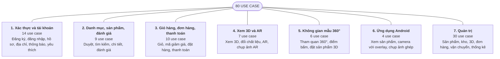
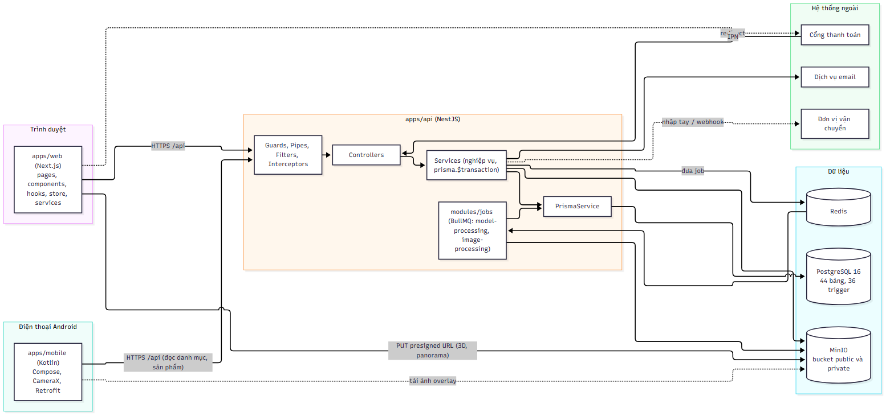
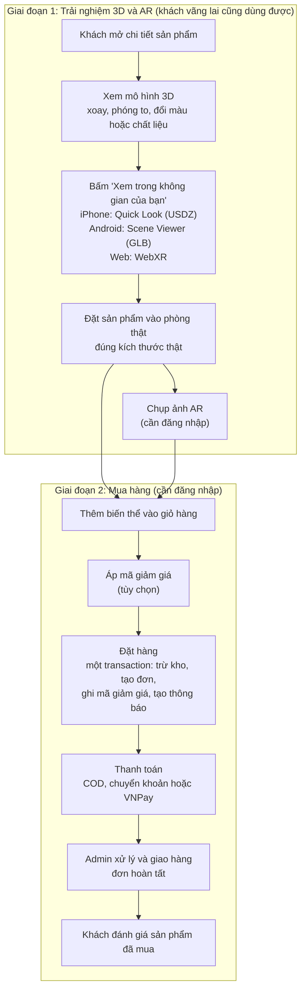

# Báo cáo giữa kì 1: Aurelia Living

Website thương mại điện tử nội thất có xem sản phẩm 3D, thực tế tăng cường (AR), không gian mẫu 360° và ứng dụng Android.

Nội dung dưới đây chia thành 4 slide, mỗi slide một phần của yêu cầu.

---

## Slide 1. Chức năng chính

### **80 use case**, chia thành 7 nhóm chức năng

| Nhóm | Số use case |
| --- | --- |
| 1. Xác thực và tài khoản | 14 |
| 2. Danh mục, sản phẩm, đánh giá | 9 |
| 3. Giỏ hàng, đơn hàng, thanh toán | 10 |
| 4. Xem 3D và AR | 7 |
| 5. Không gian mẫu 360° | 6 |
| 6. Ứng dụng Android | 4 |
| 7. Quản trị | 30 |
| **Tổng** | **80** |

**Ba tác nhân:** Khách vãng lai (chỉ xem), Người dùng (đăng nhập, mua hàng), Quản trị viên.

Sơ đồ use case tổng quát đầy đủ: `docs/DAC_TA_CHUC_NANG_THEO_VAI_TRO.md`, mục 5.1.

---

## Slide 2. Kiến trúc hệ thống

Bản vector (phóng to không vỡ): `docs/diagrams/svg/architecture_kien-truc-he-thong.svg`.

**Cách đọc nhanh sơ đồ:**

- **Máy khách:** trình duyệt (web Next.js) và điện thoại Android (Kotlin).
- **API (NestJS):** nhận yêu cầu qua bộ bảo vệ (giới hạn tốc độ, xác thực JWT, phân quyền), xử lý nghiệp vụ trong Service rồi ghi dữ liệu.
- **Cơ sở dữ liệu:** PostgreSQL (44 bảng).
- **Lưu trữ tệp:** MinIO (S3) với hai bucket public và private; trình duyệt tải mô hình 3D và ảnh 360° lên trực tiếp bằng đường dẫn có chữ ký (presigned URL).
- **Hàng đợi và cache:** Redis. Bốn hàng đợi `model-processing`, `image-processing`, `mail`, `notification` và một worker chạy cùng tiến trình API; Redis còn lưu cache và bộ đếm giới hạn tốc độ.
- **Hệ thống ngoài:** cổng thanh toán (VNPay sandbox), đơn vị vận chuyển, máy chủ email (SMTP).

---

## Slide 3. Công nghệ sử dụng

| Web | Backend | Mobile (Android) |
| --- | --- | --- |
| **Next.js** (React) | **NestJS** (Node.js) | **Kotlin** |
| **TypeScript** | **PostgreSQL** + Prisma | **Jetpack Compose** |
| **Tailwind CSS** | **Redis** + BullMQ (hàng đợi) | **CameraX** (camera) |
| **Three.js** + React Three Fiber (xem 3D) | **MinIO / S3** (lưu tệp) | **Retrofit** (gọi API) |
| **model-viewer** (AR) | **JWT** (xác thực) | **Hilt** (khởi tạo phụ thuộc) |
| **TanStack Query** (gọi API) | **Docker** (môi trường chạy) | **Coil** (tải ảnh) |

---

## Slide 4. Luồng nghiệp vụ tiêu biểu: xem sản phẩm 3D/AR rồi đặt hàng

Luồng này thể hiện điểm đặc biệt của đề tài: khách xem sản phẩm 3D, đặt thử vào không gian thật bằng AR rồi mới quyết định mua.

**Điểm nhấn khi trình bày:**

- Tệp 3D được xử lý nền khi admin tải lên: kiểm tra, sinh nhiều mức chi tiết (LOD), nén; thiết bị yếu tải mức nhẹ.
- Hệ thống chọn tệp phù hợp theo thiết bị: USDZ cho iPhone, GLB cho Android và web, kèm kích thước thật để AR hiển thị đúng tỉ lệ.
- Đặt hàng là một giao dịch duy nhất, nên tồn kho, đơn hàng, mã giảm giá và thông báo luôn nhất quán.

Sơ đồ chi tiết từng bước: `docs/BAO_CAO_PHAN_TICH_THIET_KE.md` (UC-3D-01, UC-3D-02, UC-ORD-01, UC-PAY-01).
