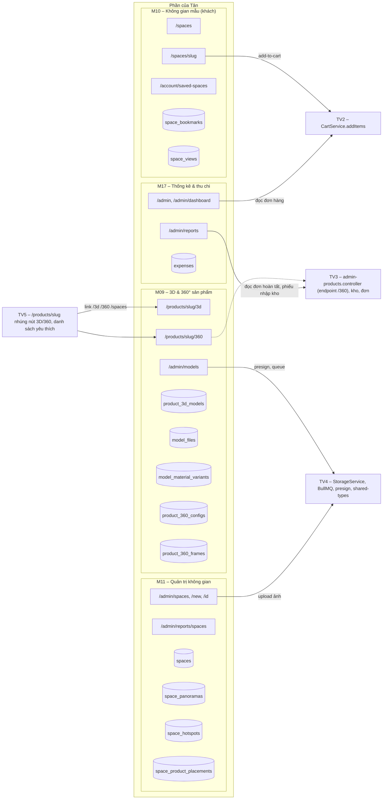
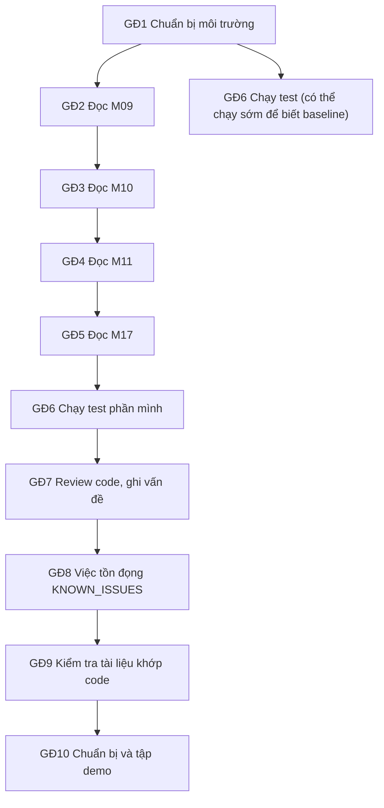
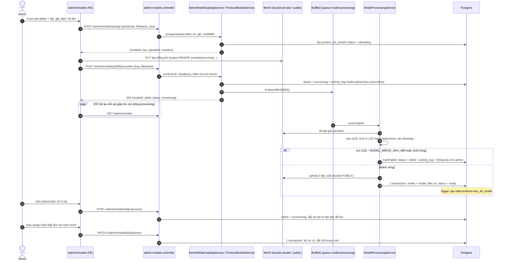
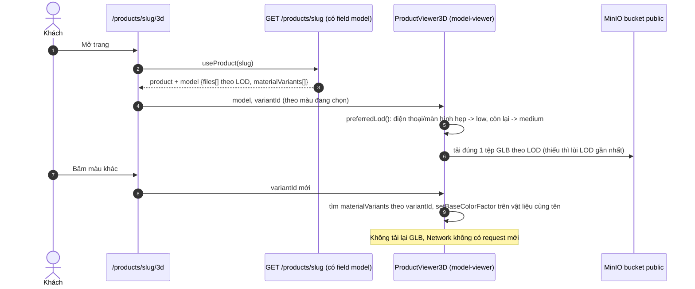
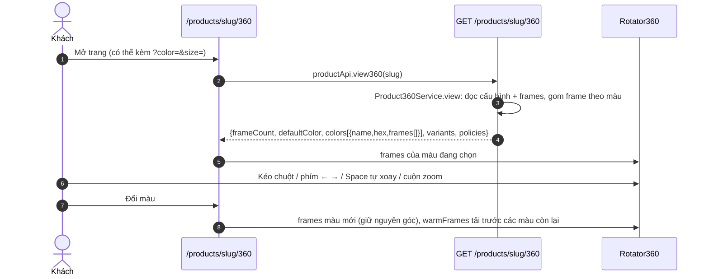
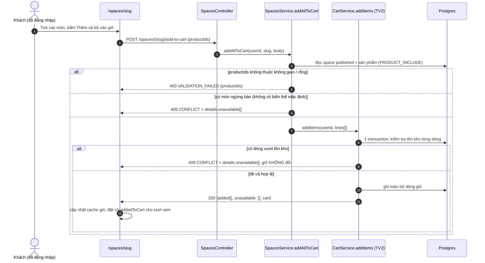
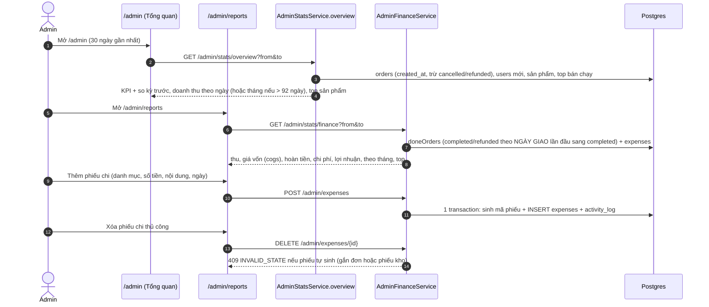
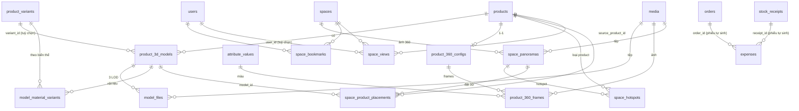
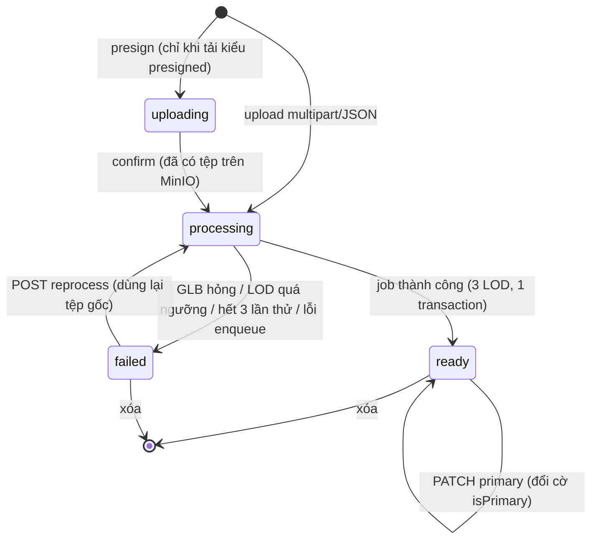

# Hướng dẫn cá nhân – Châu Nhựt Tân (Thành viên 1)

> **Vai trò:** Thành viên 1 – Trải nghiệm 3D, không gian mẫu 360° và thống kê.
> **Ngày lập:** 2026-11-11 · **Lập trên commit `main`:** `8e92fa7` (Merge PR #2 `fix/prettier-format`).
> **Đối tượng đọc:** sinh viên. Đọc xong phải hiểu, tự chạy, tự kiểm thử và trình bày được trước giảng viên.
> **Quy ước:** mọi dẫn chứng có dạng `đường-dẫn:dòng` (số dòng tính trên commit trên). Chỗ chưa kiểm chứng ghi **"Cần xác minh"**. Số điểm/dòng code lấy từ [task cá nhân.md](task%20cá%20nhân.md).

## Mục lục

0. [Tóm tắt nhanh](#0-tóm-tắt-nhanh)
1. [Lộ trình làm việc (flow các task)](#1-lộ-trình-làm-việc-flow-các-task)
2. [Flow từng chức năng (15 UC)](#2-flow-từng-chức-năng)
3. [Dữ liệu (DB)](#3-dữ-liệu-db)
4. [API (42 endpoint)](#4-api)
5. [Frontend (13 trang)](#5-frontend)
6. [Việc tồn đọng được giao](#6-việc-tồn-đọng-được-giao)
7. [Kiểm thử](#7-kiểm-thử)
8. [Phối hợp với thành viên khác](#8-phối-hợp-với-thành-viên-khác)
9. [Kịch bản demo (3–5 phút)](#9-kịch-bản-demo-35-phút)
10. [Câu hỏi giảng viên và gợi ý trả lời](#10-câu-hỏi-giảng-viên-và-gợi-ý-trả-lời)
11. [Kiến thức cần nắm](#11-kiến-thức-cần-nắm)
12. [Điểm cần lưu ý](#12-điểm-cần-lưu-ý)
13. [Phụ lục](#13-phụ-lục)

---

## 0. Tóm tắt nhanh

_Mục này để làm gì: cho bạn bức tranh tổng thể trong 1 phút trước khi đi vào chi tiết._

| Mục | Nội dung |
|---|---|
| Họ tên | Châu Nhựt Tân |
| Vai trò | Thành viên 1 |
| Người review PR của Tân | Thành viên 2 (Nguyễn Tường Vy) – [task cá nhân.md](task%20cá nhân.md) mục "Review chéo" |
| Tân review cho | Thành viên 5 (Khổng Thị Huyền Trang) |

**Phần của Tân, nói bằng lời dễ hiểu:**

1. Khách xem một chiếc ghế **dạng 3D**, xoay quanh nó, và bấm đổi màu thì ghế đổi màu ngay (không tải lại mô hình).
2. Khách cũng xem được **360° bằng chuỗi ảnh** (kéo chuột để xoay như đĩa quay).
3. Khách vào **phòng mẫu 360°**: kéo để nhìn quanh căn phòng, bấm các chấm tròn (hotspot) để xem sản phẩm, rồi "Thêm cả bộ vào giỏ".
4. Admin tải file mô hình `.glb` lên; hệ thống tự kiểm tra, tạo 3 bản nhẹ/nặng khác nhau (LOD) ở nền, xong mới cho khách xem.
5. Admin dựng phòng mẫu: tạo không gian, tải ảnh 360°, đặt hotspot, đặt mô hình 3D vào ảnh, và xem **phễu**: bao nhiêu người xem → bấm hotspot → thêm vào giỏ.
6. Admin xem **thống kê** doanh thu, top bán chạy và sổ **thu chi**.

| Module | UC | Endpoint | Trang FE | Bảng DB | Dòng code | Điểm |
|---|---:|---:|---:|---:|---:|---:|
| M09 – Mô hình 3D & 360° sản phẩm | 4 | 18 | 3 | 5 | 4.054 | 57.2 |
| M10 – Không gian mẫu 360° phía khách | 6 | 8 | 3 | 2 | 1.990 | 42 |
| M11 – Quản trị không gian mẫu, placement, phễu | 4 | 10 | 4 | 4 | 2.183 | 42.7 |
| M17 – Thống kê & thu chi | 1 | 6 | 3 | 1 | 1.726 | 22.9 |
| **Tổng** | **15** | **42** | **13** | **12** | **9.953** (61 tệp) | **164.8** |

### Bản đồ phần việc của Tân



---

## 1. Lộ trình làm việc (flow các task)

_Mục này để làm gì: cho bạn một thứ tự làm việc rõ ràng, từ cài môi trường tới tập demo. Cột "Hạn" để trống, bạn tự điền._

### Sơ đồ thứ tự và phụ thuộc



### Giai đoạn 1 – Chuẩn bị môi trường

| Mục | Nội dung |
|---|---|
| Mục tiêu | Chạy được dự án với dữ liệu thật, đăng nhập được khách và admin, mở được các trang của mình |
| Ước lượng | 0,5 ngày · **Hạn:** ______ |

**Các bước:**
1. Cài đặt: `npm install` ở thư mục gốc (Node theo [ENVIRONMENT.md](ENVIRONMENT.md)). Bật Docker Desktop.
2. **Cách nhanh nhất để demo:** `npm run demo` (chạy `scripts/demo.mjs`; tự dùng DB `aurelia_demo`, API cổng 4000, web cổng 3000). Nếu MinIO lỗi: `npm run demo:local` (lưu ảnh ở thư mục `apps/api/uploads`). Nguồn: [HUONG_DAN_DEMO.md](HUONG_DAN_DEMO.md) và `package.json:31-33`.
3. **Cách dev thủ công** (khi cần sửa code): `npm run infra:up` (Postgres, Redis, MinIO, Mailpit – `package.json:37`) → `npm run db:deploy` → `npm run db:seed` → `npm run dev`.
4. Dựng DB test (cần cho supertest): `node scripts/db-reset.mjs aurelia_test` (script chỉ chấp nhận `aurelia_demo` hoặc `aurelia_test`, theo [task cá nhân.md](task%20cá nhân.md) Phần 3).
5. Mở lần lượt các trang của mình (xem [mục 5](#5-frontend)). Tài khoản: khách `khachhang@aurelia.vn` / `123456`; admin `admin@aurelia.vn` / `admin123` ([HUONG_DAN_DEMO.md](HUONG_DAN_DEMO.md) dòng 31-34).

> **Cẩn thận:** không bao giờ chạy `prisma migrate dev/reset` hoặc `db push` lên DB có dữ liệu thật (`aurelia_dev`). Redis bắt buộc phải chạy thì job xử lý GLB mới hoạt động (BullMQ).

**Đầu ra:** web mở được `http://localhost:3000`, Swagger mở được `http://localhost:4000/docs`.
**Tiêu chí hoàn thành:** đăng nhập admin vào `/admin/models` thấy danh sách mô hình; mở `/spaces` thấy danh sách phòng mẫu.

### Giai đoạn 2 – Đọc hiểu M09 (3D/360° sản phẩm)

| Mục | Nội dung |
|---|---|
| Mục tiêu | Giải thích được 3 flow: (a) admin tải GLB, (b) khách xem 3D và đổi màu, (c) khách xoay 360° |
| Ước lượng | 1,5 ngày · **Hạn:** ______ |

**Các bước:**
1. Đọc [UC-3D-01, UC-3D-03, UC-ADM-13, UC-ADM-14 ở mục 2](#m09--mô-hình-3d--xem-360-sản-phẩm).
2. Đọc code theo thứ tự: `apps/api/src/modules/product-models/admin-models.controller.ts` → `admin-model-catalog.service.ts` (`upload` dòng 181, `reprocess` 425, `setPrimary` 482) → `jobs/model-processing/model-processing.service.ts` (`process` 56, `markFailed` 85) → `glb-tools.ts` (`buildLod` 85).
3. FE: `apps/web/src/app/admin/models/page.tsx`, `services/admin.api.ts:155-232`, `components/viewer/ProductViewer3D.tsx`, `components/product/Rotator360.tsx`.
4. Làm theo mục "Cách tự kiểm tra" của từng UC trên trình duyệt.

**Đầu ra:** tự vẽ lại được sequence a, b, c (mục 2) không nhìn tài liệu.
**Tiêu chí hoàn thành:** trả lời được câu hỏi giảng viên số 1, 4 (mục 10).

### Giai đoạn 3 – Đọc hiểu M10 (không gian mẫu phía khách)

| Mục | Nội dung |
|---|---|
| Mục tiêu | Giải thích: tải panorama + hotspot, ghi lượt xem một lần khi rời trang, thêm cả bộ vào giỏ, đổi món, lưu yêu thích |
| Ước lượng | 1,5 ngày · **Hạn:** ______ |

**Các bước:** (1) đọc UC-SPACE-01 → 06 ở mục 2; (2) BE: `modules/spaces/spaces.controller.ts` → `spaces.service.ts` (`list` 79, `recordView` 159, `alternatives` 220, `addAllToCart` 341); (3) FE: `app/(shop)/spaces/[slug]/page.tsx` (beacon dòng 67-92, addAll 97-121), `components/viewer/SpacePanorama.tsx`, `services/space.api.ts`.
**Tiêu chí hoàn thành:** giải thích được câu hỏi giảng viên số 5, 3 (mục 10).

### Giai đoạn 4 – Đọc hiểu M11 (quản trị không gian, placement, phễu)

| Mục | Nội dung |
|---|---|
| Mục tiêu | Giải thích: luật "≥ 1 ảnh 360° mới được đăng", hotspot nằm trong body PATCH, placement yaw/pitch/scale, cách tính phễu |
| Ước lượng | 1,5 ngày · **Hạn:** ______ |

**Các bước:** BE `spaces/admin-spaces.service.ts` (`validatePanoramas` 114, `write` 173), `panoramas/panoramas.service.ts` (`create` 225, `resolveRefs` 187), `admin-stats/admin-space-stats.service.ts` (`funnel` 61); FE `components/admin/SpaceForm.tsx`, `PlacementEditor.tsx`, `app/admin/reports/spaces/page.tsx`.
**Tiêu chí hoàn thành:** tự tạo một phòng mẫu mới có ≥ 1 ảnh, 1 hotspot sản phẩm, 1 placement; đọc đúng số liệu phễu của nó.

### Giai đoạn 5 – Đọc hiểu M17 (thống kê, thu chi)

| Mục | Nội dung |
|---|---|
| Mục tiêu | Giải thích: doanh thu tính thế nào (khác nhau giữa trang Tổng quan và trang Báo cáo), phiếu chi tự sinh và thủ công |
| Ước lượng | 1 ngày · **Hạn:** ______ |

**Các bước:** BE `admin-stats/admin-stats.service.ts` (`overview` 78), `admin-finance.service.ts` (`doneOrders` 65, `report` 82, `createExpense` 299, `removeExpense` 340); FE `app/admin/page.tsx`, `app/admin/reports/page.tsx`.
**Tiêu chí hoàn thành:** trả lời được "doanh thu ở trang Tổng quan khác doanh thu ở trang Báo cáo chỗ nào" (xem UC-ADM-28 và [mục 12](#12-điểm-cần-lưu-ý)).

### Giai đoạn 6 – Chạy test phần mình

| Mục | Nội dung |
|---|---|
| Mục tiêu | Có baseline xanh cho toàn bộ test của 4 module |
| Ước lượng | 0,5 ngày · **Hạn:** ______ |

Các lệnh và thứ tự: xem [mục 7](#7-kiểm-thử). **Tiêu chí hoàn thành:** ghi lại số test pass/fail vào PR hoặc ghi chú cá nhân.

### Giai đoạn 7 – Review code, ghi vấn đề

| Mục | Nội dung |
|---|---|
| Mục tiêu | Danh sách lỗi/điểm khó hiểu/đề xuất của phần mình (không sửa lan sang module người khác) |
| Ước lượng | 1 ngày · **Hạn:** ______ |

**Các bước:** (1) đọc [mục 12](#12-điểm-cần-lưu-ý) để biết sẵn các điểm đã phát hiện; (2) tạo issue hoặc ghi vào mô tả PR; (3) gắn nhãn module (M09/M10/M11/M17).
**Tiêu chí hoàn thành:** có ít nhất danh sách vấn đề được ghi lại và gửi Thành viên 2 xem.

### Giai đoạn 8 – Làm các việc tồn đọng (KNOWN_ISSUES)

Chi tiết ở [mục 6](#6-việc-tồn-đọng-được-giao). Ước lượng 1,5–2 ngày · **Hạn:** ______

### Giai đoạn 9 – Kiểm tra tài liệu khớp code

| Mục | Nội dung |
|---|---|
| Mục tiêu | Đối chiếu dòng của 4 module trong [API_CONTRACT.md](API_CONTRACT.md) (và `docs/api/openapi.json`), UC trong [DAC_TA_CHUC_NANG_THEO_VAI_TRO.md](DAC_TA_CHUC_NANG_THEO_VAI_TRO.md) + [DOI_CHIEU_UC.md](DOI_CHIEU_UC.md), bảng trong [DATABASE_SCHEMA.md](DATABASE_SCHEMA.md) |
| Ước lượng | 0,5 ngày · **Hạn:** ______ |

**Cách làm:** mở từng endpoint ở bảng mục 4 trong Swagger (`/docs`) và so với API_CONTRACT. Ghi chỗ lệch vào PR. **Tiêu chí hoàn thành:** danh sách chỗ lệch (có thể rỗng).

### Giai đoạn 10 – Chuẩn bị và tập demo

Chi tiết ở [mục 9](#9-kịch-bản-demo-35-phút). Ước lượng 0,5 ngày · **Hạn:** ______. **Tiêu chí hoàn thành:** chạy trơn kịch bản 1 lần trên `aurelia_demo`, bấm giờ ≤ 5 phút.

---

## 2. Flow từng chức năng

_Mục này để làm gì: với mỗi UC, bạn thấy người dùng bấm gì, code chạy qua những file nào, ghi/đọc bảng nào, và tự kiểm tra thế nào. Đây là phần quan trọng nhất._

**Cách đọc flow:** mỗi UC có 10 bước theo thứ tự: người dùng → giao diện → component → hàm gọi API → endpoint → controller → service → DB → việc nền/storage → response → giao diện cập nhật. Bước nào không có thì ghi "–".

**Các bí danh đường dẫn dùng trong mục này:**
`BE` = `apps/api/src/modules` · `FE` = `apps/web/src`.

### Các sơ đồ tuần tự dùng chung (a → i)

#### (a) Admin tải GLB → xử lý nền → sẵn sàng



Dẫn chứng: `admin.api.ts:179-195` (presign → PUT → confirm), `admin-model-catalog.service.ts:339` (`presignUpload`), `product-models.service.ts:40,60` (`presignFile`, `confirmFile`), `model-processing.service.ts:56,85,116,154`, `model-processing.processor.ts:17,28`, `admin-model-catalog.service.ts:425,482`.

> Có 3 cách tải: (1) presigned (flow trên, dùng khi driver MinIO), (2) multipart `POST /admin/models/upload`, (3) JSON base64 `POST /admin/models` (`admin.api.ts:180` chọn theo `getUploadMode()`).

#### (b) Khách xem 3D và đổi màu



Dẫn chứng: `3d/page.tsx:28-42,113-116`, `ProductViewer3D.tsx:41-70` (chọn LOD), `:109-126` (áp vật liệu), `products.service.ts:221` + `catalog-views.service.ts` (`primaryModel`, chỉ lấy `isPrimary` + `status = ready`).

#### (c) Khách xem 360° sản phẩm



Dẫn chứng: `product-360.service.ts:47-101`, `360/page.tsx:43,88,112`, `Rotator360.tsx:4,17,41,224-290`.

#### (d) Khách xem không gian mẫu và ghi lượt xem

```mermaid
sequenceDiagram
  autonumber
  actor K as Khách
  participant P as /spaces/slug
  participant API as SpacesController
  participant SV as SpacesService
  participant DB as Postgres
  K->>P: Mở /spaces/phong-khach-hien-dai (có thể ?from=sofa-nordic)
  P->>API: GET /spaces/{slug}
  API->>SV: detail -> buildDetail
  SV->>DB: space published + panoramas + hotspots + placements + sản phẩm
  SV-->>P: SpaceDetail (panoramas[{url, hotspots[], placements[]}], products[])
  P->>P: SpacePanorama vẽ ảnh lên mặt cầu, hotspot đặt theo yaw/pitch
  K->>P: Bấm hotspot (thông tin / sản phẩm / điều hướng)
  P->>P: onHotspot: clicks += 1; điều hướng thì đổi ảnh
  K->>P: Rời trang (tab ẩn / pagehide / chuyển trang trong app)
  P->>API: sendBeacon POST /spaces/{slug}/views {visitorId, sourceProductId, hotspotClickCount, addedToCart, accessToken?}
  API->>SV: recordView: kiểm tra visitorId UUID, xác định userId
  SV->>DB: INSERT space_views
  Note over DB: trigger trg_space_views_increase_count tăng spaces.view_count
  API-->>P: 204 (không có nội dung)
```

Dẫn chứng: `spaces.controller.ts:42-47,59-69`, `spaces.service.ts:143,159-218,268`, `[slug]/page.tsx:67-92`, `space.api.ts` (`sendViewBeacon`), `migration.sql:1849-1862`.

#### (e) Thêm cả bộ không gian vào giỏ (tất cả-hoặc-không)



Dẫn chứng: `spaces.service.ts:341-386`, `cart.service.ts:214-250` (transaction + `unavailable` + `CONFLICT`), `[slug]/page.tsx:97-121` (xử lý 409 hiển thị toast), [DECISIONS.md](DECISIONS.md) D-N37.

#### (f) Đổi món (không ghi DB)

```mermaid
sequenceDiagram
  autonumber
  actor K as Khách
  participant P as /spaces/slug
  participant API as GET .../placements/{id}/alternatives
  participant SV as SpacesService.alternatives
  participant DB as Postgres
  K->>P: Bấm ghim món trong ảnh, bấm Đổi món
  P->>API: spaceApi.alternatives(slug, placementId)
  API->>SV: alternatives
  SV->>DB: placement của space published; sản phẩm CÙNG DANH MỤC, published, có mô hình chính ready (tối đa 12)
  SV-->>P: [{id,name,slug,price,variantId,model{files[]}}]
  K->>P: Chọn một món
  P->>P: swaps[placementId] = món mới (state ở client)
  Note over P: Nhãn "Đang xem thử — không được lưu lại". Tải lại trang về món gốc. KHÔNG có request ghi nào
```

Dẫn chứng: `[slug]/page.tsx:48-58,173-230`, `spaces.service.ts:220-255`.

#### (g) Admin tạo không gian: thông tin → ảnh 360° → hotspot → placement

```mermaid
sequenceDiagram
  autonumber
  actor A as Admin
  participant F as SpaceForm (/admin/spaces/new)
  participant API as AdminSpacesController
  participant SV as AdminSpacesService.write
  participant ING as ingestImage (ảnh 360° ≤ 20MB)
  participant DB as Postgres
  participant PL as PlacementEditor / PanoramasService
  A->>F: Tab Thông tin cơ bản (tên, loại phòng, phong cách, giảm combo)
  A->>F: Tab Ảnh 360°: tải ảnh lên (uploadMany -> media)
  A->>F: Tab Điểm tương tác: thêm hotspot yaw/pitch (product / navigation / info)
  A->>F: Chọn trạng thái, bấm Lưu
  F->>API: POST /admin/spaces {title, roomType, status, panoramas[{url,hotspots[]}]}
  API->>SV: create -> write
  SV->>SV: validate + validatePanoramas (yaw, pitch, productId, targetIndex)
  alt status = published mà panoramas rỗng
    SV-->>F: 400 VALIDATION_FAILED (panoramas: cần ít nhất một ảnh 360°)
  else hợp lệ
    SV->>ING: ingestImage từng ảnh (ngoài transaction)
    SV->>DB: 1 transaction: spaces + space_panoramas + space_hotspots (+ activity_log)
    SV-->>F: chi tiết không gian (có id)
  end
  A->>PL: Vào /admin/spaces/id, tab Đặt sản phẩm 3D
  PL->>API: POST /admin/panoramas/{panoId}/placements {productId, yaw, pitch, distance, scale...}
  API->>DB: resolveRefs: sản phẩm tồn tại, mô hình ready; INSERT space_product_placements
```

Dẫn chứng: `admin-spaces.service.ts:95,114,173,218-220,225-231,233,365`, `SpaceForm.tsx:25-30,115-123`, `panoramas.service.ts:187,225`, `PlacementEditor.tsx:34-40,87-94`.

> **Hotspot lưu thế nào:** KHÔNG có endpoint riêng cho hotspot. Hotspot nằm trong mảng `panoramas[].hotspots[]` của body `POST/PATCH /admin/spaces` (`SpaceForm.tsx:120`, `admin-spaces.service.ts:298`). Đây là lý do module `hotspots/` trống.

#### (h) Phễu không gian mẫu

```mermaid
sequenceDiagram
  autonumber
  actor A as Admin
  participant F as /admin/reports/spaces
  participant API as GET /admin/stats/spaces?from=&to=
  participant SV as AdminSpaceStatsService.funnel
  participant DB as Postgres (space_views)
  A->>F: Chọn khoảng ngày (mặc định 30 ngày)
  F->>API: ?from=YYYY-MM-DD&to=YYYY-MM-DD
  API->>SV: funnel(q)
  SV->>SV: range(): từ 00:00 đến 23:59:59.999 giờ +07:00
  SV->>DB: SQL gộp theo pk = COALESCE(visitor_id, 'u'+user_id, 'r'+id)
  Note over DB: mỗi người xem một không gian nhiều lần chỉ tính 1 lần ở mỗi bước
  DB-->>SV: viewers, clicked (hotspot_click_count>0), carted (added_to_cart), both
  SV-->>F: totals, spaces[] (kèm sources top 5), sources top 10; các tỉ lệ clickRate/cartRate/clickToCartRate
```

Dẫn chứng: `admin-stats.controller.ts:30-39` (quyền `manage_content` ghi đè `view_orders`), `admin-space-stats.service.ts:1-12` (định nghĩa), `:42-50` (múi giờ), `:61-100` (SQL), `vn-time.db-spec.ts`.

#### (i) Thống kê tổng quan và báo cáo tài chính



Dẫn chứng: `admin-stats.service.ts:78-135`, `admin-finance.service.ts:65-114,299-363`, `admin-finance.controller.ts:18-47`.

---

### M09 – Mô hình 3D & xem 360° sản phẩm

#### UC-3D-01 – Xem mô hình 3D của sản phẩm

| Mục | Nội dung |
|---|---|
| Tác nhân | Khách (không cần đăng nhập) |
| Trạng thái | ✅ Đủ ([task cá nhân.md](task%20cá%20nhân.md) mục M09; **Cần xác minh** lại dòng riêng trong DOI_CHIEU_UC.md) |
| Người dùng thấy | Mô hình 3D của sản phẩm, kéo để xoay; có nhãn LOD và dung lượng tệp (`ProductViewer3D.tsx:251`); không có mô hình thì thấy trạng thái trống ("EmptyState", `3d/page.tsx:58-69`) |

**Flow:**
1. Khách mở `/products/sofa-nordic/3d` (nút "3D" từ trang chi tiết: `(shop)/products/[slug]/page.tsx:116,149`).
2. Component `FE/app/(viewer)/products/[slug]/3d/page.tsx` dùng `useProduct(slug)` (dòng 28).
3. Hàm gọi API: `productApi.detail` (trong hook `useProduct`; **Cần xác minh** tên hàm chính xác). `FE/services/product.api.ts:36` còn có `productApi.model(slug)` → `GET /products/{slug}/model`.
4. Endpoint: `GET /products/{slug}` (có field `model`) hoặc `GET /products/{slug}/model`.
5. Controller: `BE/products/products.controller.ts:43,50` (`:slug`, `:slug/model`).
6. Service: `products.service.ts:221-224` → `CatalogViews.primaryModel` (chỉ mô hình `isPrimary` và `status = ready`).
7. DB đọc: `product_3d_models`, `model_files` (+ `model_material_variants`).
8. Storage: GLB nằm ở bucket public (MinIO); trình duyệt tải trực tiếp, không qua API.
9. Response: `model { files[{format, lod, url, fileSize}], materialVariants[], glbUrl }`.
10. Giao diện: `ProductViewer3D.tsx:41-70` chọn LOD (điện thoại/màn hình ≤767px/tiết kiệm dữ liệu → `low`, còn lại `medium`, thiếu thì lùi LOD gần nhất), hiển thị bằng `<model-viewer>` (`@google/model-viewer`).

**Nhánh lỗi:** sản phẩm không tồn tại → ErrorState (`3d/page.tsx:51`); chưa có mô hình ready → EmptyState có nút quay lại trang sản phẩm (`:58-69`); tệp GLB lỗi tải → **Cần xác minh** xử lý trong `ModelViewerElement.tsx`.

**Quy tắc nghiệp vụ:** chỉ mô hình `ready` và là mô hình chính được phục vụ cho khách; trang 3D đồng bộ chọn màu/kích thước bằng biến thể mặc định (`3d/page.tsx:34-38`).

**Tự kiểm tra:** đăng nhập không cần; mở `http://localhost:3000/products/sofa-nordic/3d`. Mong đợi: mô hình hiện sau vài giây, nhãn "GLB · LOD medium". Thu hẹp cửa sổ < 768px, tải lại: nhãn thành "LOD low".

#### UC-3D-03 – Đổi màu/chất liệu trên mô hình 3D

| Mục | Nội dung |
|---|---|
| Tác nhân | Khách |
| Trạng thái | ✅ Đủ |
| Người dùng thấy | Bấm các chấm màu (Be, Kem, Xám): mô hình đổi màu ngay, không nhấp nháy tải lại |

**Flow:**
1. Khách bấm một màu trên `/products/sofa-nordic/3d`.
2. `3d/page.tsx:41-42`: tìm biến thể theo `(color, size)` → `variant`.
3. Truyền `variantId` cho `ProductViewer3D` (`:113-116`).
4–8. **Không gọi API thêm** (dữ liệu `materialVariants` đã có sẵn trong `model` từ lần tải đầu).
9. `ProductViewer3D.tsx:109-126`: `model.materialVariants.find(variantId)` → trên vật liệu cùng `materialName` gọi `setBaseColorFactor` (và roughness/metalness theo config).
10. Thuộc tính `data-material-applied` được đặt để test (`:203`).

**Quy tắc:** cấu hình vật liệu chỉ có `baseColor` (hex `#RRGGBB`), `roughness`, `metalness` (`model-materials.service.ts:21-22`). Biến thể chưa cấu hình thì giữ nguyên vật liệu gốc.
**Nhánh lỗi:** vật liệu không có trong GLB → không đổi (**Cần xác minh** có cảnh báo hay không).
**Tự kiểm tra:** mở `/products/sofa-nordic/3d`, bấm lần lượt 3 màu, mở DevTools → Network: không có request GLB mới ([HUONG_DAN_DEMO.md](HUONG_DAN_DEMO.md) 10f). Test: `materials.spec.ts` (nhóm `vat-lieu`).

#### UC-ADM-13 – Tải và quản lý mô hình 3D sản phẩm

| Mục | Nội dung |
|---|---|
| Tác nhân | Admin (quyền `manage_products`) |
| Trạng thái | **✅ Đủ** theo [DOI_CHIEU_UC.md](DOI_CHIEU_UC.md) dòng 43 (ô này trong task cá nhân.md bị lỗi hiển thị, xem [mục 12](#12-điểm-cần-lưu-ý)) |
| Người dùng thấy | Bảng mô hình: trạng thái Đang xử lý / Sẵn sàng / Lỗi, nút Xử lý lại, Đặt làm mô hình chính, Vật liệu theo biến thể, Xóa |

**Flow:** xem **sequence (a)** ở trên. Tóm tắt 10 bước:
1. Admin vào `/admin/models`, chọn sản phẩm, chọn tệp `.glb`.
2. `FE/app/admin/models/page.tsx` (tải: dòng ~105; danh sách + polling: 261-280).
3. `adminApi.models.upload` (`admin.api.ts:155-195`): chế độ presigned: `POST /admin/models/presign` → PUT thẳng MinIO (`direct-upload.ts:39`) → `POST /admin/models/:id/files/confirm`; chế độ multipart: `POST /admin/models/upload`.
4. Endpoint: `POST /admin/models/presign` (`admin-models.controller.ts:105`), `POST /:id/files/confirm` (`:134`).
5. Controller: `BE/product-models/admin-models.controller.ts` (`@RequirePermission('manage_products')` dòng 36).
6. Service: `admin-model-catalog.service.ts:339` (`presignUpload`) → `product-models.service.ts:40` (`presignFile`: key `models/incoming/{modelId}/{uuid}.glb`, bucket **private**) → `:60` (`confirmFile`).
7. DB ghi: `product_3d_models` (status `uploading` → `processing`), `activity_logs`. Lưu `sourceKey` vào log để xử lý lại.
8. Việc nền: `JobsService.enqueueModel` → BullMQ queue `model-processing` (`jobs.constants.ts:6`), `JOB_ATTEMPTS = 3` (`:33`) → `ModelProcessingProcessor` (`model-processing.processor.ts:17`) → `ModelProcessingService.process` (`:56`): tải tệp gốc, `readGlb` kiểm tra, `buildLod` ×3 (high giữ 100% đa giác/texture ≤2048, medium 50%/1024, low 15%/512 – `glb-tools.ts:22-26`), nén Meshopt (`:85-110`, nếu nén lỗi thì giữ bản chưa nén), kiểm tra mỗi LOD ≤ `MODEL_SERVE_MAX_MB` (mặc định **5**, `env.validation.ts:61`), upload bucket **public**, `saveAll` (một transaction: `media` + `model_files` ×3 + `status = ready`, idempotent bằng upsert, `:154-200`).
9. Response: `202 {modelId, jobId, status: 'processing'}`.
10. FE: `refetchInterval` tự hỏi lại `GET /admin/models` khi còn dòng `processing/uploading` (`page.tsx:275-277`) → dòng chuyển "Sẵn sàng".

**Xử lý lỗi (vòng đời):**
- Tệp không phải GLB hoặc quá 100MB: `validateModelFile` (`model-file-validator.ts:7,11,43`) → 415 "Hệ thống chỉ hỗ trợ tệp GLB" hoặc 413. USDZ/AR đã bị loại bỏ (D-P11).
- GLB hỏng hoặc LOD vượt ngưỡng: `InvalidModelFileError`/`ModelTooLargeError` → processor ném `UnrecoverableError` (không retry vô ích, `processor.ts:20`) → `onFailed` → `markFailed` (`service.ts:85`): `status = failed`, ghi `activity_logs` (`model.processing_failed`), tạo thông báo cho admin đã tải.
- Lỗi tạm thời (mạng/Redis): BullMQ thử lại tối đa 3 lần rồi mới `failed` (`processor.ts:28-33`).
- **Xử lý lại:** `POST /admin/models/:id/reprocess` (`admin-model-catalog.service.ts:425`): chỉ khi `failed` (409 `INVALID_STATE` nếu khác); đọc `sourceKey` từ `activity_logs`; nếu tệp gốc không còn → 409 "Không còn tệp gốc…".
- **Đặt mô hình chính:** `PATCH /admin/models/:id/primary` (`:482`): chỉ khi `ready`; một transaction bỏ cờ cũ rồi đặt cờ mới (đảm bảo bởi `uq_product_3d_models_primary`).
- **Xóa:** `DELETE /admin/models/:id` xóa 1 tệp (tệp cuối thì xóa luôn mô hình, `:514`); `DELETE /admin/models/model/:modelId` xóa cả mô hình (`:543`).

**Quy tắc quan trọng:** tệp gốc ở bucket **private** (không công khai); chỉ bản đã xử lý ở bucket **public**. Tên key do server sinh (UUID) nên không thể path traversal; `confirm` kiểm tra key phải bắt đầu `models/incoming/{id}/` và không chứa `..` (`product-models.service.ts:67`).

**Tự kiểm tra:** đăng nhập admin → `/admin/models` → chọn "Sofa Nordic" → tải một `.glb` nhỏ → thấy "Đang xử lý nền…" → "Sẵn sàng" sau vài giây (cần Redis chạy). Tải một file giả đổi đuôi `.glb` → chuyển "Lỗi" → nút "Xử lý lại". Test: `models-processing.db-spec.ts`, `model-processing.service.spec.ts`, `model-file-validator.spec.ts`.

#### UC-ADM-14 – Cấu hình biến thể chất liệu cho mô hình 3D

| Mục | Nội dung |
|---|---|
| Tác nhân | Admin (`manage_products`) |
| Trạng thái | ✅ Đủ |
| Người dùng thấy | Hộp thoại "Vật liệu theo biến thể": mỗi biến thể chọn một vật liệu có trong GLB và một màu |

**Flow:**
1. Admin bấm Thao tác → "Vật liệu theo biến thể" ở dòng mô hình `ready` (`admin/models/page.tsx:423`).
2. `FE/components/admin/MaterialVariantsModal.tsx`.
3. `adminApi.models.*` → `GET /admin/models/:id/materials` (tên vật liệu trong GLB), `GET /admin/models/:id/material-variants`, `PUT /admin/models/:id/material-variants/:variantId`, `DELETE ...` (`admin-models.controller.ts:145-175`).
5–6. `BE/product-models/model-materials.service.ts`: `materialNames` (đọc GLB, `:95`), `set` (`:122`): tên vật liệu 1–150 ký tự, config hợp lệ (hex `#RRGGBB`, roughness, metalness), biến thể phải thuộc sản phẩm của mô hình (400 nếu sai).
7. DB: `model_material_variants` (UNIQUE `(model_id, variant_id)` – `schema.prisma:309`), upsert nên lưu lại thì ghi đè.
10. Khách mở trang 3D thấy màu mới (xem UC-3D-03).

**Tự kiểm tra:** admin đổi màu một biến thể → Lưu → mở `/products/sofa-nordic/3d` bấm biến thể đó. Test: `model-materials.db-spec.ts`, `materials.spec.ts`.

> **Ảnh 360° của sản phẩm (cấu hình admin)** cũng thuộc M09: tab "Ảnh 360°" trong trang sản phẩm admin → `Product360Editor.tsx` → `PUT /admin/products/:id/360` (`admin-products.controller.ts:44-50`, service `admin-products.service.ts:555`): body `{enabled, autoRotate, colors:[{name,hex,frames[]}]}`; bật 360° cần ít nhất một màu có ≥ 2 ảnh (400 nếu không, `:564-568`); mỗi ảnh ≤ giới hạn `frame` (mô tả: 2MB/ảnh); ghi `product_360_configs` + `product_360_frames`. File controller này thuộc Thành viên 3.

#### Xem 360° sản phẩm (phía khách)

Không có mã UC riêng trong 4 UC của M09, nhưng thuộc `GET /products/{slug}/360`. Flow xem **sequence (c)**. Chi tiết: lỗi 404 "Ảnh 360° của sản phẩm không tồn tại" nếu chưa bật (`product-360.service.ts:61-62`); điều khiển `Rotator360.tsx:4` (kéo ~8px/frame có quán tính, ← →, Space tự xoay, +/- zoom, Esc thoát toàn màn hình). Tự kiểm tra: `/products/sofa-nordic/360`.

---

### M10 – Không gian mẫu 360° phía khách

#### UC-SPACE-01 – Duyệt và tìm kiếm không gian mẫu

| Mục | Nội dung |
|---|---|
| Tác nhân | Khách (không cần đăng nhập) |
| Trạng thái | ✅ Đủ |
| Người dùng thấy | Lưới thẻ phòng mẫu, bộ lọc theo loại phòng/phong cách, ô tìm kiếm, sắp xếp |

**Flow:**
1. Khách mở `/spaces` (có thể kèm `?q=&style=&roomType=&sort=&page=`).
2. `FE/app/(shop)/spaces/page.tsx` + `components/product/SpaceCard.tsx`.
3. `FE/hooks/useSpaces.ts` → `spaceApi.list` / `spaceApi.facets` (`services/space.api.ts`). Trang gọi `useSpaces({sort:'popular',pageSize:6})` cho phần nổi bật, `useSpaces({...})` cho danh sách (8/trang), `useSpaceFacets()` (`page.tsx:31-33`).
4. `GET /spaces`, `GET /spaces/facets`.
5. `BE/spaces/spaces.controller.ts:25-40` (`@Public()`).
6. `spaces.service.ts:79` (`list`): lọc `status = published`, `roomType`, `style`, `q` (bỏ dấu tiếng Việt bằng `foldVi`), `bookmarked`, `product=<slug>` (không gian có chứa sản phẩm đó); sắp xếp `newest` (theo `publishedAt ?? createdAt`) / `popular` (`viewCount`) / `title`; phân trang 12/trang mặc định. `facets` (`:127`) đếm số phòng theo phong cách và loại phòng.
7. DB đọc: `spaces`, `space_panoramas`, `space_hotspots`, `space_product_placements`, `space_bookmarks` (nếu đã đăng nhập, để gắn `isBookmarked`).
9. Response `{items, page, pageSize, total}`.
10. Lỗi: `ErrorState` (`page.tsx:160`); không có kết quả: `EmptyState` (`:181`).

**Quy tắc:** chỉ phòng `published` hiển thị; lọc/tìm kiếm làm **trong bộ nhớ** sau khi tải hết phòng đã đăng (`spaces.service.ts:92-105`) – ổn với số lượng ít; ghi chú hiệu năng cho giảng viên nếu hỏi.
**Tự kiểm tra:** `/spaces` → lọc "Phòng khách" → gõ "hien dai" (không dấu vẫn tìm được "hiện đại").

#### UC-SPACE-02 – Xem không gian mẫu 360°

| Mục | Nội dung |
|---|---|
| Tác nhân | Khách |
| Trạng thái | ✅ Đủ |
| Người dùng thấy | Ảnh 360° kéo xoay được, hotspot, danh sách ảnh thu nhỏ để đổi góc, cột sản phẩm bên phải |

**Flow:** xem **sequence (d)** (nửa đầu). Điểm chính: `FE/components/viewer/SpacePanorama.tsx` dùng React Three Fiber: ảnh `useTexture(url)` (`:91`) vẽ lên mặt cầu; `toPosition(yaw,pitch)` (`:27`) đổi góc thành tọa độ 3D; `OrbitControls` để kéo xoay/zoom. Ảnh mở đầu: ảnh `isStart` hoặc ảnh đầu (`[slug]/page.tsx:62`). Ảnh lỗi tải có `ErrorBoundary` và `resetKey` để thử lại (`SpacePanorama.tsx:202`).
**Nhánh lỗi:** không gian không tồn tại/nháp/đã ẩn → 404 `RESOURCE_NOT_FOUND` "Không gian mẫu không tồn tại." (`spaces.service.ts:150`) → `ErrorState`/`EmptyState` ở FE (`[slug]/page.tsx:137-148`).
**Tự kiểm tra:** `/spaces/phong-lam-viec-toi-gian` – kéo xoay, bấm ảnh thu nhỏ.

#### UC-SPACE-03 – Bấm điểm sản phẩm trong phòng mẫu (hotspot)

| Mục | Nội dung |
|---|---|
| Tác nhân | Khách |
| Trạng thái | ✅ Đủ |
| Người dùng thấy | 3 loại hotspot: sản phẩm (thẻ giá, nút Thêm/Xem), thông tin (nội dung), điều hướng (chuyển sang ảnh khác) |

**Flow:**
1. Khách bấm hotspot (`Hotspot` trong `SpacePanorama.tsx:154-175`: màu theo loại: sản phẩm `bg-primary`, điều hướng `bg-sky-600`, thông tin `bg-stone-600`).
2. `[slug]/page.tsx:155` `onHotspot`: tăng `stats.current.clicks`; loại `navigation` thì `setPanoId(targetPanoramaId)`; loại khác thì mở thẻ chi tiết.
3–8. Không gọi API (dữ liệu hotspot đã có trong `GET /spaces/{slug}`: `spaces.service.ts:268-330`).
9–10. Số lần bấm được gửi **một lần** khi rời trang (UC-SPACE-06). Nút "Thêm" từ thẻ sản phẩm hoặc "Thêm cả bộ vào giỏ": xem **sequence (e)**.

**Quy tắc "Thêm cả bộ vào giỏ":** danh sách món = các sản phẩm xuất hiện trong hotspot loại `product` (`spaces.service.ts:52-60`); tất cả-hoặc-không; thiếu hàng → toast liệt kê món lỗi và lý do (`[slug]/page.tsx:107-118`). Giảm giá combo: hằng `COMBO_DISCOUNT_PERCENT = 10` (`spaces.service.ts:19`) và `calcComboTotal` (`:23`) – **Cần xác minh** cách dùng cùng `comboDiscountPercent` của từng không gian.
**Tự kiểm tra:** đăng nhập khách, `/spaces/phong-khach-hien-dai`, tick/bỏ tick món, bấm "Thêm cả bộ vào giỏ"; để thử 409: hạ tồn kho một món về 0 (admin kho) rồi thêm lại – giỏ không đổi, toast nêu tên món. Test: `spaces.combo.spec.ts`, `mock-m3.db-spec.ts`, `spaces360.spec.ts`.

#### UC-SPACE-04 – Lưu / bỏ lưu không gian yêu thích

| Mục | Nội dung |
|---|---|
| Tác nhân | Khách đã đăng nhập |
| Trạng thái | ✅ Đủ |
| Người dùng thấy | Nút "Lưu không gian"; trang `/account/saved-spaces` liệt kê các phòng đã lưu |

**Flow:**
1. Bấm "Lưu không gian" (`[slug]/page.tsx:123-130`, mutation) hoặc "bỏ lưu" ở trang đã lưu.
3. `spaceApi.bookmark` → `PUT /spaces/{slug}/bookmark`; `spaceApi.unbookmark` → `DELETE /spaces/{slug}/bookmark` (`space.api.ts`).
5. `spaces.controller.ts:82-91` (không `@Public()` nên bắt buộc đăng nhập).
6. `spaces.service.ts:397` `bookmark`: `bySlug` (chỉ phòng đang đăng, nếu không 404) → `upsert` theo `(userId, spaceId)` nên bấm lại không lỗi (idempotent); `unbookmark` (`:407`) xóa `deleteMany`, phòng không tồn tại vẫn thành công.
7. DB: `space_bookmarks` (UNIQUE `uq_space_bookmarks_user_space`, `schema.prisma:711`).
10. Trang `/account/saved-spaces` (`saved-spaces/page.tsx:23`) dùng `spaceApi.list({bookmarked:true})`; chưa đăng nhập bị chuyển đi; rỗng thì `EmptyState` (`:57`).

**Tự kiểm tra:** đăng nhập khách → lưu một phòng → mở `/account/saved-spaces` thấy phòng → bỏ lưu → biến mất. Test: `account.db-spec.ts`, `saved-spaces.test.tsx`, `spaces360.spec.ts`.

#### UC-SPACE-05 – Thử đổi món đồ trong phòng mẫu

Xem **sequence (f)**. Điểm cần nhớ: (1) endpoint `GET /spaces/{slug}/placements/{placementId}/alternatives`, công khai; (2) điều kiện món gợi ý: **cùng danh mục**, `published`, chưa xóa, có mô hình chính `ready`, tối đa 12, không gồm chính món đang đặt (`spaces.service.ts:220-255`); (3) **không có thao tác ghi nào** (DB hoặc API), chỉ đổi state ở client; (4) placement không thuộc phòng đang đăng → 404 (`:228-229`).
**Tự kiểm tra:** [HUONG_DAN_DEMO.md](HUONG_DAN_DEMO.md) 10g. Test: `placements.db-spec.ts`, `placements360.spec.ts`.

#### UC-SPACE-06 – Ghi nhận lượt xem không gian mẫu

Xem **sequence (d)** (nửa sau). Chi tiết:
- **Gửi một lần khi rời trang:** `[slug]/page.tsx:67-92` đăng ký `visibilitychange` (tab ẩn), `pagehide`, và cleanup của `useEffect` (chuyển trang trong app); cờ `st.sent` đảm bảo chỉ một lần.
- **Vì sao `sendBeacon`:** trình duyệt không cho đặt header `Authorization` trong beacon, nên `sendViewBeacon` gửi kèm `accessToken` trong body (`space.api.ts`); nếu beacon không dùng được thì `fetch` với `keepalive: true`.
- **BE:** `recordView` (`spaces.service.ts:159`): `visitorId` bắt buộc và phải là UUID (400 nếu thiếu/sai), `hotspotClickCount` nguyên 0–1000; `userId` lấy từ header hoặc từ `accessToken` trong body (token sai/hết hạn thì ghi ẩn danh); `sourceProductId` nhận id hoặc slug sản phẩm (từ `?from=`). Trả `204`.
- **DB:** INSERT `space_views`; trigger `trg_space_views_increase_count` tăng `spaces.view_count` (`migration.sql:1849-1862`). Code **không** tăng tay.
- **Tự kiểm tra:** mở một phòng, bấm vài hotspot, rời trang; vào `/admin/reports/spaces` thấy số tăng (UC-ADM-29). Test: `space-source.db-spec.ts`, `space-source.spec.ts`.

---

### M11 – Quản trị không gian mẫu

#### UC-ADM-15 – Quản lý không gian mẫu và ảnh 360°

| Mục | Nội dung |
|---|---|
| Tác nhân | Admin (`manage_content`) |
| Trạng thái | ✅ Đủ |
| Người dùng thấy | Danh sách phòng (lọc, sắp xếp, xóa); form 5–6 tab: Thông tin cơ bản, Ảnh 360°, Điểm tương tác, Đặt sản phẩm 3D, Sản phẩm, Hiển thị (`SpaceForm.tsx:25-30`) |

**Flow:** xem **sequence (g)**. Các điểm chính:
1. `/admin/spaces` (`admin/spaces/page.tsx`, danh sách `adminApi.spaces.list` dòng 30; xóa dòng 39-40); `/admin/spaces/new` và `/admin/spaces/[id]` đều render `SpaceForm` (file 8 và 10 dòng).
4. `GET/POST /admin/spaces`, `GET/PATCH/DELETE /admin/spaces/:id` (`admin-spaces.controller.ts:18-46`).
6. `admin-spaces.service.ts`: `validate` (`:95`): tên 2–255 ký tự, `roomType` thuộc enum, `status` ∈ draft/published/archived, `comboDiscountPercent` 0–50; `write` (`:173`) dùng chung cho tạo/sửa (PATCH trộn với dữ liệu hiện có).
   - **Slug:** đổi tên **không** đổi slug (giữ link và dấu trang); chỉ đổi khi admin gửi slug mới (`:204-215`).
   - **Luật đăng:** `status = published` mà không có ảnh 360° nào → 400 "Cần có ít nhất một ảnh 360° để đăng không gian mẫu." (`:218-220`). Có thể lưu nháp không ảnh.
   - **Ảnh 360°:** `ingestImage` từng ảnh (tối đa 20MB, thư mục `panoramas`) **ngoài** transaction, rồi một transaction ghi `spaces` + `space_panoramas` + `space_hotspots` + `activity_logs` (`:225-233`).
   - **Xóa:** `remove` (`:373`) dùng `$transaction([...])`.
7. DB: `spaces`, `space_panoramas`, `space_hotspots`; `publishedAt` đặt khi lần đầu đăng (`:249`).
10. FE: sau lưu, làm mới danh sách/cache; lỗi validation hiện dưới từng ô (`details` theo trường).

**Tự kiểm tra:** `/admin/spaces/new` → nhập tên, chọn loại phòng, **chưa** tải ảnh, chọn trạng thái "Đăng", Lưu → thấy lỗi bắt buộc có ảnh. Tải 1 ảnh → Lưu OK → vào `/spaces` thấy phòng mới. Test: `mock-m3.db-spec.ts` (tải ảnh lớn), `dac-conformance.db-spec.ts` (nhóm 4), `admin360.spec.ts`, `admin-m3.spec.ts`.

#### UC-ADM-16 – Quản lý điểm tương tác (hotspot)

| Mục | Nội dung |
|---|---|
| Tác nhân | Admin (`manage_content`) |
| Trạng thái | ✅ Đủ |

**Flow:** hotspot **không có route riêng**; nằm trong body lưu không gian (tab "Điểm tương tác" của `SpaceForm`).
1. Admin chọn ảnh, bấm vị trí trên ảnh để đặt hotspot, chọn loại.
2. `SpaceForm.tsx` giữ `panos[].hotspots[]` trong state (`:48,159,172`); khi Lưu gửi cả mảng (`:120`).
6. `validatePanoramas` (`admin-spaces.service.ts:114-171`): `yaw` ∈ [-180, 360], `pitch` ∈ [-90, 90], `type` ∈ product/navigation/info; loại `product` bắt buộc `productId` tồn tại (và `variantId` phải thuộc sản phẩm); loại `navigation` có `targetIndex` phải trỏ tới ảnh có trong danh sách (không thì "Ảnh đích không tồn tại.").
7. DB: `space_hotspots` (cột `panorama_id`, `type`, `yaw`, `pitch`, `product_id`, `target_panorama_id`, `title`, `content`; `schema.prisma:719-739`). Ghi lại theo cách thay thế mảng trong transaction (**Cần xác minh** chi tiết xóa/ghi lại tại `admin-spaces.service.ts:290-330`).
8. Mỗi sản phẩm gợi ý của không gian phải có ít nhất một hotspot loại sản phẩm trên ảnh đầu (`:318`, **Cần xác minh** đầy đủ).

**Quy tắc lệch nhẹ cần biết:** hotspot cho phép `yaw` đến 360 nhưng placement chỉ -180..180 (`panoramas.service.ts:175`) – ghi ở [mục 12](#12-điểm-cần-lưu-ý).
**Tự kiểm tra:** thêm hotspot loại "điều hướng" trỏ ảnh 2 → lưu → khách mở phòng, xoay tới hotspot, bấm → đổi ảnh. Test: `dac-conformance.db-spec.ts`, `admin360.spec.ts`.

#### UC-ADM-17 – Đặt mô hình 3D sản phẩm vào ảnh 360° (placement)

| Mục | Nội dung |
|---|---|
| Tác nhân | Admin (`manage_content`) |
| Trạng thái | ✅ Đủ |
| Người dùng thấy | Tab "Đặt sản phẩm 3D": xem trước 3D trong ảnh, kéo ghim hoặc chỉnh thanh trượt, Lưu vị trí |

**Flow:**
1. Admin vào `/admin/spaces/<id>` → tab "Đặt sản phẩm 3D" → chọn sản phẩm → "Thêm vào ảnh".
2. `FE/components/admin/PlacementEditor.tsx`: danh sách `adminApi.placements.list(panorama.id)` (`:46`), tạo (`:87-94`, mặc định yaw/pitch = góc nhìn mặc định của ảnh, `distance: 3`, `scale: 1`); thanh trượt `yaw` ±180, `distance` 0.5–20, `scale` 0.1–5 (`:34-40`).
4. `GET/POST /admin/panoramas/:id/placements`, `PATCH/DELETE /admin/panoramas/:id/placements/:placementId` (`admin-panoramas.controller.ts:16-50`).
6. `BE/panoramas/panoramas.service.ts`: `create` (`:225`): `productId` bắt buộc; `fields` (`:171`): `yaw` -180..180, `pitch` -90..90, `distance` > 0 và ≤ 49, `rotationX/Y/Z` -360..360 (mặc định 0), `scale` > 0 và ≤ 20 (mặc định 1); `resolveRefs` (`:187`): sản phẩm phải tồn tại; biến thể phải thuộc sản phẩm; mô hình (nếu chọn) phải thuộc sản phẩm và `ready`; không chọn mô hình ⇒ lấy mô hình chính `ready`, nếu sản phẩm chưa có thì lỗi "Sản phẩm chưa có mô hình 3D sẵn sàng để đặt vào ảnh." Transaction: INSERT + `activity_logs` (`placement.create`).
7. DB: `space_product_placements` (xóa ảnh/sản phẩm thì cascade; xóa biến thể thì `SetNull`, `schema.prisma:785-787`).
10. Khách thấy mô hình hiện đúng chỗ sau vài giây ("Đang tải mô hình 3D…"); GLB chọn LOD qua `pickLodUrl` (`SpacePanorama.tsx:55`); ảnh vẫn xem được khi mô hình lỗi tải (`ErrorBoundary`).

**Tự kiểm tra:** [HUONG_DAN_DEMO.md](HUONG_DAN_DEMO.md) 10g. Test: `placements.db-spec.ts`, `placements360.spec.ts` (nhóm `phong-3d`).

#### UC-ADM-29 – Thống kê AR và phễu không gian mẫu

Xem **sequence (h)**. (Phần AR đã bị loại bỏ hoàn toàn, D-P11; chỉ còn phễu không gian.) Cách tính nằm ở `admin-space-stats.service.ts:1-12`:
- **Người xem** = số `visitorId` khác nhau (khách đã đăng nhập vẫn gửi `visitorId` của trình duyệt nên trước/sau đăng nhập chỉ tính một); dòng cũ không có `visitorId` dùng `user_id`; không có cả hai thì mỗi dòng là một người.
- `clicked` = người có ≥ 1 lượt bấm hotspot; `carted` = người có ≥ 1 lượt thêm giỏ; `both` = cả hai.
- `clickRate = clicked/viewers`, `cartRate = carted/viewers`, `clickToCartRate = both/clicked` (0 khi mẫu số = 0).
- **Giờ Việt Nam:** khoảng ngày `from..to` hiểu là 00:00 → 23:59:59.999 giờ +07:00 (`:42-50`); ngày sai định dạng → 400.
- Endpoint: `GET /admin/stats/spaces` yêu cầu `manage_content` (ghi đè `view_orders` của controller, `admin-stats.controller.ts:30-32`).
- FE: `app/admin/reports/spaces/page.tsx` (biểu đồ Recharts, bảng "Dẫn tới từ").
**Tự kiểm tra:** [HUONG_DAN_DEMO.md](HUONG_DAN_DEMO.md) 10h (mặc định có ≈ 350 lượt xem demo). Test: `space-funnel.db-spec.ts`, `vn-time.db-spec.ts`.

---

### M17 – Thống kê & thu chi

#### UC-ADM-28 – Xem thống kê tổng quan

| Mục | Nội dung |
|---|---|
| Tác nhân | Admin (`view_orders`; ghi/xóa phiếu chi cần `process_orders`) |
| Trạng thái | 🟡 Lệch có chủ đích, đã ghi ở [CHUAN_MO_RONG.md](CHUAN_MO_RONG.md) Phần 1 mục 1.4 và D-N25 ([DOI_CHIEU_UC.md](DOI_CHIEU_UC.md) dòng 58) |

**Flow – Tổng quan (`/admin`):**
1. Admin mở `/admin` (route cũ `/admin/dashboard` chỉ `redirect('/admin')` – `admin/dashboard/page.tsx`).
2. `FE/app/admin/page.tsx` (`useQuery` ở dòng 40-47: kỳ hiện tại và biểu đồ).
3. `adminApi.stats` → `GET /admin/stats/overview?from&to` (`admin.api.ts:67`).
5. `admin-stats.controller.ts:21-29`.
6. `admin-stats.service.ts:78` `overview`: kỳ mặc định 30 ngày (`:64`); so với kỳ trước liền kề; **doanh thu = tổng `orders.total` của đơn không `cancelled/refunded`, nhóm theo `created_at` (ngày đặt) giờ VN** (`:80-81,114-128`); khách mới = user có vai trò `user`; top bán chạy `topProducts` (`:184`).
9. Response: KPI + chuỗi doanh thu theo ngày (theo tháng nếu khoảng > 92 ngày) + tỉ lệ trạng thái đơn + đơn gần đây + top + hoạt động gần đây.

**Flow – Báo cáo tài chính (`/admin/reports`):**
1. `admin/reports/page.tsx`: các tab `overview, revenue, expense, ledger, debt` (`:38`).
3. `adminApi.finance` → `GET /admin/stats/finance` (`admin-finance.controller.ts:18`).
6. `admin-finance.service.ts`: **doanh thu = đơn đã giao thành công, tính theo NGÀY GIAO** (lần đầu `order_status_history.to_status = 'completed'`, `doneOrders` `:65-73`); đơn sau đó bị hoàn (`refunded`) vẫn là doanh thu ngày giao, tiền hoàn nằm ở phiếu chi `refund` (hệ thống tự sinh khi duyệt hoàn tiền); lợi nhuận = thu − chi (`:98-100`).
   - Phiếu nhập kho hoàn tất tự sinh phiếu chi `cogs` (giá vốn); phí vận chuyển và phí cổng thanh toán **không** tự sinh, admin nhập tay.
7. DB: `orders`, `order_status_history`, `expenses` (đọc), `expenses` (ghi).

**Thêm/xóa phiếu chi:** `POST /admin/expenses` (`createExpense` `:299`): `category` ∈ danh mục thủ công (không cho `refund`, báo "hoàn tiền do hệ thống tự ghi"), `amount` > 0 và ≤ 999.999.999.999, `note` bắt buộc ≤ 500 ký tự, `date` dạng `YYYY-MM-DD`; transaction: sinh mã (`nextExpenseCode`) + INSERT + `activity_logs`. `DELETE /admin/expenses/:id` (`removeExpense` `:340`): 404 nếu không có; **409 `INVALID_STATE` nếu phiếu tự sinh** (có `orderId` hoặc `receiptId`).
**Tìm kiếm nhanh admin:** `GET /admin/search` (`admin-misc.controller.ts:22-26`, quyền một trong `manage_products/view_orders/manage_users`; **Cần xác minh** ngữ nghĩa "một trong" hay "tất cả").
**Tự kiểm tra:** `/admin`: đổi khoảng ngày xem số liệu đổi; `/admin/reports` → tab "Chi phí" → thêm phiếu chi 100.000 loại "Khác" → thấy lợi nhuận giảm; thử xóa phiếu giá vốn tự sinh → bị từ chối. Test: `mock-m2.db-spec.ts` (dashboard), `mock-m4.db-spec.ts` (thu chi, báo cáo), `vn-time.db-spec.ts` (ca 00:30 giờ VN), `admin-m2.spec.ts`, `admin-m4.spec.ts`.

---

## 3. Dữ liệu (DB)

_Mục này để làm gì: nắm 12 bảng của Tân, khóa, ràng buộc, trigger, và vòng đời trạng thái mô hình 3D. Nguồn: `apps/api/prisma/schema.prisma` (số dòng ghi cạnh tên bảng) và `apps/api/prisma/migrations/0_init/migration.sql`._

### ERD



### Bảng và cột chính

| Bảng (schema.prisma) | Mục đích | Cột chính | Khóa / index / ràng buộc đặc biệt |
|---|---|---|---|
| `product_3d_models` (:483) | Mô hình 3D của sản phẩm | `product_id`, `variant_id?`, `length/width/height_mm`, `placement` (floor/wall/table), `status` (uploading/processing/ready/failed), `is_primary`, `version`, `poster_media_id?`, `viewer_config` json | **Partial unique `uq_product_3d_models_primary` (product_id) WHERE is_primary** (`migration.sql:1557`) ⇒ mỗi sản phẩm tối đa 1 mô hình chính; index `status`, `product_id` |
| `model_files` (:277) | Từng tệp GLB theo LOD | `model_id`, `format` (glb/usdz), `lod` (high/medium/low), `media_id`, `polygon_count`, `texture_resolution`, `is_compressed`, `checksum` | UNIQUE `(model_id, format, lod)` (:292) ⇒ upsert idempotent |
| `model_material_variants` (:298) | Cấu hình vật liệu theo biến thể | `model_id`, `variant_id`, `material_name`, `config` json (baseColor/roughness/metalness) | UNIQUE `(model_id, variant_id)` (:309) |
| `product_360_configs` (:1127) | Cấu hình xoay 360° | `product_id` (unique), `enabled`, `auto_rotate`, `rotation_speed`=30, `default_color_id?`, `frame_count`=36 | 1-1 với sản phẩm |
| `product_360_frames` (:1143) | Từng ảnh của chuỗi xoay | `config_id`, `attribute_value_id` (màu), `frame_index`, `media_id` | UNIQUE `(config_id, attribute_value_id, frame_index)` (:1153) |
| `space_bookmarks` (:703) | Không gian khách đã lưu | `user_id`, `space_id` | UNIQUE `(user_id, space_id)` (:711) |
| `space_views` (:799) | Mỗi lượt xem | `space_id`, `user_id?`, `visitor_id?` (uuid), `source_product_id?`, `hotspot_click_count`, `added_to_cart` | index `(space_id, created_at)`, `visitor_id`; **trigger `trg_space_views_increase_count`** tăng `spaces.view_count` |
| `spaces` (:823) | Không gian mẫu | `title`, `slug` (unique), `room_type` (enum 7 giá trị), `style`, `status` (draft/published/archived), `view_count`, `combo_discount_percent` (4,1), `published_at`, `cover_media_id?` | index `(room_type, status)` |
| `space_panoramas` (:744) | Ảnh 360° của không gian | `space_id`, `media_id`, `title`, `default_yaw/pitch/fov`, `sort_order`, `is_start` | index `(space_id, sort_order)`; "mỗi không gian chỉ MỘT ảnh mở đầu" bằng index riêng (`migration.sql` ngay sau dòng 1560, **Cần xác minh** tên) |
| `space_hotspots` (:719) | Điểm tương tác | `panorama_id`, `type` (product/navigation/info), `yaw`, `pitch` (decimal 9,4), `product_id?`, `target_panorama_id?`, `title`, `content` | index theo ảnh, sản phẩm, ảnh đích |
| `space_product_placements` (:769) | Mô hình 3D đặt vào ảnh | `panorama_id`, `product_id`, `variant_id?`, `model_id?`, `yaw`, `pitch`, `distance`, `rotation_x/y/z`=0, `scale`=1 | FK composite `(variant_id, product_id)`; xóa biến thể ⇒ SetNull |
| `expenses` (:1362) | Phiếu chi | `code` (unique), `category` (cogs/shipping/marketing/payment_fee/refund/other), `amount` (15,2), `note`, `date` (Date), `order_id?`, `receipt_id?` | index `date`; có `order_id`/`receipt_id` ⇒ phiếu **tự sinh**, không xóa tay được |

**Trigger / hàm đặc biệt liên quan:**
- `refresh_product_3d_flags(p_product_id)` + `trg_models_refresh_flags` (`migration.sql:1783-1810`): cập nhật `products.has_3d_model = true` khi có ít nhất một mô hình `ready`. Cờ này dùng để FE hiện nút 3D. (Hàm trong `0_init` còn tính `has_ar`; cột `has_ar` đã bị loại bởi migration `20261109010100_remove_ar` – xem [KNOWN_ISSUES.md](KNOWN_ISSUES.md) dòng 72.)
- `trg_space_views_increase_count` (`migration.sql:1849-1862`).

### Vòng đời trạng thái mô hình 3D



Dẫn chứng: `admin-model-catalog.service.ts:381-395` (lỗi enqueue ⇒ failed), `:425-480`, `model-processing.service.ts:85-114,154-200`, `product-models.service.ts:60-90`.

---

## 4. API

_Mục này để làm gì: bảng đầy đủ 42 endpoint và ví dụ request/response. Quyền: `Public` = không cần đăng nhập; "Đăng nhập" = có JWT; `manage_*`/`view_orders`/`process_orders` = quyền admin đọc từ `role_permissions`._

Đường dẫn controller: `BE` = `apps/api/src/modules`.

### M09 – 18 endpoint

| # | Method | Path | Quyền | Dùng ở trang | Mô tả | Mã lỗi chính | File:dòng |
|---|---|---|---|---|---|---|---|
| 1 | GET | `/products/{slug}/model` | Public | `/products/[slug]/3d` (qua chi tiết) | Mô hình chính `ready` | 404 | `BE/products/products.controller.ts:50` |
| 2 | GET | `/products/{slug}/360` | Public | `/products/[slug]/360` | Dữ liệu xoay 360° | 404 (chưa bật) | `products.controller.ts:56`, `product-360.service.ts:47` |
| 3 | GET | `/admin/products/{id}/360` | `manage_products` | tab 360° admin sản phẩm | Đọc cấu hình | 404 | `BE/products/admin-products.controller.ts:39`, service `:520` |
| 4 | PUT | `/admin/products/{id}/360` | `manage_products` | `Product360Editor` | Lưu cấu hình + frames | 400 (cần ≥ 1 màu ≥ 2 ảnh) | `admin-products.controller.ts:44`, service `:555` |
| 5 | GET | `/admin/models` | `manage_products` | `/admin/models` | Danh sách mô hình (lọc, trạng thái) | 401/403 | `BE/product-models/admin-models.controller.ts:45` |
| 6 | POST | `/admin/models` | `manage_products` | (JSON base64) | Tải GLB dạng JSON, 202 | 400/413/415 | `:52`, service `admin-model-catalog.service.ts:400` |
| 7 | POST | `/admin/models/upload` | `manage_products` | `/admin/models` (multipart) | Tải multipart, 202 | 400/413/415 | `:62`, service `:181` |
| 8 | DELETE | `/admin/models/model/{modelId}` | `manage_products` | `/admin/models` | Xóa cả mô hình | 404 | `:90`, service `:543` |
| 9 | DELETE | `/admin/models/{id}` | `manage_products` | `/admin/models` | Xóa 1 tệp (id là fileId) | 404 | `:96`, service `:514` |
| 10 | POST | `/admin/models/presign` | `manage_products` | `/admin/models` | Xin URL ký để PUT thẳng MinIO | 400/413/415 | `:105`, service `:339` |
| 11 | POST | `/admin/models/{id}/reprocess` | `manage_products` | `/admin/models` | Xử lý lại mô hình `failed`, 202 | 404; 409 `INVALID_STATE` | `:111`, service `:425` |
| 12 | PATCH | `/admin/models/{id}/primary` | `manage_products` | `/admin/models` | Đặt mô hình chính | 404; 409 (chưa `ready`) | `:120`, service `:482` |
| 13 | POST | `/admin/models/{id}/files/presign` | `manage_products` | luồng presigned theo mô hình có sẵn | URL ký cho 1 tệp | 413/415 | `:127`, `product-models.service.ts:40` |
| 14 | POST | `/admin/models/{id}/files/confirm` | `manage_products` | `/admin/models` | Xác nhận tệp đã lên, đẩy job, 202 | 400/404/413 | `:134`, `product-models.service.ts:60` |
| 15 | GET | `/admin/models/{id}/materials` | `manage_products` | `MaterialVariantsModal` | Tên vật liệu trong GLB | 404 | `:145`, `model-materials.service.ts:95` |
| 16 | GET | `/admin/models/{id}/material-variants` | `manage_products` | `MaterialVariantsModal` | Cấu hình vật liệu hiện có | 404 | `:151`, `model-materials.service.ts:82` |
| 17 | PUT | `/admin/models/{id}/material-variants/{variantId}` | `manage_products` | `MaterialVariantsModal` | Lưu cấu hình (upsert) | 400 | `:157`, `model-materials.service.ts:122` |
| 18 | DELETE | `/admin/models/{id}/material-variants/{variantId}` | `manage_products` | `MaterialVariantsModal` | Xóa cấu hình | 404 | `:170`, `model-materials.service.ts:161` |

### M10 – 8 endpoint

| # | Method | Path | Quyền | Dùng ở trang | Mô tả | Mã lỗi chính | File:dòng |
|---|---|---|---|---|---|---|---|
| 19 | GET | `/spaces` | Public (đăng nhập thì có `isBookmarked`) | `/spaces`, `/account/saved-spaces` | Duyệt/tìm/lọc/sắp xếp | – | `BE/spaces/spaces.controller.ts:25`, service `:79` |
| 20 | GET | `/spaces/facets` | Public | `/spaces` | Đếm theo phong cách, loại phòng | – | `:36`, service `:127` |
| 21 | GET | `/spaces/{slug}` | Public | `/spaces/[slug]` | Chi tiết (ảnh, hotspot, placement, sản phẩm) | 404 | `:42`, service `:143` |
| 22 | GET | `/spaces/{slug}/placements/{placementId}/alternatives` | Public | `/spaces/[slug]` | Gợi ý Đổi món (không ghi) | 404 | `:49`, service `:220` |
| 23 | POST | `/spaces/{slug}/views` | Public | `/spaces/[slug]` (beacon) | Ghi 1 lượt xem, 204 | 400 (visitorId), 404 | `:59`, service `:159` |
| 24 | POST | `/spaces/{slug}/add-to-cart` | Đăng nhập | `/spaces/[slug]` | Thêm bộ vào giỏ, tất cả-hoặc-không | 400, 404, **409** (`details.unavailable`) | `:71`, service `:341` |
| 25 | PUT | `/spaces/{slug}/bookmark` | Đăng nhập | `/spaces/[slug]` | Lưu (idempotent) | 404 | `:82`, service `:397` |
| 26 | DELETE | `/spaces/{slug}/bookmark` | Đăng nhập | `/spaces/[slug]`, `/account/saved-spaces` | Bỏ lưu | – | `:88`, service `:407` |

### M11 – 10 endpoint

| # | Method | Path | Quyền | Dùng ở trang | Mô tả | Mã lỗi chính | File:dòng |
|---|---|---|---|---|---|---|---|
| 27 | GET | `/admin/spaces` | `manage_content` | `/admin/spaces` | Danh sách (lọc/sắp xếp) | – | `BE/spaces/admin-spaces.controller.ts:18`, service `:59` |
| 28 | POST | `/admin/spaces` | `manage_content` | `/admin/spaces/new` | Tạo (kèm ảnh, hotspot) | 400 (≥ 1 ảnh khi đăng) | `:25`, service `:365` |
| 29 | GET | `/admin/spaces/{id}` | `manage_content` | `/admin/spaces/[id]` | Chi tiết mọi trạng thái | 404 | `:34`, service `:91` |
| 30 | PATCH | `/admin/spaces/{id}` | `manage_content` | `/admin/spaces/[id]` | Sửa từng phần | 400/404 | `:39`, service `:369` |
| 31 | DELETE | `/admin/spaces/{id}` | `manage_content` | `/admin/spaces` | Xóa | 404 | `:44`, service `:373` |
| 32 | GET | `/admin/panoramas/{id}/placements` | `manage_content` | `PlacementEditor` | Liệt kê placement của 1 ảnh | 404 | `BE/panoramas/admin-panoramas.controller.ts:16`, service `:215` |
| 33 | POST | `/admin/panoramas/{id}/placements` | `manage_content` | `PlacementEditor` | Tạo placement | 400 (mô hình chưa ready…) | `:22`, service `:225` |
| 34 | PATCH | `/admin/panoramas/{id}/placements/{placementId}` | `manage_content` | `PlacementEditor` | Sửa vị trí/xoay/tỉ lệ | 400/404 | `:31`, service `:261` |
| 35 | DELETE | `/admin/panoramas/{id}/placements/{placementId}` | `manage_content` | `PlacementEditor` | Xóa (200) | 404 | `:42`, service `:309` |
| 36 | GET | `/admin/stats/spaces` | `manage_content` (ghi đè) | `/admin/reports/spaces` | Phễu không gian | 400 (ngày sai) | `BE/admin-stats/admin-stats.controller.ts:30`, `admin-space-stats.service.ts:61` |

### M17 – 6 endpoint

| # | Method | Path | Quyền | Dùng ở trang | Mô tả | Mã lỗi chính | File:dòng |
|---|---|---|---|---|---|---|---|
| 37 | GET | `/admin/stats/overview` | `view_orders` | `/admin` | KPI, doanh thu theo ngày, top | 400 (ngày sai) | `admin-stats.controller.ts:21`, service `:78` |
| 38 | GET | `/admin/search` | một trong `manage_products`/`view_orders`/`manage_users` | thanh tìm của admin | Tìm nhanh | – | `admin-misc.controller.ts:22`, service `:57` |
| 39 | GET | `/admin/stats/finance` | `view_orders` | `/admin/reports` | Báo cáo thu chi | 400 | `admin-finance.controller.ts:18`, service `:82` |
| 40 | GET | `/admin/expenses` | `view_orders` | `/admin/reports` (sổ) | Danh sách phiếu chi | – | `:27`, service `:279` |
| 41 | POST | `/admin/expenses` | `process_orders` | `/admin/reports` | Thêm phiếu chi | 400 | `:34-37`, service `:299` |
| 42 | DELETE | `/admin/expenses/{id}` | `process_orders` | `/admin/reports` | Xóa phiếu thủ công | 404; **409** (phiếu tự sinh) | `:41-45`, service `:340` |

**Tổng: 18 + 8 + 10 + 6 = 42.** (Endpoint `/admin/notifications` nằm cùng controller `admin-misc` nhưng thuộc Thành viên khác, không tính.)

### Ví dụ 5 endpoint quan trọng nhất

> Dạng response chung của API: `{ "success": true, "data": ... }` (xem test `health.e2e-spec.ts`; chi tiết ở [API_CONVENTIONS.md](API_CONVENTIONS.md)). Giá trị dưới đây rút từ code, **Cần xác minh** tên trường chính xác trong `docs/api/openapi.json` khi đối chiếu.

**1. `POST /admin/models/presign`** (đầu vào của luồng tải GLB; body theo `presignInput`, `admin-model-catalog.service.ts:369`)
```json
// Request
{ "productId": 12, "fileName": "sofa-nordic.glb", "format": "glb", "size": 3145728 }
// Response 200
{ "success": true, "data": {
  "modelId": 31,
  "key": "models/incoming/31/6f1c...e2.glb",
  "uploadUrl": "http://127.0.0.1:9000/aurelia-private/...",
  "method": "PUT",
  "headers": { "Content-Type": "model/gltf-binary" },
  "expiresIn": 900 } }
```

**2. `POST /admin/models/{id}/files/confirm`** (sau khi PUT xong)
```json
// Request
{ "key": "models/incoming/31/6f1c...e2.glb", "fileName": "sofa-nordic.glb", "format": "glb" }
// Response 202
{ "success": true, "data": { "modelId": 31, "jobId": "42", "status": "processing" } }
```
Lỗi mẫu: tệp chưa lên → 404 "Chưa thấy tệp trên kho, hãy tải lên trước."; vượt 100MB → 413.

**3. `POST /spaces/{slug}/add-to-cart`**
```json
// Request (productIds tuỳ chọn; bỏ qua = tất cả các món của không gian)
{ "productIds": [3, 7, 9] }
// Response 200
{ "success": true, "data": { "added": [{ "productId": 3, "name": "Sofa Nordic", "variantId": 15 }],
  "unavailable": [], "cart": { "items": [ "..." ] } } }
// Response 409 (không món nào được thêm)
{ "success": false, "error": { "code": "CONFLICT",
  "message": "Có sản phẩm không thể thêm vào giỏ; chưa thêm sản phẩm nào.",
  "details": { "unavailable": [{ "productId": 7, "name": "Bàn trà", "reason": "Chỉ còn 0 sản phẩm trong kho." }] } } }
```

**4. `POST /spaces/{slug}/views`** (gọi bằng `sendBeacon`)
```json
// Request
{ "visitorId": "0b8f9a0e-4d2a-4a6f-9c1d-5a7a1c2d3e4f", "sourceProductId": "sofa-nordic",
  "hotspotClickCount": 3, "addedToCart": true, "accessToken": "<JWT tuỳ chọn>" }
// Response 204 (không có body)
```
Lỗi mẫu: `visitorId` không phải UUID → 400 với `details.visitorId`.

**5. `POST /admin/panoramas/{id}/placements`**
```json
// Request
{ "productId": 3, "variantId": null, "modelId": null,
  "yaw": 20, "pitch": -5, "distance": 3, "rotationY": 90, "scale": 1 }
// Response 200/201
{ "success": true, "data": { "id": 55, "panoramaId": 4, "productId": 3, "modelId": 31,
  "yaw": 20, "pitch": -5, "distance": 3, "scale": 1,
  "model": { "files": [ { "lod": "medium", "url": "..." } ] } } }
```
Lỗi mẫu: sản phẩm chưa có mô hình `ready` → 400 `details.modelId` "Sản phẩm chưa có mô hình 3D sẵn sàng để đặt vào ảnh."

---

## 5. Frontend

_Mục này để làm gì: biết mỗi trang nằm ở file nào, gọi API gì, xử lý loading/lỗi/rỗng ra sao. `FE` = `apps/web/src`._

| # | Route | Mục đích | Component chính | API gọi | Loading / lỗi / rỗng | File |
|---|---|---|---|---|---|---|
| 1 | `/products/[slug]/3d` | Xem 3D, đổi màu | `ProductViewer3D` | `GET /products/{slug}` (có `model`) | `PageSkeleton`; `ErrorState` (:51); `EmptyState` khi chưa có mô hình (:58) | `FE/app/(viewer)/products/[slug]/3d/page.tsx` (187 dòng) |
| 2 | `/products/[slug]/360` | Xoay 360° theo màu, mua ngay | `Rotator360` (+`warmFrames`) | `GET /products/{slug}/360`, đánh giá, hỏi đáp | `PageSkeleton`/`Skeleton`, `ErrorState`, `EmptyState` | `FE/app/(shop)/products/[slug]/360/page.tsx` (634) |
| 3 | `/admin/models` | Tải/quản lý GLB, vật liệu | `MaterialVariantsModal` | `GET/POST /admin/models*`, `PATCH primary`, `reprocess`, `DELETE` | Polling 3 trạng thái (`refetchInterval` :275); nhãn "Đang xử lý nền…" (:349) | `FE/app/admin/models/page.tsx` (467) |
| 4 | `/spaces` | Duyệt/tìm phòng mẫu | `SpaceCard` | `GET /spaces`, `GET /spaces/facets` | `ProductGridSkeleton`; `ErrorState` (:160); `EmptyState` (:181) | `FE/app/(shop)/spaces/page.tsx` (201) |
| 5 | `/spaces/[slug]` | Xem phòng 360°, hotspot, giỏ, đổi món, lưu | `SpacePanorama`, `Hotspot` | `GET /spaces/{slug}`, `alternatives`, `add-to-cart`, `bookmark`, `views` | `PageSkeleton` (:134); `ErrorState`/`EmptyState` (:137-148) | `FE/app/(shop)/spaces/[slug]/page.tsx` (530) |
| 6 | `/account/saved-spaces` | Phòng đã lưu | `SpaceCard`/thẻ riêng | `GET /spaces?bookmarked=true`, `DELETE bookmark` | `Skeleton`; `ErrorState` (:54); `EmptyState` (:57) | `FE/app/(account)/account/saved-spaces/page.tsx` (91) |
| 7 | `/admin/spaces` | Danh sách phòng | `FilterBar` chung, bảng | `GET /admin/spaces`, `DELETE` | Biến `error` (:115) | `FE/app/admin/spaces/page.tsx` (157) |
| 8 | `/admin/spaces/new` | Tạo phòng | `SpaceForm` | `POST /admin/spaces`, tải ảnh `media.api` | Lỗi theo trường | `FE/app/admin/spaces/new/page.tsx` (8) |
| 9 | `/admin/spaces/[id]` | Sửa phòng + placement | `SpaceForm`, `PlacementEditor` | `GET/PATCH /admin/spaces/{id}`, `placements*` | – | `FE/app/admin/spaces/[id]/page.tsx` (10) |
| 10 | `/admin/reports/spaces` | Phễu không gian | `ChartCard`, `KpiCard` (Recharts) | `GET /admin/stats/spaces` | – | `FE/app/admin/reports/spaces/page.tsx` (209) |
| 11 | `/admin` | Tổng quan | `KpiCard`, `ChartCard` | `GET /admin/stats/overview` (kỳ + biểu đồ) | – | `FE/app/admin/page.tsx` (325) |
| 12 | `/admin/dashboard` | Chuyển hướng về `/admin` | – | – | `redirect('/admin')` | `FE/app/admin/dashboard/page.tsx` (6) |
| 13 | `/admin/reports` | Thu chi, báo cáo (5 tab) | form phiếu chi | `GET /admin/stats/finance`, `POST/DELETE /admin/expenses`, đơn chưa thanh toán, phiếu nhập kho | – | `FE/app/admin/reports/page.tsx` (669) |

**Component/service dùng chung cần nhớ:**
- `components/viewer/ProductViewer3D.tsx` (292 dòng; dùng `@google/model-viewer`), `SpacePanorama.tsx` (517; dùng React Three Fiber + drei), `components/product/Rotator360.tsx` (502), `SpaceCard.tsx` (104).
- `components/admin/{MaterialVariantsModal (218), Product360Editor (227), SpaceForm (581), PlacementEditor (303)}.tsx`.
- `hooks/useSpaces.ts` (21), `services/space.api.ts` (77), `services/admin.api.ts` (models :155, spaces :233, placements :242, expenses :314), `services/direct-upload.ts` (PUT presigned bằng XHR, :39).
- `components/ui/States.tsx` (`EmptyState`, `ErrorState`, `PageSkeleton`), `lib/visitor.ts` (`getVisitorId`).
- Các tệp **gần như rỗng/khung** (không cần đọc kỹ): `store/viewerStore.ts` (store rỗng), `lib/three-helpers.ts` (`export {}`), `components/viewer/{Hotspot, ModelLoader, ModelViewer}.tsx` (5–9 dòng; **Cần xác minh** có ai dùng không).

**Trang nhúng phần của Tân nhưng thuộc người khác:** `app/(shop)/products/[slug]/page.tsx` (Thành viên 5) nhúng nút 3D/360° (dòng 116-117, 149) và khối "Xem trong không gian mẫu" (dòng 157, liên kết `/spaces?product=<slug>`).
**Trang 360° và 3D cũng nhúng hành vi mua hàng** (`useCartActions`, Thành viên 2).

---

## 6. Việc tồn đọng được giao

_Mục này để làm gì: 3 việc còn lại từ [KNOWN_ISSUES.md](KNOWN_ISSUES.md), cách làm từng bước, và khi nào coi là xong. Mức: S ≤ nửa ngày, M ≈ 1–2 ngày, L > 2 ngày._

**Quy trình chung cho mọi việc:** (1) `git fetch origin && git checkout -b <loại>/<mô-tả> origin/main`; (2) làm + chạy kiểm tra (`npm run format:check && npm run lint && npm run typecheck`); (3) commit theo Conventional Commits (≤ 100 ký tự tiêu đề, mỗi dòng thân ≤ 100); (4) `git push -u origin <nhánh>`; (5) mở PR, **Thành viên 2** review (vòng review chéo); (6) merge khi CI xanh và có ít nhất 1 approve. Không push thẳng `main`.

### Việc 1 – Module rỗng `hotspots/` (mức **S**, cột Hạn: ______)

- **Bối cảnh:** `apps/api/src/modules/hotspots/` có 3 tệp (`admin-hotspots.controller.ts` 13 dòng, `hotspots.module.ts`, `hotspots.service.ts` 7 dòng), **không có route**. Logic hotspot đã gộp vào `admin-spaces` (hotspot nằm trong body `POST/PATCH /admin/spaces`). [KNOWN_ISSUES.md](KNOWN_ISSUES.md) dòng 74 ghi lý do bằng "D-N32"; **lưu ý** D-N32 trong [DECISIONS.md](DECISIONS.md) dòng 56 nói về *biến thể và ảnh sản phẩm* chứ không nói riêng về hotspot (xem [mục 12](#12-điểm-cần-lưu-ý)).
- **Cách làm:** (1) Tạo nhánh `chore/hotspots-empty-module`. (2) Mở 3 tệp trên và kiểm tra ai import: `grep -rn "hotspots" apps/api/src --include=*.ts`. (3) **Báo cáo cho nhóm trước khi xóa** (đây là chỉ dẫn trong task cá nhân.md: "cần nhóm đồng ý"). (4) Nếu nhóm đồng ý xóa: xóa thư mục, gỡ import ở `app.module.ts` nếu có, chạy `npm run typecheck && npm run test`. Nếu giữ: thêm comment đầu tệp ghi rõ lý do và tham chiếu quyết định đúng.
- **Tiêu chí hoàn thành:** hoặc module bị xóa và build/test xanh, hoặc có comment lý do rõ; nhóm đã trả lời; `KNOWN_ISSUES.md` được cập nhật (qua PR riêng hoặc thông báo người phụ trách tài liệu).

### Việc 2 – Test cho endpoint chưa có tham chiếu (mức **M**, cột Hạn: ______)

- **Bối cảnh:** [KNOWN_ISSUES.md](KNOWN_ISSUES.md) dòng 66 liệt kê `GET /spaces/facets` và `PATCH|DELETE /admin/panoramas/:id/placements/:placementId` chưa có test tham chiếu.
- **Cách làm:**
  1. Tạo nhánh `test/spaces-facets-placement-patch-delete`.
  2. Đọc mẫu: `apps/api/test/placements.db-spec.ts` (231 dòng; có sẵn cách dựng dữ liệu, đăng nhập admin, gọi supertest) và `space-source.db-spec.ts`.
  3. Dựng DB test mới: `node scripts/db-reset.mjs aurelia_test`.
  4. Viết test mới (mở rộng `placements.db-spec.ts`): (a) `GET /spaces/facets` đếm đúng `styles`, `roomTypes` chỉ tính phòng `published`; (b) `PATCH` placement đổi `yaw`/`scale` đúng, giá trị ngoài khoảng (ví dụ `scale: 0`) → 400, placement thuộc ảnh khác → 404; (c) `DELETE` placement → 200, gọi lại → 404.
  5. Chạy: `cd apps/api && npx jest --config test/jest-db.config.js --runInBand test/placements.db-spec.ts` (cần `aurelia_test` + Redis theo cấu hình test).
- **Tiêu chí hoàn thành:** 3 nhóm test mới xanh, chạy lại nhiều lần vẫn xanh (test tự dọn dữ liệu), CI xanh.

### Việc 3 – Kiểm lại e2e `spaces360.spec.ts` sau khi đổi hợp đồng add-to-cart (mức **S**, cột Hạn: ______)

- **Bối cảnh:** D-N37 ([DECISIONS.md](DECISIONS.md) dòng 61): `POST /spaces/:slug/add-to-cart` đổi sang tất cả-hoặc-không (409 + `details.unavailable` thay vì thêm món còn hàng). Test API (`mock-m3.db-spec.ts`) đã có; cần xác nhận e2e giao diện vẫn đúng.
- **Cách làm:** (1) nhánh `test/spaces360-e2e-recheck`; (2) `E2E_ONLY=xem-360 npm run test:e2e:real` (nhóm gồm `product360.spec.ts`, `spaces360.spec.ts`, `admin360.spec.ts` – `scripts/e2e-real.mjs:38-41`; script tự reset `aurelia_test`, chỉ chạm DB test); (3) ghi kết quả (số pass/fail, lỗi nếu có) vào mô tả PR hoặc ghi chú; (4) nếu có test fail do hợp đồng mới, sửa **test** cho đúng hợp đồng (không đổi hành vi BE) rồi chạy lại.
- **Tiêu chí hoàn thành:** nhóm `xem-360` xanh; có ghi lại kết quả.
- **Lưu ý:** `npm run test:e2e:real` cần Docker (Redis/Postgres) chạy; chạy lần lượt các nhóm khác (`admin-3d`, `vat-lieu`, `phong-3d`) theo [mục 7](#7-kiểm-thử).

---

## 7. Kiểm thử

_Mục này để làm gì: biết có những test nào cho phần mình, chạy lệnh gì, theo thứ tự nào, và checklist thủ công cho 15 UC._

### Bảng test

| File test | Loại | Kiểm cái gì | Lệnh chạy |
|---|---|---|---|
| `apps/api/test/models-processing.db-spec.ts` | supertest (DB thật) | Tải GLB, job, trạng thái, xử lý lại, đặt mô hình chính | lệnh A (bên dưới) |
| `apps/api/test/model-materials.db-spec.ts` | supertest | Cấu hình vật liệu theo biến thể | lệnh A |
| `apps/api/test/ar-removed.db-spec.ts` | supertest | AR đã bị loại, chỉ GLB | lệnh A (**Cần xác minh** có trong danh sách lệnh của task cá nhân.md) |
| `apps/api/test/placements.db-spec.ts` | supertest | Placement, đổi món | lệnh A |
| `apps/api/test/space-funnel.db-spec.ts` | supertest | Phễu, gộp theo `visitorId` | lệnh A |
| `apps/api/test/space-source.db-spec.ts` | supertest | `?from=`, `sourceProductId` | lệnh A |
| `apps/api/test/vn-time.db-spec.ts` | supertest | Múi giờ VN (ca 00:30) | lệnh A |
| `apps/api/test/mock-m3.db-spec.ts` | supertest | Không gian mẫu, add-to-cart, ảnh lớn | lệnh A (thêm tên file) |
| `apps/api/test/mock-m4.db-spec.ts`, `mock-m2.db-spec.ts` | supertest | Thu chi, báo cáo; dashboard | lệnh A (thêm tên file) |
| `apps/api/test/account.db-spec.ts` | supertest | Lưu/bỏ lưu (UC-SPACE-04) | lệnh A (thêm tên file) |
| `apps/api/test/dac-conformance.db-spec.ts` | supertest | Đối chiếu đặc tả (nhóm 4) | lệnh A (thêm tên file) |
| `apps/api/test/minio-flow.minio-spec.ts` | tích hợp MinIO | Tải qua presigned thật | `npm run test:e2e:minio -w @aurelia-living/api` (**Cần xác minh** script) |
| `apps/api/src/modules/product-models/model-file-validator.spec.ts` | unit | Kiểm tra tệp GLB (đuôi, MIME, kích thước) | lệnh B |
| `apps/api/src/modules/jobs/model-processing/model-processing.service.spec.ts` | unit | Xử lý GLB, `markFailed`, ngưỡng | lệnh B |
| `apps/api/src/modules/spaces/spaces.combo.spec.ts` | unit | `calcComboTotal` | lệnh B |
| `apps/web/tests/unit/saved-spaces.test.tsx` | Vitest (component) | Trang đã lưu | `cd apps/web && npx vitest run` |
| `apps/web/tests/e2e/{admin-models, materials, product360, admin360, spaces360, space-source, placements360, admin-minio, admin-m2, admin-m3, admin-m4, home}.spec.ts` | Playwright (API thật) | Toàn bộ luồng trình duyệt | lệnh C |

### Lệnh chạy (đã đối chiếu đường dẫn và tên config còn tồn tại)

- **Chuẩn bị:** `node scripts/db-reset.mjs aurelia_test` (dựng mới DB test).
- **Lệnh A – supertest (DB thật):**
  `cd apps/api && npx jest --config test/jest-db.config.js --runInBand test/placements.db-spec.ts test/space-funnel.db-spec.ts test/space-source.db-spec.ts test/models-processing.db-spec.ts test/model-materials.db-spec.ts test/vn-time.db-spec.ts`
  (Chạy toàn bộ: `npm run test:e2e:db -w @aurelia-living/api` – `apps/api/package.json:13`; file config `apps/api/test/jest-db.config.js` tồn tại.)
- **Lệnh B – unit:** `cd apps/api && npx jest src/modules/product-models src/modules/jobs src/modules/spaces`
- **Lệnh C – Playwright với API thật (từng nhóm):**
  `E2E_ONLY=xem-360 npm run test:e2e:real`, rồi lần lượt `E2E_ONLY=admin-3d`, `E2E_ONLY=vat-lieu`, `E2E_ONLY=phong-3d` (tên nhóm khai báo ở `scripts/e2e-real.mjs:38-52`; `admin-m2/3/4` cũng có nhóm riêng).
  Các nhóm xử lý nền cần Redis chạy; nhóm MinIO: `npm run test:e2e:real:minio`.

### Thứ tự khuyến nghị và kết quả mong đợi

1. Lệnh B (nhanh, không cần DB) → xanh toàn bộ.
2. Dựng `aurelia_test` → Lệnh A → xanh toàn bộ.
3. Playwright theo thứ tự `xem-360` → `admin-3d` → `vat-lieu` → `phong-3d` → `admin-m2/3/4` (mỗi nhóm script tự reset DB test). Mong đợi: xanh; ghi lại số test.
4. Nếu có test đỏ: ghi tên test + thông báo lỗi, **không** sửa lan sang module người khác; báo Thành viên phụ trách.

> **Phân biệt:** `npm run test:e2e` (không có `:real`) chạy Playwright ở chế độ dữ liệu giả (mock) cho **toàn bộ** thư mục `tests/e2e`; nhiều spec ở đây yêu cầu API thật (ghi chú đầu `ext-uc.spec.ts`), nên cho phần của Tân hãy dùng `test:e2e:real`.

### Checklist kiểm thử thủ công (15 UC)

Tài khoản: khách `khachhang@aurelia.vn / 123456`; admin `admin@aurelia.vn / admin123`. Tự đánh ✅/❌.

| UC | Bước làm | Dữ liệu mẫu | Kết quả mong đợi | ✅/❌ |
|---|---|---|---|---|
| UC-3D-01 | Mở `/products/sofa-nordic/3d` | sofa-nordic | Mô hình 3D hiện, nhãn LOD medium; thu hẹp < 768px tải lại → LOD low | |
| UC-3D-03 | Bấm lần lượt Be, Kem, Xám | sofa-nordic | Màu đổi ngay; Network không có GLB mới | |
| UC-ADM-13 | Admin `/admin/models`, tải `.glb` hợp lệ cho Sofa Nordic | file GLB nhỏ | "Đang xử lý nền…" → "Sẵn sàng" (3 LOD); file giả → "Lỗi" → Xử lý lại | |
| UC-ADM-14 | Dòng mô hình → Thao tác → Vật liệu theo biến thể, đổi màu, Lưu | Sofa Nordic | Trang 3D của khách có màu mới | |
| UC-SPACE-01 | `/spaces`, lọc "Phòng khách", gõ "hien dai" | – | Lọc và tìm không dấu đúng; sắp xếp đổi thứ tự | |
| UC-SPACE-02 | `/spaces/phong-lam-viec-toi-gian`, kéo xoay, bấm ảnh thu nhỏ | – | Ảnh xoay; đổi được góc | |
| UC-SPACE-03 | Bấm hotspot sản phẩm/thông tin/điều hướng; tick món, Thêm cả bộ vào giỏ | phong-khach-hien-dai | Thẻ giá hiện; điều hướng đổi ảnh; giỏ có các món đã chọn | |
| UC-SPACE-04 | Đăng nhập khách, Lưu không gian, mở `/account/saved-spaces`, bỏ lưu | – | Hiện rồi biến mất; chưa đăng nhập bị chuyển đi | |
| UC-SPACE-05 | `/spaces/phong-khach-hien-dai`, ghim món → Đổi món → chọn món | – | Mô hình đổi tại chỗ, nhãn "Đang xem thử"; tải lại về món gốc | |
| UC-SPACE-06 | Mở phòng, bấm vài hotspot, rời trang; xem `/admin/reports/spaces` | – | Số lượt xem/người xem tăng | |
| UC-ADM-15 | `/admin/spaces/new`: Đăng không ảnh → lỗi; thêm ảnh → Lưu | ảnh 360° | Lỗi bắt buộc ảnh; sau đó phòng xuất hiện ở `/spaces` | |
| UC-ADM-16 | Thêm hotspot navigation/product/info, Lưu | – | Khách thấy và bấm được đúng hành vi | |
| UC-ADM-17 | `/admin/spaces/<id>` → tab Đặt sản phẩm 3D → thêm, kéo ghim, Lưu | sản phẩm có mô hình ready | Khách thấy mô hình đúng chỗ | |
| UC-ADM-29 | `/admin/reports/spaces` (30 ngày) | dữ liệu demo ≈ 350 lượt | Biểu đồ phễu + bảng "Dẫn tới từ" | |
| UC-ADM-28 | `/admin` đổi khoảng ngày; `/admin/reports` thêm/xóa phiếu chi | – | Số liệu đổi; xóa phiếu tự sinh bị từ chối | |

(Ngoài 15 UC: xem 360° sản phẩm `/products/sofa-nordic/360` – kéo, ← →, đổi màu giữ góc.)

---

## 8. Phối hợp với thành viên khác

_Mục này để làm gì: biết khi nào phải báo ai, và quy trình làm việc chung._

| Thành viên | Phần dính líu | File dùng chung | Khi nào cần báo nhau |
|---|---|---|---|
| **TV5** (Khổng Thị Huyền Trang) | Trang chi tiết sản phẩm nhúng nút 3D/360° và khối "Xem trong không gian mẫu" | `apps/web/src/app/(shop)/products/[slug]/page.tsx` (dòng 116-117, 149, 157), cờ `has3dModel`, `has360` | Đổi URL `/3d`, `/360`, `/spaces?product=`, hoặc tên trường `model`/`has360`/`has3dModel` trong response chi tiết |
| **TV2** (Nguyễn Tường Vy) | Thêm cả bộ vào giỏ dùng `CartService.addItems` | `apps/api/src/modules/cart/cart.service.ts` (`addItems` dòng 214), hợp đồng 409 + `details.unavailable` (D-N37) | Đổi chữ ký `addItems`, cấu trúc lỗi 409, quy tắc tồn kho; Tân cũng là **người được TV2 review** |
| **TV3** (Nguyễn Minh Nhật) | Endpoint `/360` nằm trong controller sản phẩm admin; thu chi đọc đơn đã hoàn tất, phiếu nhập kho, hoàn tiền | `apps/api/src/modules/products/admin-products.controller.ts` (:39-50), `admin-products.service.ts` (:520,:555), bảng `orders`, `order_status_history`, `stock_receipts`, `expenses` (phiếu `cogs`/`refund` tự sinh) | Đổi trạng thái đơn (`completed`), cách sinh phiếu chi `cogs`/`refund`, hoặc thay đổi `save360` |
| **TV4** (Phạm Thị Phi Yến) | `StorageService` (MinIO/local, presign), BullMQ (`JobsService`), `shared-types`, `ActivityLogService` | `apps/api/src/modules/jobs/*`, `storage/*`, `packages/shared-types` (`npm run types:generate`), `env.validation.ts` (`MODEL_SERVE_MAX_MB`) | Đổi API storage (`presignPut`, `head`, `upload`), tên queue, biến môi trường, hoặc kiểu dùng chung |

### Quy trình làm việc

1. **Nhánh:** `<loại>/<mô-tả-ngắn-kebab-case>` với loại ∈ `feat, fix, docs, chore, test` (ví dụ `test/spaces-facets-placement-patch-delete`).
2. **Commit:** Conventional Commits; hook `commitlint`: tiêu đề ≤ 100 ký tự, **mỗi dòng thân ≤ 100 ký tự**; loại hợp lệ `feat, fix, docs, style, refactor, perf, test, build, ci, chore, revert` ([task cá nhân.md](task%20cá nhân.md) Phần 3).
3. **Trước khi push:** `npm run format:check`, `npm run lint`, `npm run typecheck` (và `npm test`); đổi schema thì có migration và chạy `npm run types:generate`; đổi hành vi thì cập nhật tài liệu.
4. **PR:** một mục đích, mô tả nêu thay đổi API/DB/biến môi trường và cách kiểm thử; cần ≥ 1 approve; `main` được bảo vệ, không push thẳng.
5. **Review chéo:** **Thành viên 2 review PR của Tân; Tân review PR của Thành viên 5.** Khi review ưu tiên: đúng nghiệp vụ so với DAC_TA, xử lý lỗi và mã trạng thái, transaction/khóa khi ghi, phân quyền, test kèm theo, tài liệu cập nhật.
6. **An toàn dữ liệu:** không chạy `prisma migrate dev/reset` hoặc `db push` lên `aurelia_dev`; DB test `aurelia_test`, DB demo `aurelia_demo`.

---

## 9. Kịch bản demo (3–5 phút)

_Mục này để làm gì: kịch bản có thời lượng, URL và câu nói gợi ý để Tân trình bày._

**Vị trí trong demo chung** ([task cá nhân.md](task%20cá%20nhân.md) Phần 3): **bước 3** (Xem 3D, đổi màu vật liệu, xoay 360°, không gian mẫu 360° – hotspot, đổi món) và **một phần bước 6** (thống kê, thu chi, phễu không gian; trình bày cùng Thành viên 5 và 4).

**Chuẩn bị trước buổi demo:**
- Chạy `npm run demo` (DB `aurelia_demo`, dữ liệu demo có sẵn 53 sản phẩm, 10 sản phẩm có 360°, 3 phòng đã đặt sẵn đồ 3D).
- Mở sẵn các tab: (1) `/admin/login` đã đăng nhập admin, (2) `/products/sofa-nordic/3d`, (3) `/products/sofa-nordic/360`, (4) `/spaces/phong-khach-hien-dai`, (5) `/admin/reports/spaces`, (6) `/admin`, (7) `/admin/reports`.
- **Làm nóng cache:** mở tab 3D và tab phòng khách trước ~1 phút để GLB và ảnh 360° đã tải (đỡ chờ).
- Chuẩn bị sẵn 1 file `.glb` nhỏ để tải ở bước 1; đăng nhập khách ở cửa sổ ẩn danh khác nếu cần thêm giỏ.

**Phương án dự phòng:** 3D không tải được → nói "mô hình đã được xử lý sẵn", chuyển sang tab 360° (ảnh tĩnh nhẹ); MinIO lỗi → khởi động lại bằng `npm run demo:local` (ảnh lưu ở `apps/api/uploads`); Redis lỗi thì job nền không chạy → bỏ bước tải GLB, chỉ mở danh sách mô hình đã `ready` ([HUONG_DAN_DEMO.md](HUONG_DAN_DEMO.md)).

| # | Bước | URL / tài khoản | Thao tác | Câu nói gợi ý | Thời lượng |
|---|---|---|---|---|---|
| 1 | Admin tải GLB | `http://localhost:3000/admin/models` (admin) | Chọn Sofa Nordic, tải `.glb`, chỉ trạng thái "Đang xử lý" → "Sẵn sàng" | "Tệp đi thẳng lên MinIO bằng URL ký; hệ thống xử lý nền, tạo 3 mức chất lượng nên điện thoại tải bản nhẹ." | 40 giây |
| 2 | Khách xem 3D, đổi màu | `/products/sofa-nordic/3d` | Kéo xoay; bấm Be → Kem → Xám; mở Network | "Đổi màu chỉ đổi vật liệu, không tải lại mô hình." | 40 giây |
| 3 | Khách xem 360° | `/products/sofa-nordic/360` | Kéo, phím ← →, đổi màu | "Đây là chuỗi ảnh theo từng màu, xoay như đĩa quay." | 30 giây |
| 4 | Không gian mẫu | `/spaces` → `/spaces/phong-khach-hien-dai` | Xoay ảnh; bấm hotspot sản phẩm/thông tin/điều hướng | "Hotspot lưu bằng góc yaw/pitch, nên đúng vị trí ở mọi kích thước màn hình." | 60 giây |
| 5 | Thêm cả bộ + Đổi món | cùng trang (khách) | Tick món, "Thêm cả bộ vào giỏ"; ghim món → Đổi món | "Thêm cả bộ là tất cả-hoặc-không: hết hàng một món thì không món nào được thêm. Đổi món chỉ để xem thử." | 50 giây |
| 6 | Admin đặt mô hình vào ảnh | `/admin/spaces/<id>` → tab Đặt sản phẩm 3D | Thêm một sản phẩm, kéo ghim, Lưu | "Admin đặt đồ 3D thật vào ảnh 360°; khách thấy ngay." | 40 giây |
| 7 | Phễu + thống kê | `/admin/reports/spaces`, `/admin`, `/admin/reports` | Đọc phễu; đổi khoảng ngày; thêm phiếu chi | "Phễu đếm theo từng người xem, không đếm trùng; doanh thu ở báo cáo tính theo ngày giao." | 60 giây |

Tổng ≈ 5 phút. Rút gọn xuống 3 phút: bỏ bước 3 và bước 6.

---

## 10. Câu hỏi giảng viên và gợi ý trả lời

_Mục này để làm gì: chuẩn bị 10 câu hỏi (5 đã có + 5 mới) với đáp án bám code thật._

**1. Vì sao tải GLB phải đi qua job nền BullMQ và sinh 3 mức LOD? Ngưỡng 5 MB và nén Meshopt để làm gì? Tệp hỏng thì sao?**
Xử lý GLB (đọc, giảm đa giác, nén texture) mất nhiều giây nên không thể làm trong request HTTP; request trả `202` rồi worker làm nền (`admin-model-catalog.service.ts:181-255`, `model-processing.processor.ts:17`). Ba LOD: high (100% đa giác, texture ≤2048), medium (50%, ≤1024), low (15%, ≤512) (`glb-tools.ts:22-26`) để điện thoại/mạng chậm tải bản nhẹ (`ProductViewer3D.tsx:41`). Mỗi LOD phải ≤ `MODEL_SERVE_MAX_MB` = 5 (`env.validation.ts:61`), vượt thì báo lỗi yêu cầu giảm đa giác/texture (`model-processing.service.ts:116-140`). Meshopt nén hình học để giảm dung lượng tải (`glb-tools.ts:98-105`). Tệp hỏng → lỗi không thể phục hồi, **không retry**, chuyển `failed`, ghi nhật ký và thông báo cho admin; admin bấm "Xử lý lại" (`reprocess`) để chạy lại từ tệp gốc đã lưu.

**2. Hotspot và placement lưu vị trí thế nào? Ràng buộc DB nào bảo đảm một mô hình chính mỗi sản phẩm? Ai cập nhật `has_3d_model`?**
Cả hai lưu **góc nhìn từ tâm ảnh**: `yaw` (trái/phải, độ), `pitch` (lên/xuống, độ); placement thêm `distance` (mét), `rotationX/Y/Z`, `scale` (`schema.prisma:769-781`). Đổi sang tọa độ 3D bằng `toPosition` (`SpacePanorama.tsx:27`). Mỗi sản phẩm một mô hình chính nhờ **partial unique index** `uq_product_3d_models_primary ON (product_id) WHERE is_primary` (`migration.sql:1557`), và `setPrimary` bỏ cờ cũ rồi đặt cờ mới trong một transaction (`admin-model-catalog.service.ts:482`). Cờ `products.has_3d_model` do **trigger** `trg_models_refresh_flags` → hàm `refresh_product_3d_flags` cập nhật khi mô hình đổi (`migration.sql:1783-1810`).

**3. Phễu không gian gộp người dùng và khách thế nào? Vì sao tính theo giờ Việt Nam?**
"Người xem" = một `visitorId` (UUID lưu ở trình duyệt, khách đăng nhập vẫn gửi) nên trước/sau đăng nhập chỉ tính một; dòng cũ không có `visitorId` dùng `user_id` (`admin-space-stats.service.ts:1-12,61-70`). Mỗi người xem nhiều lần chỉ tính một lần ở mỗi bước (dùng `bool_or` theo nhóm). Ngày phải theo giờ VN vì server lưu UTC: 00:30 ngày 2 giờ VN là 17:30 ngày 1 UTC, nếu tính UTC sẽ rơi sai ngày; khoảng ngày được đổi sang `00:00..23:59:59.999 +07:00` (`:42-50`) và có test `vn-time.db-spec.ts`.

**4. Vì sao ảnh/GLB lớn tải thẳng lên MinIO bằng presigned URL? CORS và `confirm` để làm gì? Tệp gốc ở bucket nào?**
Để tệp nặng không đi qua API (tốn băng thông/RAM của server). API chỉ cấp URL ký có hạn (`product-models.service.ts:40-58`); trình duyệt PUT thẳng (`direct-upload.ts:39`), nên bucket cần cấu hình **CORS** cho phép origin web (test `admin-minio.spec.ts` kiểm CORS). Bước `confirm` cho API biết tệp đã lên: kiểm tra key hợp lệ (`models/incoming/{id}/…`, không `..`), tệp tồn tại trên kho (`head`), kích thước ≤ 100MB, rồi mới đặt `processing` và đẩy job (`:60-108`). Tệp gốc ở bucket **private**; chỉ 3 bản LOD đã xử lý sang bucket **public**.

**5. Thêm cả bộ vào giỏ vì sao "tất cả-hoặc-không"? Cài đặt thế nào, trả lỗi gì?**
Để giỏ không bị thêm dở khi một món hết hàng giữa chừng (D-N37). Một request, `CartService.addItems` chạy trong **một `$transaction`**, kiểm tra tồn kho từng dòng, gom món lỗi vào `unavailable`, nếu có thì ném `409 CONFLICT` kèm `details.unavailable[]` và giỏ không đổi (`cart.service.ts:214-250`; `spaces.service.ts:341-386`). FE đọc `details.unavailable` hiển thị tên + lý do (`[slug]/page.tsx:107-118`).

**6. (Mới) Vì sao ghi lượt xem bằng `sendBeacon` khi rời trang, không gọi API lúc mở trang?**
Để mỗi lần xem chỉ tạo **một** bản ghi, gồm cả số lần bấm hotspot và cờ đã thêm giỏ (D-N11). `sendBeacon` được trình duyệt đảm bảo gửi dù tab đang đóng, nhưng không đặt được header `Authorization`, nên token đi kèm trong body và BE tự xác thực (`spaces.service.ts:159-218`, `space.api.ts`); FE chống gửi trùng bằng cờ `sent` (`[slug]/page.tsx:70-92`).

**7. (Mới) Khi đổi màu trên trang 3D, vì sao không tải lại mô hình?**
Dữ liệu `materialVariants` đi cùng response mô hình. Khi đổi biến thể, component chỉ tìm cấu hình theo `variantId` và gọi `setBaseColorFactor` trên vật liệu cùng tên trong chính đối tượng đã tải (`ProductViewer3D.tsx:109-126`).

**8. (Mới) Vì sao hotspot không có API riêng?**
Hotspot luôn thuộc một ảnh và được sửa cùng ảnh/không gian trong form 5 tab, nên gộp vào body `PATCH /admin/spaces/:id` để lưu **nguyên tử** trong một transaction và kiểm tra liên kết (điểm điều hướng phải trỏ tới ảnh có trong danh sách) cùng lúc (`admin-spaces.service.ts:114-171`). Vì vậy module `hotspots/` trống.

**9. (Mới) Doanh thu ở trang Tổng quan và trang Báo cáo tính khác nhau chỗ nào, vì sao?**
Tổng quan: tổng `orders.total` của đơn không hủy/hoàn, theo **ngày đặt** (`admin-stats.service.ts:80-81,114-128`) – nhanh, cho cái nhìn xu hướng. Báo cáo tài chính: chỉ đơn đã giao thành công, theo **ngày giao** (lần đầu sang `completed`), tiền hoàn trừ qua phiếu chi `refund` (`admin-finance.service.ts:1-8,65-73`). Sự lệch này đã ghi ở CHUAN_MO_RONG 1.4 / D-N25. (**Cần xác minh** nội dung đúng của D-N25 trước khi trích.)

**10. (Mới) Vì sao xóa được phiếu chi này mà không xóa được phiếu kia?**
Phiếu có `order_id` hoặc `receipt_id` là phiếu **hệ thống tự sinh** (giá vốn `cogs` khi hoàn tất nhập kho, `refund` khi duyệt hoàn tiền); xóa tay làm sai sổ nên API trả `409 INVALID_STATE`. Chỉ phiếu admin nhập tay (không gắn đơn/phiếu kho) mới xóa được (`admin-finance.service.ts:340-352`).

---

## 11. Kiến thức cần nắm

_Mục này để làm gì: bảng tra nhanh các khái niệm, kèm link tài liệu chính thức._

| Khái niệm / công nghệ | Dùng ở đâu trong phần của Tân | Giải thích ngắn | Tài liệu chính thức |
|---|---|---|---|
| glTF / GLB | Định dạng mô hình 3D tải lên (`model-file-validator.ts`) | glTF là chuẩn mô hình 3D web; GLB là bản đóng gói nhị phân một tệp | https://www.khronos.org/gltf/ |
| LOD (Level of Detail) | 3 bản high/medium/low (`glb-tools.ts:22`) | Cùng một mô hình ở nhiều mức chi tiết; thiết bị yếu tải bản nhẹ | https://en.wikipedia.org/wiki/Level_of_detail_(computer_graphics) |
| Meshopt | Nén LOD (`glb-tools.ts:98`) và giải nén ở trình duyệt | Nén dữ liệu đỉnh/chỉ số để file nhỏ | https://github.com/zeux/meshoptimizer |
| three.js / React Three Fiber | Vẽ phòng 360° và mô hình đặt trong ảnh (`SpacePanorama.tsx`) | Thư viện 3D WebGL; R3F là cách dùng three.js dạng component React | https://threejs.org/docs/ · https://r3f.docs.pmnd.rs/ |
| `@google/model-viewer` | Xem 3D sản phẩm (`ProductViewer3D.tsx`) | Web component hiển thị GLB | https://modelviewer.dev/ |
| Ảnh equirectangular 360° | Ảnh phòng mẫu | Ảnh chữ nhật 2:1 trải mặt cầu | https://en.wikipedia.org/wiki/Equirectangular_projection |
| Yaw / pitch | Hotspot, placement | Yaw: xoay ngang; pitch: ngước lên/xuống (độ) | https://en.wikipedia.org/wiki/Aircraft_principal_axes |
| Presigned URL | Tải GLB/ảnh lớn thẳng lên MinIO | URL có chữ ký, hạn dùng ngắn, cho phép PUT trực tiếp | https://docs.aws.amazon.com/AmazonS3/latest/userguide/PresignedUrlUploadObject.html |
| MinIO / S3 | Kho tệp (bucket private/public) | Kho đối tượng tương thích S3 | https://min.io/docs/minio/linux/index.html |
| BullMQ / Redis | Hàng đợi `model-processing`, 3 lần thử | Hàng đợi tác vụ nền dựa trên Redis | https://docs.bullmq.io/ |
| Transaction Prisma (`$transaction`) | Đặt mô hình chính, lưu không gian, thêm giỏ | Nhóm nhiều ghi thành một đơn vị tất cả-hoặc-không | https://www.prisma.io/docs/orm/prisma-client/queries/transactions |
| Partial unique index | `uq_product_3d_models_primary` | Chỉ ràng buộc duy nhất trên các dòng thỏa `WHERE` | https://www.postgresql.org/docs/16/indexes-partial.html |
| Trigger PostgreSQL | `has_3d_model`, `view_count` | Hàm tự chạy khi bảng bị INSERT/UPDATE/DELETE | https://www.postgresql.org/docs/16/trigger-definition.html |
| Múi giờ Asia/Ho_Chi_Minh | Thống kê, phễu, báo cáo | UTC+7, không có giờ mùa hè; đổi khoảng ngày sang `+07:00` | https://www.postgresql.org/docs/16/datatype-datetime.html |
| `navigator.sendBeacon` | Ghi lượt xem khi rời trang | Gửi dữ liệu nền, đảm bảo khi đóng tab | https://developer.mozilla.org/docs/Web/API/Navigator/sendBeacon |
| TanStack Query | `useSpaces`, polling `/admin/models` | Quản lý cache và tải dữ liệu phía client | https://tanstack.com/query/latest |

---

## 12. Điểm cần lưu ý

_Mục này để làm gì: ghi các chỗ tài liệu lệch code hoặc chưa chắc, phát hiện khi viết file này. **Chỉ ghi, không sửa** theo yêu cầu._

### Chỗ tài liệu lệch code / chưa nhất quán

1. **Ô "Trạng thái" của UC-ADM-13 trong [task cá nhân.md](task%20cá nhân.md) (mục M09, bảng use case) đang lỗi hiển thị** (`apps/api/test/models-processi…`). Đối chiếu [DOI_CHIEU_UC.md](DOI_CHIEU_UC.md) dòng 43: UC-ADM-13 là **✅ Đủ** (cột "Ghi chú": BullMQ sinh LOD, ngưỡng `MODEL_SERVE_MAX_MB`; D-P10, D-N21, D-N22). Trạng thái đúng: **✅ Đủ**.
2. **Trích dẫn "D-N32" cho module `hotspots` rỗng chưa chính xác.** [task cá nhân.md](task%20cá nhân.md) và [KNOWN_ISSUES.md](KNOWN_ISSUES.md) dòng 74 viết logic hotspot "đã gộp vào `admin-spaces`, D-N32", nhưng [DECISIONS.md](DECISIONS.md) dòng 56 D-N32 mô tả **biến thể và ảnh sản phẩm** (`admin-products`), không nhắc hotspot/spaces. Quyết định gần nhất về placement/phễu là D-T57/D-T58 (dòng 150-151). Cần xác minh quyết định nào nên trích.
3. **"Doanh thu theo ngày giao" ở tóm tắt M17** ([task cá nhân.md](task%20cá nhân.md)) chỉ đúng cho `/admin/stats/finance`. `/admin/stats/overview` tính theo **ngày đặt** (`created_at`) và loại đơn hủy/hoàn (`admin-stats.service.ts:80-81,119-122`). Đây là phần "lệch có chủ đích" (CHUAN_MO_RONG 1.4 / D-N25) nhưng cách mô tả trong task cá nhân gộp hai khái niệm.
4. **Comment cũ mâu thuẫn trong code:** `spaces.service.ts:331-334` còn nói "Món hết hàng/ngừng bán không làm hỏng cả thao tác: trả danh sách `unavailable`" – trái với comment ngay dưới (`:335-340`) và D-N37 (409, không thêm món nào).
5. **Khoảng giá trị không đồng nhất:** hotspot `yaw` được chấp nhận trong [-180, 360] (`admin-spaces.service.ts:122`) trong khi placement `yaw` chỉ [-180, 180] (`panoramas.service.ts:175`). Thanh trượt FE: `distance` tối đa 20, `scale` tối đa 5 (`PlacementEditor.tsx:36,40`) còn BE cho `distance` ≤ 49, `scale` ≤ 20 (`panoramas.service.ts:177,182`).
6. **Hàm SQL `refresh_product_3d_flags` trong `0_init` còn tính `has_ar`** (`migration.sql:1783-1795`) dù AR đã bị loại (migration `20261109010100_remove_ar`); đây là lịch sử migration, hiện hành đã được migration sau xử lý (xem [KNOWN_ISSUES.md](KNOWN_ISSUES.md) dòng 72). **Cần xác minh** hàm hiện tại sau migration.
7. **File rỗng/khung ở FE:** `store/viewerStore.ts`, `lib/three-helpers.ts`, `components/viewer/{Hotspot, ModelLoader, ModelViewer}.tsx` rất ngắn/rỗng (trong khi tóm tắt M09 vẫn liệt kê `viewerStore.ts`, `three-helpers.ts` là tệp chính). Khi trình bày không nên nói đây là nơi chứa logic.
8. **Tính năng yêu cầu của đề bài nhưng thư viện thực tế khác:** trang 3D sản phẩm dùng `@google/model-viewer`, không phải React Three Fiber; R3F chỉ dùng cho phòng 360° (`SpacePanorama.tsx`) (xem D-T32 ở [DECISIONS.md](DECISIONS.md) dòng 115).
9. **Tìm kiếm/lọc `/spaces` làm trong bộ nhớ** sau khi tải hết phòng đã đăng (`spaces.service.ts:92-105`): ổn với dữ liệu nhỏ, không mở rộng tốt (ghi chú hiệu năng).
10. **Liên kết `?from=<slug>`:** [HUONG_DAN_DEMO.md](HUONG_DAN_DEMO.md) 10h nói giao diện "hiện chưa có liên kết nào tự gắn tham số này", nhưng `app/(shop)/products/[slug]/page.tsx:157` có khối "Xem trong không gian mẫu"; và `space-source.spec.ts` có tên "liên kết gắn ?from=<slug>". **Cần xác minh** hiện trạng thực tế (có thể tài liệu demo đã cũ).

### Các chỗ "Cần xác minh" (tổng hợp)

- Tên hàm FE chính xác tải chi tiết sản phẩm ở trang 3D (`useProduct` → `productApi.*`), và FE có gọi trực tiếp `GET /products/{slug}/model` hay không.
- Ngữ nghĩa `@RequirePermission('a','b','c')` (một trong hay tất cả) ở `GET /admin/search`.
- Cách ghi/xóa hotspot trong `write` (`admin-spaces.service.ts:290-330`) và quy tắc "sản phẩm gợi ý có ít nhất một hotspot trên ảnh đầu" (`:318`).
- Cách dùng `COMBO_DISCOUNT_PERCENT` (hằng 10) so với `spaces.combo_discount_percent` từng không gian.
- Index "mỗi không gian chỉ MỘT ảnh mở đầu" (tên và dòng trong `0_init`).
- Script `test:e2e:minio` của `apps/api/package.json` và việc `ar-removed.db-spec.ts` có nằm trong lệnh chạy của task cá nhân.md không.
- Nội dung chính xác D-N25 và dòng riêng của UC-3D-01/03 trong DOI_CHIEU_UC.md (chỉ lấy từ task cá nhân.md).
- Tên trường chính xác trong ví dụ JSON ở mục 4 (đối chiếu `docs/api/openapi.json`).
- Xử lý khi vật liệu của biến thể không có trong GLB (có cảnh báo hay bỏ qua).

---

## 13. Phụ lục

### 13.1. Danh sách file thuộc phạm vi của Tân

**Backend (`apps/api/src`):**
- `modules/product-models/`: `admin-models.controller.ts`, `admin-model-catalog.service.ts`, `product-models.service.ts`, `model-materials.service.ts`, `model-file-validator.ts` (+ `.spec.ts`), `product-models.module.ts`, `dto/`
- `modules/jobs/model-processing/`: `model-processing.processor.ts`, `model-processing.service.ts` (+ `.spec.ts`), `glb-tools.ts`; dùng chung `jobs/jobs.constants.ts`, `jobs.service.ts`, `jobs.module.ts` (TV4)
- `modules/products/product-360.service.ts`; endpoint `/360` trong `products.controller.ts:56` và `admin-products.controller.ts:39-50` (TV3)
- `modules/spaces/`: `spaces.controller.ts`, `spaces.service.ts`, `admin-spaces.controller.ts`, `admin-spaces.service.ts`, `spaces.module.ts`, `spaces.combo.spec.ts`
- `modules/panoramas/`: `admin-panoramas.controller.ts`, `panoramas.service.ts`, `panoramas.module.ts`
- `modules/admin-stats/`: `admin-stats.controller.ts`, `admin-stats.service.ts`, `admin-space-stats.service.ts`, `admin-finance.controller.ts`, `admin-finance.service.ts`, `admin-misc.controller.ts`, `admin-misc.service.ts`, `admin-stats.module.ts`
- `modules/hotspots/` (khung rỗng: `admin-hotspots.controller.ts`, `hotspots.module.ts`, `hotspots.service.ts`)
- DB: `apps/api/prisma/schema.prisma` (12 bảng ở mục 3), `prisma/migrations/0_init/migration.sql`, `prisma/seed.ts` (dữ liệu demo)

**Frontend (`apps/web/src`):**
- `app/(viewer)/products/[slug]/3d/page.tsx`; `app/(shop)/products/[slug]/360/page.tsx`
- `app/(shop)/spaces/page.tsx`, `app/(shop)/spaces/[slug]/page.tsx`; `app/(account)/account/saved-spaces/page.tsx`
- `app/admin/models/page.tsx`; `app/admin/spaces/{page.tsx, new/page.tsx, [id]/page.tsx}`; `app/admin/reports/{page.tsx, spaces/page.tsx}`; `app/admin/page.tsx`; `app/admin/dashboard/page.tsx`
- `components/viewer/{ProductViewer3D, SpacePanorama, ModelViewerElement, ModelPreview, Hotspot, ModelLoader, ModelViewer}.tsx`
- `components/product/{Rotator360, SpaceCard}.tsx`; `components/admin/{MaterialVariantsModal, Product360Editor, SpaceForm, PlacementEditor}.tsx`
- `hooks/useSpaces.ts`; `services/space.api.ts` (+ phần `models`, `spaces`, `placements`, `expenses`, `stats`, `finance` trong `services/admin.api.ts`; `services/direct-upload.ts`); `lib/three-helpers.ts`, `lib/visitor.ts`; `store/viewerStore.ts`

**Test:**
- API (supertest): `models-processing`, `model-materials`, `ar-removed`, `account`, `mock-m3`, `space-source`, `placements`, `space-funnel`, `vn-time`, `dac-conformance`, `mock-m4`, `mock-m2`, `extension` (`.db-spec.ts`), `minio-flow.minio-spec.ts`, `storage-jobs.e2e-spec.ts` (cùng thư mục `apps/api/test/`)
- API (unit): `model-file-validator.spec.ts`, `model-processing.service.spec.ts`, `spaces.combo.spec.ts`
- Web: `apps/web/tests/unit/saved-spaces.test.tsx`; Playwright `apps/web/tests/e2e/{admin-models, materials, product360, admin360, admin-minio, home, spaces360, space-source, placements360, admin-m2, admin-m3, admin-m4}.spec.ts`

### 13.2. Xác nhận số liệu

| Chỉ số | Trong file này | Trong [task cá nhân.md](task%20cá nhân.md) | Khớp? |
|---|---:|---:|---|
| UC | 15 (4 + 6 + 4 + 1) | 15 | ✅ |
| Endpoint | 42 (18 + 8 + 10 + 6), liệt kê ở mục 4, đã đếm từng dòng | 42 | ✅ |
| Trang FE | 13 (3 + 3 + 4 + 3), liệt kê ở mục 5 | 13 | ✅ |
| Bảng DB | 12 (5 + 2 + 4 + 1), liệt kê ở mục 3 | 12 | ✅ |
| Sơ đồ tuần tự yêu cầu (a–i) | 9 | 9 yêu cầu | ✅ |

Khác biệt nhỏ duy nhất giữa hai tài liệu: **ô trạng thái UC-ADM-13** (lỗi hiển thị trong task cá nhân.md) và cách trích **D-N32** (xem mục 12, điểm 1–2). Ngoài ra file này **không sửa** tài liệu nào khác.
